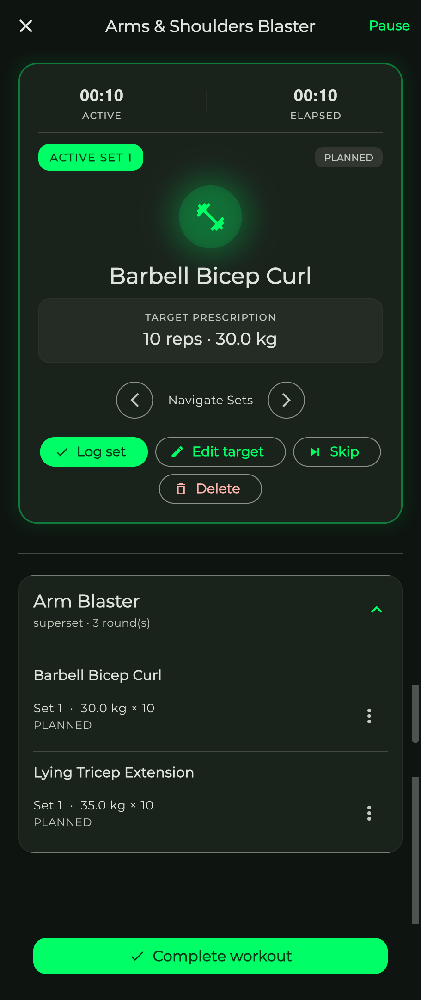
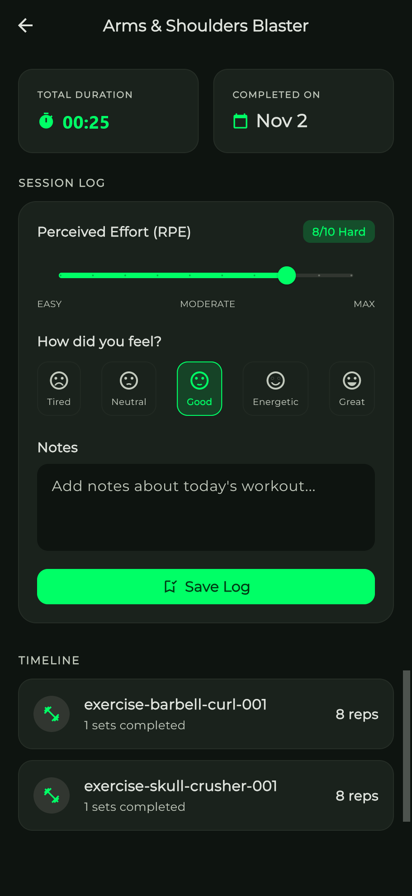
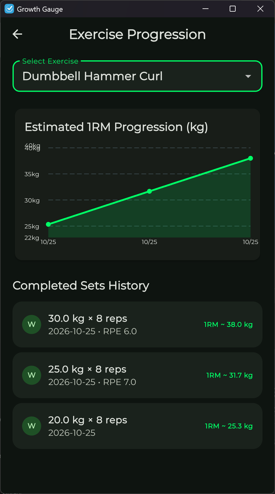
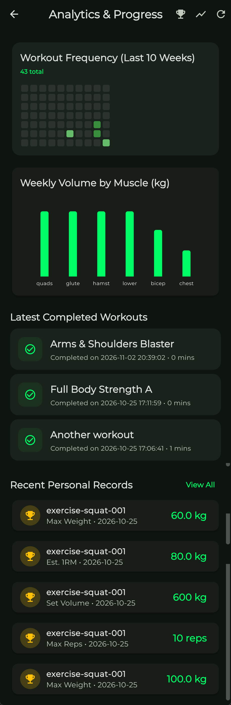
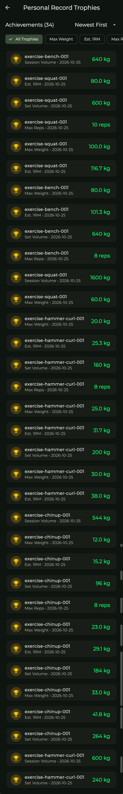

# Growth Gauge

[](https://flutter.dev)
[](https://dart.dev)
[](https://drift.simonbinder.eu/)
[](https://bloclibrary.dev)
[](https://dart.dev/null-safety)
[](LICENSE)

**Growth Gauge** is an offline-first, privacy-focused strength and conditioning fitness tracking application. Designed for serious lifters and athletes, it combines live workout runtime management, immutable routine templates, and zero-lag materialized analytics with complete local data ownership.

---

## Architecture & Technology Stack

Growth Gauge is built upon **Clean Architecture** principles to maintain strict separation of concerns, deterministic state management, and offline data integrity:

- **Authoritative Persistence (Drift SQLite):** Dual-storage architecture:
  1. *Authoritative Document Store:* JSON aggregate documents stored with composite keys (`collection`, `id`) and UTC timestamps.
  2. *Materialized Relational Read Models:* Normalized SQLite tables for zero-lag analytics queries, PR detection, and volume aggregation.
- **State Machine & Logic (`flutter_bloc` / `cubit`):** Deterministic state machine transitions for active workout sessions (`Draft` $\to$ `InProgress` $\leftrightarrow$ `Paused` $\to$ `Completed`), crash recovery, and reactive UI streams.
- **Immutable Domain Entities (Freezed):** Type-safe, immutable domain models, value objects, domain events, and audit logs with automatic JSON serialization.
- **Declarative Navigation (`go_router`):** Deep-linkable, typed routing using responsive shells (`ShellRoute`) for mobile and desktop viewports.
- **Reactive Visualizations (`fl_chart`):** Interactive progression curves, volume bar charts, and frequency heatmaps streamed directly from Drift queries.
- **Adaptive Design System:** Material 3 dark-themed UI anchored by athletic seed palettes (Forest Green `#00FF66`, Midnight, etc.), Manrope geometric typography, and WCAG 2.1 AA/AAA accessibility compliance.

---

## Current Implementation & Screenshots

### 1. Training Dashboard & Activity Trends
Responsive dashboard featuring volume summaries, calendar navigation, and quick-start routine cards.

| Mobile Layout (`HomePage-Mobile.png`) | Desktop Layout (`HomePage-Desktop.png`) |
| :---: | :---: |
|  |  |

---

### 2. Live Workout Execution & Completion
Copy-on-write live session player with set logging, target prescriptions, rest timers, and post-workout RPE/mood capture.

| Active Workout HUD (`WorkoutRunningPage-Mobile.png`) | Workout Complete & Summary (`WorkoutCompletePage-Mobile.png`) |
| :---: | :---: |
|  |  |

---

### 3. Exercise Catalog & 1RM Progression
Comprehensive multi-dimensional taxonomy search paired with historical 1RM progression curves and set history.

| Exercise Catalog (`ExerciseCatalog-Mobile.png`) | Exercise 1RM Progression (`ExerciseProgression-Mobile.png`) |
| :---: | :---: |
|  |  |

---

### 4. Analytics & Personal Record Trophies
Automated session projections, muscle group volume distributions, workout frequency heatmaps, and PR trophy shelf.

| Analytics & Progress (`AnalyticsPage-Mobile.png`) | PR Trophy Shelf (`PRPage-Mobile.png`) |
| :---: | :---: |
|  |  |

---

## Code Implementation Examples

### 1. Starting a Live Workout Session (Copy-on-Write Runtime)
Workout templates are immutable. Starting a workout clones the published revision into an independent `WorkoutSession` aggregate:

```dart
// Launching an active session from a template revision
Future<void> startWorkoutFromTemplate(
  BuildContext context,
  WorkoutTemplate template,
  TemplateRevision revision,
) async {
  // Clone template structure into live copy-on-write session
  final session = WorkoutSession.fromTemplate(
    templateId: template.id,
    templateName: template.name,
    revision: revision,
    startedAt: DateTime.now().toUtc(),
  );

  // Persist session draft and navigate via GoRouter
  await sessionRepository.save(session);
  if (context.mounted) {
    context.push(appRouteActiveSession, extra: session);
  }
}
```

### 2. Reactive Materialized Analytics Query (Drift Read Tables)
Session completions project raw documents into normalized SQL tables. Visualizations observe these tables reactively:

```dart
// Streaming personal records from Drift materialized read models
Stream<List<PersonalRecord>> watchExerciseRecords(String exerciseId) {
  return (database.select(database.personalRecords)
        ..where((t) => t.exerciseId.equals(exerciseId))
        ..orderBy([(t) => OrderingTerm.desc(t.achievedAt)]))
      .watch();
}
```

### 3. Declarative Type-Safe Navigation (`go_router`)
Centralized routing with responsive shell routes and typed arguments:

```dart
// Navigating to exercise details with GoRouter
void openExerciseDetail(BuildContext context, Exercise exercise) {
  context.push(
    appRouteExerciseDetail,
    extra: exercise,
  );
}
```

---

## Project Structure

```text
lib/
├── core/                        # Database, unit conversions, routing, time, errors
│   ├── database/                # Drift AppDatabase & table schemas
│   ├── routing/                 # AppRouter & GoRouter configurations
│   ├── theme/                   # FitnessTheme Material 3 seed palettes
│   └── units/                   # Weight & distance converters (kg <-> lb, cm <-> in)
│
├── features/
│   ├── user/                    # Profiles, body measurements, equipment inventory
│   ├── catalog/                 # Exercise library, taxonomy filters, custom exercises
│   ├── template/                # Routines, blocks, immutable revision snapshots
│   ├── session/                 # Copy-on-write workout runtime & set logging
│   ├── analytics/               # Materialized projections, PR shelf, fl_chart graphs
│   ├── portability/             # Versioned JSON backup/restore with SHA-256 checks
│   ├── settings/                # Themes, typography, local auth, reminders
│   └── common/                  # Modular responsive widgets (AppButton, AppTextField, etc.)
│
└── app/                         # Composition root, dependency injection, top-level App
```

---

## Development & Build Process

### 1. Prerequisites
- **Flutter SDK:** $\ge 3.44.0$
- **Dart SDK:** $\ge 3.4.0$

### 2. Routine Developer Commands
Use the standardized PowerShell development scripts in [`scripts/`](scripts/README.md):

```powershell
# 1. First-time workspace configuration
./scripts/setup.ps1

# 2. Run code generation (Drift, Freezed, JSON Serializer)
./scripts/generate.ps1

# 3. Comprehensive verification (Format, Analyzer with zero warnings, Full test suite)
./scripts/check.ps1

# 4. Launch development application
./scripts/run.ps1 -d windows
```

*Bash equivalents (`./scripts/check.sh`, etc.) are provided for Linux and macOS environments.*

---

## Documentation Index

- **[Master Implementation Plan](docs/implementation-plan.md):** Complete project roadmap, status matrix, and execution queue.
- **[Application Architecture](docs/architecture.md):** Canonical architectural patterns, conventions, and layer boundaries.
- **[Unified Design System Specification](docs/design-system-spec.md):** Color tokens, typography, accessibility (WCAG AA/AAA), and modular components.
- **[Legacy & UI Parity Crosswalk](docs/legacy-design-crosswalk.md):** Full feature parity matrix and 23-screenshot UI audit.
- **[Phase Detail Specifications](docs/phases/):** Detailed implementation specifications for Phases 1 through 18.

---

## License

Growth Gauge is open-source software licensed under the [GNU AFFERO GENERAL PUBLIC](LICENSE).
