**Implementation Details**:-

Directory Path | Implementation Details & Purpose | Associated Features
-- | -- | --
ui/core | **App Core**: Contains application-wide, non-feature-specific components. This includes the global AppTheme (for Multiple Theme and Fonts), shared UI components (e.g., custom cards, loading indicators), and configuration files for routing/navigation. | Multiple Theme and Fonts
ui/profile/provider | **UserProfileProvider**: Manages the state for the UserProfile model, handles user input validation for user, fitness data and exposes the calculated results from the FitnessAssessmentService. | Personalized Fitness Profile and Assessment
ui/profile/widgets | **Profile Screens**: Contains the UI code for user profile and the screen displaying the Fitness Assessment score. | Personalized Fitness Profile and Assessment
ui/activity/provider | **ActivityProvider / WorkoutTimerProvider**: Manages the state of the active activity list and controls the internal timing and audio cues for the Custom & Preset Workout Builder (Interval logic). | Organized Activity List, Custom & Preset Workout Builder, TTS with Template
ui/activity/widgets | **Activity/Workout Screens**: Includes the UI for the Goal-Centric Activity Dashboard, the interface for building custom templates, and the full-screen view for the live, Voice-Guided Workout Coach session. | Organized Activity List, Custom & Preset Workout Builder, TTS with Template
ui/insights/provider | **InsightsProvider**: Manages state related to data visualization, handling date range selections and filtering the data retrieved from the repository for display. | Comprehensive Activity Deep Dive
ui/insights/widgets | **Insight Screens/Widgets**: Contains the visualization components, including the custom painter/widget for Streak Heatmaps and the charting library implementation for Performance Charts (X-Day). | Comprehensive Activity Deep Dive
data/models | **Domain Models**: Stores all pure Dart classes that define the structure of the application data (e.g., UserProfile, Activity, Goal). These models are used across all layers. | All features using structured data
data/repositories | **Data Access Layer**: Interfaces between the services/providers and the PersistenceService. Holds methods for CRUD operations and fetching data specific to charts/reports. | Personalized Fitness Profile, Organized Activity List, Comprehensive Activity Deep Dive
data/services | **PersistenceService**: The low-level database wrapper (e.g., using Drift/SQLite). Manages database connection, setup, and crucial DDL/Schema Migration logic for data persistence. | Local Database
data/services | **LocalAuthService**: Interacts with the platform's API to manage Biometric Data Protection (Local Lock) and PIN fallback, securing the application launch. | Biometric Data Protection
data/services | **NotificationService**: Handles scheduling, updating, and cancelling local, platform-specific notifications for the Intelligent Growth Reminders. | Scheduled Local Notification
data/services | **TTS_Service**: Encapsulates the Text-to-Speech engine integration, providing methods for the WorkoutTimerProvider to deliver clear, timely audio cues. | TTS with Template (Voice-Guided Workout Coach)
data/services | **DataExportService / DataImportService**: Contains the logic for file handling, data serialization (to JSON/CSV), and validation/parsing of incoming files for the Data Export & Import Utility. | Activity Share
data/services | **FitnessAssessmentService**: Houses the proprietary logic and calculations to take raw biometric/activity data and compute the composite AI-Powered Fitness Assessment Score. | AI-Powered Fitness Assessment

Section | Field Name | Type | Unit / Example | Purpose / Source
-- | -- | -- | -- | --
User Profile (Main) | id | String | UUID | Unique user identifier.
  | creationDate | DateTime | YYYY-MM-DD | When the profile was first created.
  | lastAssessmentDate | DateTime | YYYY-MM-DD | Timestamp of the last fitness score calculation.
  | fitnessScore | int | 0-100 | The single, overall composite fitness level score.
  | data | FitnessData | (Embedded Object) | Container for all raw user input/biometrics.
  | assessment | AssessmentResult | (Embedded Object) | Container for all calculated results and insights.
--- | --- | --- | --- | ---
Fitness Data | gender | String (enum) | Male, Female, Other | Context for formula calculations.
  | age | int | Years | Required for Max HR prediction ($220-\text{Age}$).
  | height | double | cm (e.g., 180.5) | Required for BMI calculation.
  | weight | double | kg (e.g., 75.2) | Core metric for progress tracking.
  | restingHeartRate | int | BPM (e.g., 65) | Key metric for cardiovascular fitness.
  | bodyFatPercentage | double | % (e.g., 18.5) | Advanced body composition metric.
  | muscleMass | double | kg (e.g., 55.0) | Advanced body composition metric.
  | dailyActivityLevel | String (enum) | Sedentary, Moderately Active | Used for TDEE and calorie estimation.
  | nutritionalPreference | String (enum) | Vegan, Omnivore, Keto | Context for optional nutritional guidance.
  | hydrationLevel | double | Litres/Day (e.g., 2.5) | Self-reported water intake.
  | physicalConstraints | List<String> | (e.g., "Knee Injury", "Lower Back Pain") | Defines activity limits and safety precautions.
--- | --- | --- | --- | ---
Assessment | BMIScore | double | Score (e.g., 23.1) | Calculated Body Mass Index.
  | cardioRating | String (enum) | Excellent, Good, Average, Poor | Calculated from RHR and endurance activity logs.
  | strengthRating | String (enum) | Excellent, Good, Average, Poor | Calculated from logged lifting/rep performance.
  | flexibilityRating | String (enum) | Good, Average, Poor | Calculated from activity or physical strength input.
  | predictedMaxHeartRate | int | BPM (e.g., 195) | Estimated Max HR for workout zone definition.
  | currentTDEE | int | Calories (e.g., 2400) | Total Daily Energy Expenditure estimate.
-- | -- | -- | -- | --
Goal | id | String | UUID | Unique identifier.
  | userId | String | UUID | Links the goal to the user's profile.
  | name | String | "Run 5K" | User-defined name for the goal.
  | type | GoalType (enum) | Weight, Endurance, Strength, Stamina | Defines the category of the goal.
  | targetValue | double | 5.0, 75.0 | The value the user aims to achieve (e.g., 5 km, 75 kg).
  | currentValue | double | 3.5, 80.0 | The user's current progress toward the target.
  | startDate | DateTime | YYYY-MM-DD | When the goal tracking began.
  | endDate | DateTime | YYYY-MM-DD | Target completion date.
  | status | GoalStatus (enum) | Active, Completed, Paused | Used for organizing the Goal-Centric Activity Dashboard.
--- | --- | --- | --- | ---
WorkoutTemplate | id | String | UUID | Unique identifier for the template.
  | name | String | "Full Body HIIT" | User-defined name for the routine.
  | type | TemplateType (enum) | HIIT, Yoga, Mixed | Defines the workout structure (used by the timer).
  | steps | List<WorkoutStep> | (List) | Defines the sequential flow of the workout.
--- | --- | --- | --- | ---
WorkoutStep | name | String | "Pushups Set 1" | Name of the step or instruction.
  | type | StepType (enum) | Work, Rest, Cooldown | Defines the nature of the step (controls TTS/Timer).
  | duration | Duration | 00:00:30 | The length of time for this step.
  | instruction | String | "Maintain proper form." | Optional spoken or displayed instruction.
--- | --- | --- | --- | ---
Activity | id | String | UUID | Unique identifier for the type of activity.
  | name | String | "Running", "Plank", "Pushups" | Descriptive name.
  | description | String | "Running for 15 min", "Plank for 1 min", " 15 Pushups" | Descriptive name.
  | type | ActivityType (enum) | Count Based, Time Based | Defines how the activity is measured.
  | count | int | "15" | 15 pushups.
  | interval | DateTime | "10" | 10 mins of running.
  | unit | String | Reps, Minutes | The specific unit of measure.
  | isFavorite | bool | True/False | Flag for quick access on the dashboard.
--- | --- | --- | --- | ---
ActivityLog | id | String | UUID | Unique identifier for the log entry.
  | activityId | String | UUID | Foreign Key linking to the Activity model.
  | timestamp | DateTime | YYYY-MM-DD HH:MM | When the log was recorded.
  | value | double | 10.0, 350.5 | The logged result (count, duration, or distance).
  | notes | String | "Felt strong today." | Optional user notes on the session.
  | streakDayNumber | int | 1, 2, 3... | Day count used to calculate the Streak Heatmaps.
  | RPE | int (1-10) | 8 | Rate of Perceived Exertion (how hard it felt).

Dependencies :-

Source Model | Relationship | Target Model | Description
-- | -- | -- | --
UserProfile | 1 : Many | Goal | A user can define multiple fitness goals over time.
UserProfile | 1 : 1 | Fitness Data | Biometrics (Height, Weight, RHR) are directly stored in the profile.
UserProfile | 1 : 1 | Assessment Result | The composite Fitness Score calculated by the FitnessAssessmentService is stored on the profile.

Source Model | Relationship | Target Model | Description
-- | -- | -- | --
Activity | 1 : Many | ActivityLog | A single activity (e.g., "Pushups") can have many historical log entries for insights and tracking.
ActivityLog | Many : 1 | Activity | Every log entry must belong to one specific activity.
Activity | Many : 1 | Goal | Many different activities can contribute to one overall goal (e.g., Pushups and Planks contribute to a "Strength" goal).

Source Model | Relationship | Target Model | Description
-- | -- | -- | --
WorkoutTemplate | 1 : Many | WorkoutStep | A single template (e.g., "Beginner Tabata") is composed of multiple sequential steps.
WorkoutStep | Many : 1 | WorkoutTemplate | Every step must be part of one defined template.
WorkoutStep | Many : 1 (Conditional) | Activity | If the step type is 'Work', it must reference an existing Activity (e.g., "Work: 30s Pushups"). If it is 'Rest' or 'Cooldown', this link is null.

Below List of Provider with their states will need more refinement but this will serve as an initial starting point. 

1. Profile Setup States:-

Provider / State Name | Field Name | Type | Purpose
-- | -- | -- | --
ProfileProvider (Body Metrics) | gender| Enum | Stores the user's selection of gender.
  | unitSystem | Enum | Toggles the active unit scale between "Imperial" and "Metric".
  | age | int | Captures the user's age in years.
  | height | double | Stores the height value in cm or inches depending on unit selection.
  | weight | double | Stores current body weight in kg or lbs.
  | activityLevel | Enum | Tracks lifestyle intensity from "Sedentary" to "Heavy".
  | optionalMetrics | Map<String, double> | Holds optional measurements for Neck, Waist, and Hip.
ProfileProvider (Goal Setting) | targetChips | List<String> | Tracks quick-select goal tags like "10k Steps" or "Lose 5kg".
  | dailyStepGoal | int | Stores the specific numeric target for daily steps via slider.
  | weeklyFrequency | int | Stores the number of workout days per week (3–6).
  | targetBodyFat | double | Captures the desired body fat percentage goal.
  | strengthPrGoal | Map<String, dynamic> | Stores specific lift type (e.g., Bench Press) and target weight.
ProfileProvider (Constraints) | medicalLimitations | List<String> | Lists body areas to avoid (e.g., Knees, Lower Back).
  | isMedicalToggleOn | bool | Master toggle to enable/disable specific exercise exclusions.
  | equipmentAvailable | List<String> | Checklist of owned equipment like Dumbbells or Pull-up Bars.
  | dailyTimeCap | int | Stores the max workout duration limit in minutes.
  | dietaryType | String | Stores the selected diet (e.g., Vegetarian) from the dropdown.
  | allergyNotes | String | Holds text input for specific food or environmental allergies.

2. Settings Setup States:-

Provider / State Name | Field Name | Type | Purpose
-- | -- | -- | --
ProfileProvider | gender | Enum | Stores gender selection for calorie math.
  | unitSystem | Enum | Toggles UI between Metric (kg/cm) and Imperial (lb/ft).
  | coreMeasurements | Map<String, double> | Captures Age, Height, and Weight input values.
  | activityLevel | Enum | Stores index of Sedentary, Light, Medium, or Heavy lifestyle.
  | bodyMetrics | Map<String, double> | Holds optional Neck, Waist, and Hip measurements.
GoalProvider | activeGoalTags | List<String> | Tracks chosen target chips like "10k Steps" or "Build Muscle".
  | stepTarget | int | Stores the specific numeric value from the Steps slider.
  | weeklyWorkoutGoal | int | Tracks the 3–7 days frequency selection.
  | bodyFatTarget | double | Stores the target percentage from the composition slider.
  | performanceGoal | Object | Captures specific exercise type and weight for PR goals.
ConstraintsProvider | areasToAvoid | List<String> | List of body parts (Knees, Back) to filter out exercises.
  | availableEquipment | List<String> | Checklist of user's gear (Dumbbells, Mat, etc.).
  | dailyTimeCap | int | Maximum allowed duration for a single workout session.
  | dietaryRestrictions | String? | Selected diet type (Vegetarian) or custom allergy text.
WorkoutProvider | activeSession | WorkoutModel? | Holds the full structure of the workout currently being performed.
  | currentBlockIndex | int | Pointer to the current exercise block (Warmup, Interval, or Rep).
  | elapsedTime | Duration | Real-time stopwatch state for the active interval block.
  | remainingReps | int | Counter for manual rep tracking in strength blocks.
ThemeProvider | themeMode | Enum | Global setting for Light, Dark, or System mode.
  | activeSeedColor | Color | The primary brand color used to generate the application's ColorScheme.
  | fontFamily | String | Selection between standard typography and accessibility fonts.
  | fontScaleFactor | double | Multiplier (0.75 - 1.25) derived from the UI text-size slider.
ReminderProvider | isGlobalEnabled | bool | Master toggle to enable or silence all app notifications.
  | reminderSchedule | List<Object> | Collection of time and frequency data for growth reminders.
  | messageTemplate | String | The raw message string containing placeholders like [Streak].
DataStorageProvider | exportFormat | Enum | Determines if current export task is targeting JSON or CSV.
  | lastBackupDate | DateTime? | Timestamp of the most recent successful database export.

3. Workout Setup States:-

Provider / State Name | Field Name | Type | Purpose
-- | -- | -- | --
WorkoutBuilderProvider | workoutName | String | Stores the editable title of the workout (e.g., "Morning HIIT").
  | baseTemplate | Enum | Tracks the chosen workout category: Custom, HIIT, or Strength.
  | workoutStructure | List<Block> | A collection of Warm Up, Interval/Rep Blocks, and Cool Down segments.
  | totalDuration | Duration | A calculated field summing all block times and rest periods.
  | isAudioEnabled | bool | Toggles for Sound Effects and Voice Guide settings.
WorkoutPlayerProvider | currentBlock | BlockObject | Holds the active exercise details (e.g., "Plank" or "Squats").
  | playState | Enum | Tracks if the session is Playing, Paused, or Finished.
  | remainingTime | Duration | Real-time countdown for Interval-based blocks.
  | completedReps | int | Current count for Rep-based blocks with (+/-) increment logic.
  | overallProgress | double | Percentage (0.0 to 1.0) of the entire workout completed.
  | nextUpPreview | BlockObject? | Metadata for the upcoming block (e.g., "Recovery - 00:30").
WorkoutLogProvider | perceivedEffort | int | Stores the RPE slider value from 1 (Easy) to 10 (Max).
  | userFeeling | Enum | Tracks the selected mood icon (Tired, Neutral, Good, etc.).
  | averageHeartRate | int | Captures the BPM value entered or synced for the session.
  | sessionNotes | String | Stores the user's text reflections on the workout performance.
  | completionDate | DateTime | Timestamp for when the "Save Log" action was triggered.

Block Polymorphism: In the WorkoutBuilderProvider, the workoutStructure list contains objects that can be either IntervalBlock (Time-based) or RepBlock (Count-based). The UI uses this type to switch between the Timer view and the Rep Counter view.

Drift Serialization: Since a Workout contains a list of Blocks, you should use a TypeConverter in Drift to store the structure as a JSON string while keeping individual fields like workoutName as standard text columns.

Computed Total Time: The totalDuration is a reactive getter. Whenever a user changes "Rounds" or "Rest" in the builder, the provider recalculates the sum so the header updates instantly.

Session Transition: When moving from the Player to the Deep Dive, the WorkoutLogProvider is initialized with the metadata from the activeSession to pre-populate the total duration and completion date.

4. Dashboard Setup States :-

Provider / State Name | Field Name | Type | Purpose
-- | -- | -- | --
DashboardProvider | caloriesBurned | int | Current daily/weekly total for the circular progress indicator.
  | activeTime | Duration | Aggregate time spent in active workouts for the summary card.
  | workoutCount | int | Total number of sessions completed in the current week.
  | weeklyConsistency | List<bool> | 7-day checklist (M-S) showing completed vs. missed days.
  | streakCount | int | The current "Day Streak" value displayed in the UI badge.
  | quickStartWorkouts | List<Workout> | List of available curated workout cards (e.g., HIIT, Endurance).
TrendsProvider | selectedPeriod | Enum | Active filter for charts: 1W, 1M, 3M, or YTD.
  | calendarData | Map<DateTime, bool> | Data mapping for the monthly consistency calendar view.
  | heartRateSeries | List<DataPoint> | Time-series data for the Average Heart Rate line graph.
  | durationSeries | List<DataPoint> | Time-series data for the Total Duration bar chart.
  | heartRateGrowth | double | Percentage change in heart rate compared to the previous period.
  | durationGrowth | double | Percentage change in duration compared to the previous period.
  | focusedDataPoint | DataPoint? | The specific point currently highlighted by the user's tooltip (e.g., "156 BPM").

Real-time Aggregation: The DashboardProvider should use a Stream from Drift to listen to the SessionLogs table. Whenever a workout is saved in the Deep Dive screen, the dashboard's "Calories Burned" and "Active Time" cards update automatically.

Normalized Charting: Since the charts (Heart Rate and Duration) use a similar X-axis (days of the week/month), the TrendsProvider should fetch raw data once and then project it into two different lists for the line and bar graphs respectively.

Proxy Dependency: The DashboardProvider likely needs a ProxyProvider relationship with the ProfileProvider. This allows it to calculate the percentage for the Calorie Progress Ring (e.g., "85%") based on the user's specific "Target Calories" set during the profile setup.

Temporal Scaling: When the selectedPeriod changes (e.g., from 1W to 1M), the TrendsProvider triggers a new Drift query that groups data by week instead of day, ensuring the chart remains readable regardless of the time scale.

1. User Profile & Goal Management (Profile Feature)

Layer | Component | Associated Methods | DB Interaction
-- | -- | -- | --
Provider | UserProfileProvider | loadInitialProfile(): Fetches user profile and goals. updateBiometrics(data): Updates height/weight/RHR. saveGoal(newGoal): Adds a new goal. pauseGoal(goalId): Changes goal status. | Calls Repository methods.
Repository | UserProfileRepository | getProfile(): Retrieves the single UserProfile entity. updateProfile(data): Updates any field in the profile table. getGoals(status): Fetches a list of Goal entities, filtered by status. upsertGoal(goal): Inserts or updates a goal. | Direct DB calls to PersistenceService.
Service | FitnessAssessmentService | calculateFitnessScore(profile, logs): Non-DB logic to run the Fitness Assessment algorithm using current data. | Reads data from Repository input, performs calculation.

2. Activity Tracking & Insights (Activity/Insights Features)

Layer | Component | Associated Methods | DB Interaction
-- | -- | -- | --
Provider | ActivityProvider | loadDashboardActivities(): Fetches all tracked activities grouped by goal. logActivityEntry(log): Saves a new activity log entry. selectActivityForInsights(id): Sets the current activity and triggers log loading. saveAllActivities(): Save all activities. | Calls Repository methods.
Repository | ActivityRepository | getActivities: Get alll Activities data. insertActivity(activity): Saves a single Activity entry. | Direct DB calls.
Repository | ActivityLogRepository | getActivitiesGroupedByGoal(): Complex query to join Activity, Goal, and aggregate recent ActivityLog data. insertActivityLog(log): Saves a single ActivityLog entry. getLogsForRange(activityId, range): Fetches logs needed for X-Day Charts and Streak Heatmaps. | Direct DB calls, often involving JOINs and filtering.

3. Core Services & Cross-Cutting Concerns

Layer | Component | Associated Methods | DB Interaction
-- | -- | -- | --
Provider | ThemeAndSettingsProvider | toggleThemeMode(mode): Sets theme and persists preference. toggleLocalAuth(isEnabled): Updates setting. updateFontSize(size): Sets new font size and persists preference. updateFontFamily(family): Sets new font family and persists preference. updateAuthenticationType(type): Sets new authentication type and persists preference. | Uses Service/Repository for persistence (e.g., Shared Preferences/DB for settings).
Service | LocalAuthService | authenticateUser(): Triggers the native platform's Biometric Data Protection (Local Lock) prompt. | None (Platform API interaction).
Service | NotificationService | scheduleDailyReminder(time, message): Schedules the Intelligent Growth Reminders. cancelAllReminders(): Removes existing reminders. | None (Platform API interaction).
Service | TTS_Service | speak(text): Plays an audio cue. stopSpeaking(): Stops current audio playback. | None (Platform API interaction).
Service | DataExportService | exportAllData(format): Fetches all relevant data from repositories, serializes it to JSON/CSV, and saves it to a file. | Calls Repository methods (getAllProfiles(), getAllLogs(), etc.) to retrieve data.
Service | DataImportService | importDataFromFile(file): Reads and parses the file, validates data, and calls Repository methods (upsertProfile(), insertMultipleLogs()). | Calls Repository methods to persist imported data.
Service | PersistenceService | databaseSetup(version): Initializes the database connection. runMigration(from, to): Executes the DDL/Schema Migration logic. | The actual low-level DB operations (e.g., SQLite execution).
 

**Profile Setup - Tasks**

Attached UI needs to be implemented with following task so as to easy to track and manage the steps. There is possibility the screen might not look exactly the same but is expected to reach near identical.

ID | Category | Task Label | Explicit Description
-- | -- | -- | --
1.1 | Foundations | Theme & Typography | Define global light/dark color schemes (or possible other themes) and typographic scales for titles, body, and metrics.
1.2 | Foundations | Navigation & Routing | Map the sequential flow between screens and generate the strongly-typed routing code.
1.3 | Testing | Route Verification | Verify that the initial route loads the Body Metrics screen and subsequent routes exist.
2.1 | Data Layer | Drift Schema Design | Define the local database table structure for profile attributes and list-to-string converters.
2.2 | Data Layer | DAO Implementation | Create the data access object methods for saving and retrieving the profile record.
2.3 | Testing | Persistence Logic | Verify that a mock profile object is correctly serialized and written to the database.
3.1 | State Mgmt | Session State | Create the change notifier to hold temporary user inputs across the three-screen flow.
3.2 | State Mgmt | Validation Logic | Implement rules for mandatory fields (e.g., height/weight ranges, non-empty goal selection).
3.3 | Testing | Provider Unit Tests | Verify that the state updates correctly when a user selects a goal or changes a metric.
4.1 | UI - Metrics | Body Metrics Screen | Build the layout for gender selection and numeric input fields for height and weight.
4.2 | UI - Metrics | Input Synchronization | Bind UI controllers to the state provider to ensure real-time data capture.
4.3 | Testing | Metrics Widget Test | Ensure the "Next" button remains disabled until valid height and weight are entered.
5.1 | UI - Goals | Goal Selection Grid | Construct the interactive grid of selectable cards for fitness objectives.
5.2 | UI - Goals | Visual Feedback | Implement the high-contrast "Selected" state for cards using the custom theme colors.
5.3 | Testing | Multi-Select Test | Verify that tapping multiple goal cards correctly adds/removes items from the state list.
6.1 | UI - Constraints | Constraint Chip Wrap | Build the flow-based chip layout for selecting health conditions or injuries.
6.2 | UI - Constraints | Submission Flow | Hook the final button to the database save method and navigation redirect.
6.3 | Testing | Test | Simulate a full completion and verify that the save method is called exactly once.
7.1 | Verification | Theme Integrity | Perform Golden Tests to ensure UI components render correctly in both Light and Dark modes.
7.2 | Verification | Regression Test | Ensure navigating back from Screen 2 to Screen 1 retains the previously entered data.

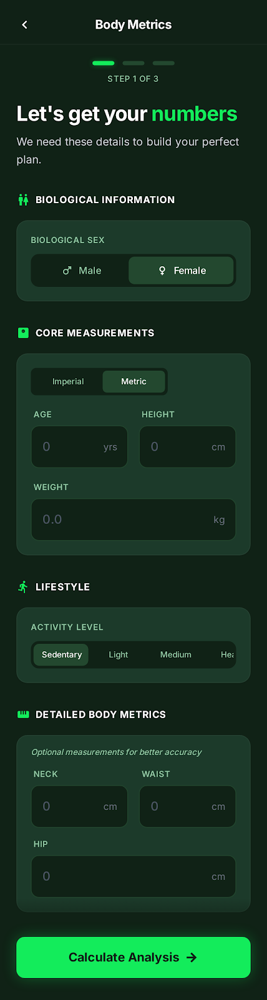

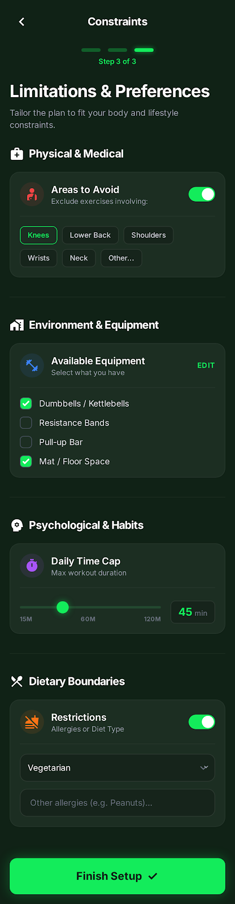

**Dashboard Setup - Tasks**

Attached UI needs to be implemented with following tasks for steps tracking.

ID | Category | Task Label | Explicit Description
-- | -- | -- | --
1.1 | Foundations | Charting Library Setup | Integrate a charting package compatible with the app's theme for rendering line and bar graphs.
1.2 | Foundations | Dashboard Navigation | Register the Dashboard and Trends routes in the Auto_Route configuration.
1.3 | Testing | Navigation Test | Verify that tapping a "Details" or "Trends" link navigates to the correct deep-link destination.
2.1 | Data Layer | Activity Schema | Define Drift tables for storing daily workout logs, including duration, calories, and heart rate.
2.2 | Data Layer | Aggregation Queries | Implement database logic to calculate weekly sums for calories and active time for the "This Week" summary.
2.3 | Testing | Query Accuracy | Verify that the Drift DAO correctly calculates weekly totals from a mock set of daily entries.
3.1 | State Mgmt | Metrics Provider | Create a state container to fetch and cache user activity data for the current view period (1W, 1M, etc.).
3.2 | State Mgmt | Date Filtering Logic | Implement logic to filter and group database records by day, week, or month based on user selection.
3.3 | Testing | Filter Logic Test | Verify the Provider correctly updates the state when switching between 1W (Weekly) and 1M (Monthly) views.
4.1 | UI - Overview | Summary Card Grid | Build the "This Week" UI section featuring calories, active time, and workout count cards.
4.2 | UI - Overview | Weekly Consistency Bar | Implement the 7-day progress indicator showing checked-off days for completed activities.
4.3 | Testing | Progress Ring Test | Ensure the calorie progress ring accurately reflects the percentage of the goal achieved (e.g., 85%).
5.1 | UI - Trends | Performance Line Chart | Construct the average heart rate line graph with interactive tooltips for specific data points.
5.2 | UI - Trends | Duration Bar Chart | Implement the total duration bar graph with highlighted bars for the current selection.
5.3 | Testing | Chart Rendering Test | Use Golden Tests to verify chart axis labels and data point colors match the typography and theme.
6.1 | UI - Interaction | Quick Start Carousel | Build the "Quick Start" horizontal list allowing users to launch specific workouts like "Full Body HIIT".
6.2 | UI - Interaction | Date Range Selector | Implement the segmented control (1W, 1M, 3M, YTD) to switch the scale of all performance charts.
6.3 | Testing | Interaction Test | Verify that tapping "Start Workout" triggers the correct workout session event in the state manager.
7.1 | Verification | Empty State Audit | Verify the UI displays appropriate "No Data" placeholders when the database is empty.
7.2 | Verification | Performance Audit | Measure frame-rate during chart scrolling to ensure smooth rendering of large data sets.

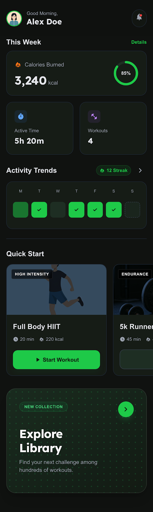
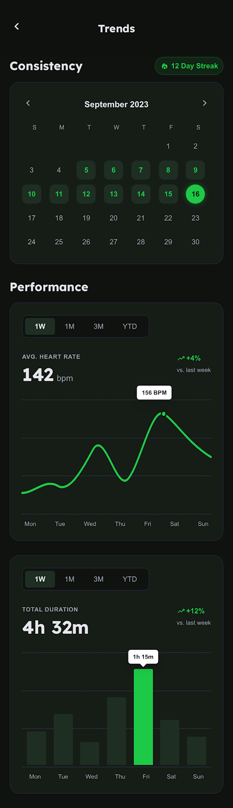

**Workout Setup - Tasks**

Attached UI needs to be implemented with following tasks for steps tracking.

ID | Category | Task Label | Explicit Description
-- | -- | -- | --
1.1 | Data Layer | Workout & Exercise Schema | Define Drift tables for Workouts, WorkoutBlocks (Intervals vs Reps), and SessionLogs.
1.2 | Data Layer | Logic Converters | Create TypeConverters for block structures to handle complex lists of exercise rounds within a SQLite row.
1.3 | Testing | DB Integrity Test | Verify that a complex workout with 4+ blocks is saved and retrieved with all parameters (rounds, time, reps) intact.
2.1 | State Mgmt | Active Session Notifier | Implement a Provider to manage the real-time countdown, current block index, and accumulated total time.
2.2 | State Mgmt | Workout Builder Logic | Build logic for adding/removing blocks, updating reps, and calculating the "Total Duration" dynamically.
2.3 | Testing | Timer & Logic Test | Verify that the session timer correctly pauses, resumes, and triggers the "Next Up" block transition.
3.1 | UI - Builder | Workout Structure UI | Build the drag-and-drop or list-based editor for Warm Up, Blocks (Interval/Reps), and Cool Down sections.
3.2 | UI - Builder | Block Configurator | Implement the UI for switching between "Interval" (Time) and "Reps" (Count) for individual exercise blocks.
3.3 | Testing | Builder Widget Test | Ensure clicking "Add Block" correctly updates the "Total Duration" header and adds a new card to the list.
4.1 | UI - Player | Dynamic Player Layout | Create the player screen that switches its primary display based on whether the current block is time-based or rep-based.
4.2 | UI - Player | Progress Indicators | Implement the "Block Progress" bar and the "Next Up" preview card to guide the user through the session.
4.3 | Testing | Player Interaction Test | Verify that the "Next/Previous" buttons correctly navigate through the block timeline.
5.1 | UI - Log | Post-Workout Summary | Build the "Deep Dive" screen featuring RPE (Perceived Effort) sliders, emoji feeling selectors, and heart rate input.
5.2 | UI - Log | Session Timeline | Implement a read-only vertical timeline showing the completed blocks and their recorded performance metrics.
5.3 | Testing | Log Submission Test | Verify that selecting a "Feeling" emoji and an RPE value enables the "Save Log" button.
6.1 | Verification | Theme & Audio Audit | Perform Golden Tests for the Player UI and verify that "Sound Effects" and "Voice Guide" toggles affect state.
6.2 | Verification | Performance Audit | Run a 60-minute simulated workout to ensure no memory leaks or UI jank during long timer operations.

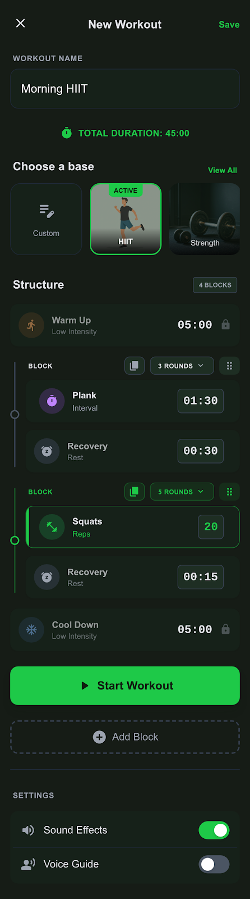
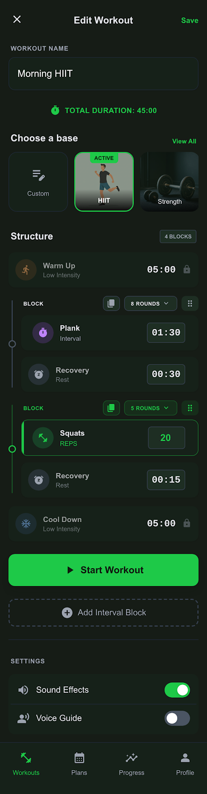
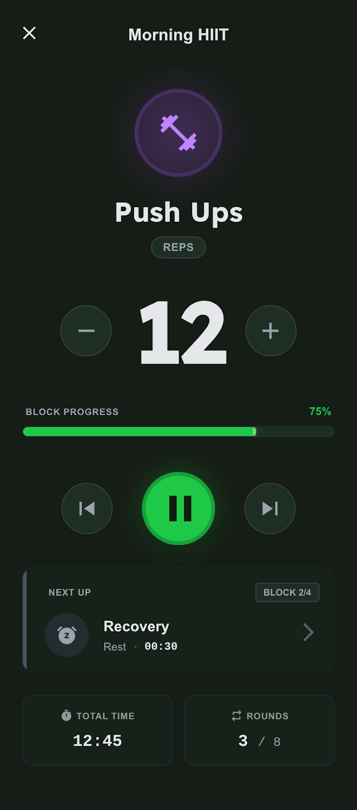
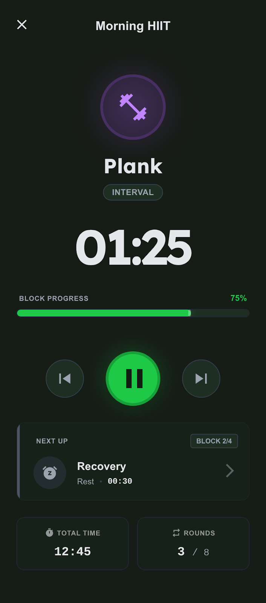
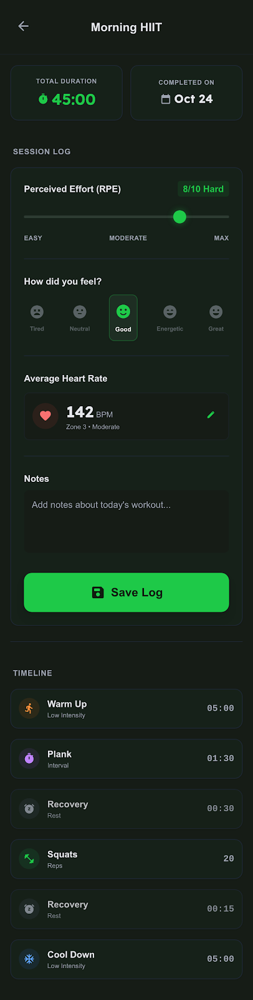

**Settings Setup - Tasks**

Attached UI needs to be implemented with following tasks for steps tracking.

ID | Category | Task Label | Description
-- | -- | -- | --
1.1 | Data Layer | Settings & Reminders Schema | Define Drift tables for UserPreferences (theme, font, scale) or reuse if already added in earlier steps and Reminders (label, time, recurrence, custom message).
1.2 | Data Layer | Backup & Export Logic | Implement services for generating JSON/CSV strings from database tables and file-picker logic for restoration.
1.3 | Testing | Schema & Export Test | Verify that exporting database content to JSON and re-importing it results in an identical database state.
2.1 | State Mgmt | Theme & UI Provider | Create a Provider to manage the active ThemeMode, custom color seeds (e.g., Forest, Midnight), and text scaling factors.
2.2 | State Mgmt | Notification Manager | Build logic to schedule/cancel local notifications based on the Reminders table and dynamic message variables.
2.3 | Testing | Variable Injection Test | Verify that motivational message variables (e.g., [Streak], [Name]) are correctly replaced with real values in the notification preview.
3.1 | UI - Settings | Main Settings Menu | Build the primary settings hub featuring user profile summary, pro-member badge, and categorized navigation tiles.
3.2 | UI - Custom | Appearance Editor | Implement selection grids for app themes (color seeds), font style radio groups, and the real-time text size slider.
3.3 | Testing | Live Preview Test | Ensure that adjusting the "Text Size" slider immediately updates the font scale in the "Live Preview" card.
4.1 | UI - Reminders | Reminder List & Quick Add | Construct the toggle-based schedule list and the "Quick Add" form for new motivational reminders.
4.2 | UI - Reminders | Notification Preview UI | Build a dedicated widget that mimics a system notification to show a real-time preview of the user's custom reminder message.
4.3 | Testing | Reminder Toggle Test | Verify that disabling "Enable All Reminders" visually deactivates all individual schedule switches and cancels pending notifications.
5.1 | UI - Data | Export/Import Interface | Create the data management dashboard with action buttons for JSON/CSV generation and the drag-and-drop file restore area.
5.2 | UI - Data | History Timeline | Implement a vertical timeline showing the history of previous exports and system backups with timestamps.
5.3 | Testing | File Picker Mock Test | Simulate a file selection and verify that the "This may overwrite existing logs" warning appears before the restore begins.
6.1 | Verification | Font & Accessibility Audit | Use Golden Tests to verify UI layout integrity when "Open Dyslexic" font is active and text size is at 120%.
6.2 | Verification | Navigation Integrity | Ensure that every tile in the Main Settings screen correctly triggers the intended Auto_Route destination.

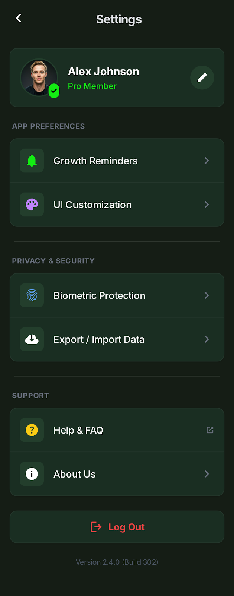
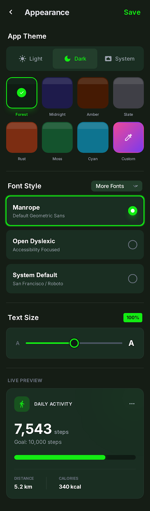
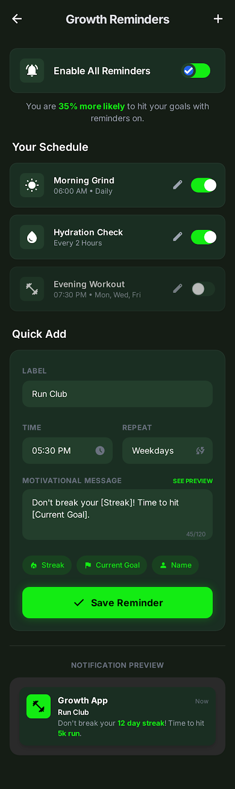
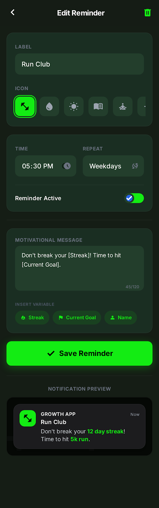
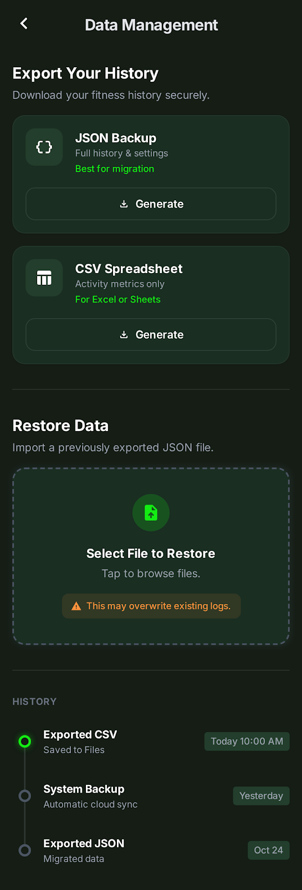