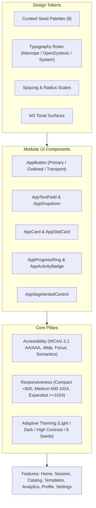

## 23. Growth Gauge Unified Design System Specification (Theme, Accessibility & Responsiveness)

This specification establishes the authoritative standard for visual styling, accessible interaction, responsive layouts, and reusable components across Growth Gauge. It consolidates legacy design requirements, resolves current code discrepancies (e.g. conflicting purple themes in `theme_config.dart`), and defines a modular component library in `lib/features/common/presentation/widgets/`.



---

### 23.1 Design Token Architecture

#### A. Curated Color Seed Palettes
The application supports 8 curated seed colors driving Material 3 `ColorScheme.fromSeed` generation. Each palette automatically generates Dark, Light, Medium Contrast, and High Contrast variants:

| Palette Name | Seed Hex | Primary Tone (Dark) | Primary Tone (Light) | Visual Identity & Intent |
|---|---|---|---|---|
| **Forest (Default)** | `#00FF66` | `#00FF66` (Electric Green) | `#008732` (Deep Forest) | High-energy athletic identity matching legacy designs |
| **Midnight** | `#5C6BC0` | `#9FA8DA` (Indigo Tint) | `#3949AB` (Deep Navy) | Focused, minimal nighttime training palette |
| **Amber** | `#FFB300` | `#FFCA28` (Warm Gold) | `#FF8F00` (High-Vis Amber) | High-visibility warning/power lifting theme |
| **Slate** | `#78909C` | `#B0BEC5` (Cool Metallic) | `#455A64` (Dark Steel) | Monochromatic, distraction-free minimalist aesthetic |
| **Rust** | `#FF5722` | `#FF8A65` (Vibrant Terracotta) | `#D84315` (Burnt Orange) | High-intensity interval / sprint training aesthetic |
| **Moss** | `#4CAF50` | `#81C784` (Natural Sage) | `#2E7D32` (Deep Foliage) | Organic, outdoor running & mobility palette |
| **Cyan** | `#00E5FF` | `#18FFFF` (Hyper Cyan) | `#0097A7` (Teal Marine) | Electric endurance / cardio aesthetic |
| **Custom** | User Defined | HCT Harmonized | HCT Harmonized | User-chosen hex color harmonized via HCT color space |

#### B. Material 3 Tonal Surfaces (Dark Theme Standard)
To eliminate jarring solid-black surfaces and ensure proper depth hierarchy:
- **Canvas / Background:** `#0E1410` (Dark green-tinted canvas)
- **`surfaceContainerLowest`:** `#090D0A` (Underlying recesses, dark slot backgrounds)
- **`surfaceContainerLow`:** `#131A14` (Recessed card slots, inactive tabs)
- **`surfaceContainer`:** `#1A221C` (Standard cards, dialog bodies, bottom sheets)
- **`surfaceContainerHigh`:** `#222B24` (Elevated cards, active set highlights, dropdown menus)
- **`surfaceContainerHighest`:** `#2A342C` (Hover states, focused borders, subtle dividers)
- **`onSurface`:** `#DFE3DD` (Primary text, 87% opacity white equivalent)
- **`onSurfaceVariant`:** `#8E988F` (Secondary captions, metadata labels, units)

#### C. Spacing & Corner Radius Scales
- **Spacing:** `xxs: 4dp`, `xs: 8dp`, `sm: 12dp`, `md: 16dp`, `lg: 20dp`, `xl: 24dp`, `xxl: 32dp`, `hero: 48dp`.
- **Border Radius:**
  - `small: 8dp` (Chips, badges, mini tags)
  - `medium: 12dp` (Text fields, dropdowns, buttons)
  - `large: 16dp` (Standard cards, accordion panels, dialogs)
  - `xlarge: 20dp` (Hero summary cards, calories banner)
  - `pill: 999dp` (Segmented controls, floating pills, transport circles)

#### D. Typography Roles & Font Families
- **Supported Families:**
  - `Manrope`: Modern geometric sans-serif (Default). Features crisp tabular numerals ideal for sets, reps, weights, and timers.
  - `Open Dyslexic`: Accessibility-focused font with weighted bottoms to prevent letter flipping and crowding.
  - `System Default`: Platform-native font (`San Francisco` on iOS/macOS, `Roboto` on Android, `Segoe UI` on Windows).
- **Scale Mapping (Material 3):**
  - `displayLarge`: 48 sp / Bold (Hero timers, active rep countdowns)
  - `headlineMedium`: 28 sp / Bold (Screen headers, metric totals like `3,240 kcal`)
  - `titleLarge`: 20 sp / Semi-bold (Card titles, block headers)
  - `titleMedium`: 16 sp / Medium (Section headers, dialog titles)
  - `bodyLarge`: 16 sp / Regular (Primary body text, descriptions)
  - `bodyMedium`: 14 sp / Regular (Form labels, metadata rows)
  - `labelLarge`: 14 sp / Bold (Button labels, tab titles)
  - `labelSmall`: 11 sp / Medium (Metric units `kg`, `reps`, badge chips)

---

### 23.2 Modular Application Widget Library

All modular components reside in `lib/features/common/presentation/widgets/`:

#### 1. `AppButton`
- **Variants:**
  - `AppButton.primary`: Filled vibrant accent button (`#00FF66` background, dark `#003913` text).
  - `AppButton.secondary`: Tonal container button (`surfaceContainerHigh` background, `primary` text).
  - `AppButton.outlined`: 1.5 dp outline button with rounded corners for secondary actions (e.g. `Generate`, `Edit target`).
  - `AppButton.ghost`: Text button with no background for quiet navigation links (e.g. `Details`, `See All`).
  - `AppButton.destructive`: Red-tinted outlined or filled button for irreversible actions (`Delete`, `Log Out`).
  - `AppButton.transport`: Circular 56 dp glowing icon button for workout player controls (Pause ⏸, Skip ⏮ ⏭).
- **Accessibility:** Guarantees minimum `48×48 dp` hit target; includes visible focus indicator.

#### 2. `AppTextField`
- **Features:**
  - Standardized dark fill (`surfaceContainerLow`) with 12 dp border radius.
  - Floating label with clear focus transition.
  - Optional prefix icon (e.g. `Icons.search`, `Icons.label`).
  - Optional suffix unit annotation (e.g. `kg`, `cm`, `yrs`, `min`).
  - Built-in character counter (e.g. `45/120` in reminder templates).
  - High-visibility error border and assistive text.

#### 3. `AppDropdown<T>`
- **Features:**
  - Clean container matching `AppTextField` styling.
  - Adaptive presentation:
    - **Compact (<600 dp):** Tapping opens a smooth modal bottom sheet with search filter.
    - **Medium / Expanded (≥600 dp):** Opens an aligned popover menu with keyboard navigation.

#### 4. `AppCard`
- **Features:**
  - Standard 16 dp rounded rectangle with `surfaceContainer` fill.
  - Selected state: High-contrast 2 dp green border outline (`colorScheme.primary`) and subtle glow.
  - Dashed variant: Border stroke for dropzones (e.g. "+ Add Block", "Select File to Restore").

#### 5. `AppSegmentedControl<T>`
- **Features:**
  - Pill-shaped container (`surfaceContainerLowest`) with sliding animated active indicator pill.
  - Equal-width segments supporting text labels, icons, or counts.
  - Used uniformly for: `Week | Month | Quarter`, `1W | 1M | 3M | YTD`, `Male | Female`, `Metric | Imperial`.

#### 6. `AppProgressRing`
- **Features:**
  - Custom-painted vector circular progress ring.
  - Centered value readout (e.g. `85%`) with optional sub-label.
  - Responsive sizing (`64 dp` in lists, `96 dp` on cards, `140 dp` in hero sections).
  - Animated progress interpolation with reduced-motion fallback.

#### 7. `AppStatCard`
- **Features:**
  - Compact stat tile with circular icon container, large metric value, title label, and trend delta (`↗ +12%`).
  - Responsive layout: expands horizontally on mobile rows, stacks neatly in desktop multi-column grids.

#### 8. `AppActivityBadge`
- **Features:**
  - Circular container with themed iconography:
    - `Warm Up`: Amber / Runner icon
    - `Interval`: Purple / Stopwatch icon
    - `Reps`: Green / Dumbbell icon
    - `Rest`: Grey-Blue / Zzz clock icon
    - `Cool Down`: Cyan / Snowflake icon
  - Includes text pill badge variant (`INTERVAL`, `REPS`).

---

### 23.3 Accessibility (A11y) & WCAG 2.1 AA/AAA Compliance

1. **Color Contrast Enforcement:**
   - Standard Mode: All text against surfaces must achieve at least `4.5:1` contrast ratio (`titleLarge`, `headlineMedium` must achieve `3:1`).
   - High Contrast Mode: Text must achieve at least `7:1` (WCAG AAA); outlines and icons must achieve `4.5:1`.
   - Contrast level is driven dynamically via `ColorScheme.contrastLevel` (`0.0` normal, `0.5` medium, `1.0` high).

2. **Touch Targets & Hit Testing:**
   - Every interactive element (buttons, chips, list items, slider thumbs, icon buttons) must have a touch target of at least `48×48 dp`.
   - Where visual controls are compact (e.g. 24 dp icon), wrap with `EdgeInsets` or `IconButton` enforcing `visualDensity: VisualDensity.standard` and `constraints: BoxConstraints(minWidth: 48, minHeight: 48)`.

3. **Visible Keyboard Focus:**
   - Desktop and tablet devices must render a distinct focus indicator when navigating via `Tab` or arrow keys:
     ```dart
     Focus(
       child: Container(
         decoration: BoxDecoration(
           border: isFocused ? Border.all(color: colorScheme.primary, width: 2.0) : null,
         ),
       ),
     )
     ```

4. **Screen Reader Semantics:**
   - Timers must not announce every millisecond tick. Announce meaningful workout milestones (e.g. "Rest complete", "Round 2 of 4 started") using `SemanticsService.announce(message, TextDirection.ltr)`.
   - Charts must provide descriptive alternative semantics (e.g. `Semantics(label: 'Weekly workout frequency: 4 workouts completed this week')`).

5. **Text Scaling & Dynamic Type:**
   - The UI must scale cleanly up to `200%` system text size without clipping text or dropping buttons off-screen.
   - Use `Flexible`, `Expanded`, and scrollable containers (`ListView`, `SingleChildScrollView`) for all cards containing text. Never use hardcoded container heights for widgets wrapping text.

6. **Reduced Motion:**
   - Check `MediaQuery.disableAnimationsOf(context)` across all animated widgets.
   - When enabled, progress rings, screen transitions, and chart animations must disable duration/curves and jump immediately to final states.

---

### 23.4 Responsive & Adaptive Layout Architecture

#### A. Window Breakpoints (`AppWindowSizeClass`)
| Window Class | Viewport Width | Form Factor | Navigation Pattern | Content Layout |
|---|---|---|---|---|
| **Compact** | `< 600 dp` | Mobile phones, portrait foldables | Bottom Navigation Bar (2–5 tabs) | 1 column, stacked cards, full-width modal sheets |
| **Medium** | `600 dp – 1024 dp` | Tablets, landscape foldables | Navigation Rail (compact icon rail) | 2-column card grids, persistent filter sheets |
| **Expanded** | `≥ 1024 dp` | Desktop, laptop, widescreen tablets | Extended Navigation Rail with labels | 3-column catalog grids, max-width bounded dashboard |

#### B. Content Width Bounding (`ResponsiveContent`)
To prevent unbounded stretching on widescreen desktop monitors:
- **Dashboards & Analytics (`FitnessHubPage`, `AnalyticsDashboardScreen`):** Constrained to `maxWidth: 1080 dp`.
- **Forms, Wizards & Onboarding (`OnboardingScreen`, `CustomExerciseScreen`, `TemplateEditorScreen`):** Constrained to `maxWidth: 760 dp`.
- **Detail Views (`ExerciseDetailScreen`, `TemplateDetailScreen`):** Constrained to `maxWidth: 900 dp`.

---

### 23.5 Design System Validation & Quality Gates

Before any new screen or component is marked complete:
- [ ] **Static Analysis:** Zero analyzer warnings or errors (`dart analyze lib --fatal-infos`).
- [ ] **Contrast Check:** Screen verified in both Standard and High Contrast modes.
- [ ] **Touch Target Test:** All interactive controls verify `minWidth >= 48 && minHeight >= 48`.
- [ ] **Text Scaling Test:** Layout renders without overflow under `TextScaler.linear(2.0)`.
- [ ] **Keyboard Navigation:** Tab traversal follows logical order and visible focus rings render.
- [ ] **Responsive Test:** Golden or widget tests verify layout at `400×800` (phone), `800×1200` (tablet), and `1440×900` (desktop).
