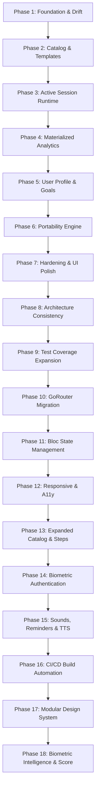

# Growth Gauge: Master Implementation Plan

This master implementation plan serves as the central source of truth for the Growth Gauge architecture, feature parity roadmap, and execution status. Detailed implementation specifications for each phase are organized into modular documents under [`docs/phases/`](phases/).

---

## 1. Executive Summary & Tech Stack Decisions

Growth Gauge is a dedicated, offline-first strength and conditioning fitness tracking application built on Clean Architecture principles and modern Flutter best practices.

### Core Architectural Decisions
- **Persistence Engine:** **Drift (SQLite)** powers:
  1. *Authoritative Document Store:* JSON aggregate documents stored in a `documents` table with composite primary keys (`collection`, `id`) and timestamps.
  2. *Materialized Relational Read Models:* Normalized SQLite tables for zero-lag analytics queries, PR tracking, and volume aggregation.
- **State Management:** **`flutter_bloc` / `cubit`** providing deterministic state machines (e.g. active workout execution) without ad-hoc service locators.
- **Data Models:** **Freezed + json_serializable** for immutable domain entities, value objects, and audit entries.
- **Visualizations:** **`fl_chart`** paired with reactive Drift query streams.
- **Design System:** Material 3 adaptive theming with 8 curated athletic seed palettes, Manrope typography, WCAG AA/AAA compliance, and modular responsive widgets.

---

## 2. Target Directory & Module Structure

```text
lib/
├── core/
│   ├── database/                # Drift AppDatabase, document tables, relational read tables
│   ├── error/                   # Failures & Result monad
│   ├── events/                  # DomainEvent bus / in-memory event dispatcher
│   ├── ids/                     # UniqueId value object & UUIDv4 validation
│   ├── routing/                 # GoRouter configuration & route registry
│   ├── theme/                   # FitnessTheme Material 3 palette & contrast variants
│   ├── time/                    # Clock abstraction & UTC date-time utilities
│   └── units/                   # Canonical unit converters (kg <-> lb, cm <-> in)
│
├── features/
│   ├── user/                    # Profile, goals, physical measurements, equipment
│   ├── catalog/                 # Exercise catalog, taxonomy, relationships, execution steps
│   ├── template/                # Routines, workout blocks, immutable template revisions
│   ├── session/                 # Live workout runtime, copy-on-write execution, set logging
│   ├── analytics/               # Materialized read models, projections, PRs, visualizations
│   ├── portability/             # Versioned import/export, schema migrations, conflict resolution
│   ├── settings/                # Theming, appearance, local auth, reminders
│   └── common/                  # Modular responsive widgets (AppButton, AppTextField, etc.)
│
└── app/                         # App entrypoint, dependency injection, global theme
```

---

## 3. Implementation Roadmap & Phase Progress Tracker



### Master Phase Review Matrix

| Phase | Title | Status | Steps | Detailed Specification | What Is Implemented | What Is Left To Build |
|---|---|---|---|---|---|---|
| **Phase 1** | Foundation & Drift Store | `[x] COMPLETED` | 6 / 6 | [`phase-01-core-foundation.md`](phases/phase-01-core-foundation.md) | Drift SQLite db, document table, domain events, result types, unit converters. | Fully complete. |
| **Phase 2** | Catalog & Templates | `[~] IN PROGRESS` | 7 / 8 | [`phase-02-catalog-templates.md`](phases/phase-02-catalog-templates.md) | Multi-dimensional catalog, seed data, immutable template revisions, block builder. | **Step 2.8:** Template archival and deletion management (soft-delete, dialogs, filter). |
| **Phase 3** | Active Session Runtime | `[x] COMPLETED` | 8 / 8 | [`phase-03-session-runtime.md`](phases/phase-03-session-runtime.md) | Copy-on-write session cloning, state machine, set logger, rest timers, crash recovery. | Polish in-session step cues sheet (links to Phase 13). |
| **Phase 4** | Materialized Analytics | `[x] COMPLETED` | 7 / 7 | [`phase-04-analytics-projections.md`](phases/phase-04-analytics-projections.md) | Drift read tables, analytics projector, PR detection, volume/frequency charts. | Period filter toggle (`1W \| 1M \| 3M \| YTD`), dynamic hub connection. |
| **Phase 5** | User Profile & Goals | `[~] IN PROGRESS` | 4 / 5 | [`phase-05-user-profile-goals.md`](phases/phase-05-user-profile-goals.md) | User domain, measurements logging, training preferences, equipment selector. | **Step 5.5:** First-launch Onboarding Wizard (3-step flow: Metrics, Goals, Constraints). |
| **Phase 6** | Portability Engine | `[x] COMPLETED` | 5 / 5 | [`phase-06-portability-engine.md`](phases/phase-06-portability-engine.md) | Versioned JSON export/import, SHA-256 verification, sequential migrations, conflicts. | UI polish for dual export cards and restore dropzone. |
| **Phase 7** | Hardening & UI Polish | `[~] IN PROGRESS` | 3 / 5 | [`phase-07-hardening-polish.md`](phases/phase-07-hardening-polish.md) | Isolate CPU offloading, stress testing (1,000 sessions), legacy cleanup, contrast tests. | **Step 7.5:** Dynamic "This Week" analytics integration. Fix raw exercise IDs. |
| **Phase 8** | Structure Consistency | `[x] COMPLETED` | 5 / 5 | [`phase-08-consistent-structure.md`](phases/phase-08-consistent-structure.md) | Layer structure cleanup, barrel file consolidation, consistent dependency paths. | Fully complete. |
| **Phase 9** | Test Coverage Expansion | `[x] COMPLETED` | 5 / 5 | [`phase-09-test-coverage.md`](phases/phase-09-test-coverage.md) | Full unit, use case, cubit, and widget coverage (>127 tests passing repository-wide). | Add widget tests for newly planned steps. |
| **Phase 10** | GoRouter Migration | `[x] COMPLETED` | 6 / 6 | [`phase-10-routing-migration.md`](phases/phase-10-routing-migration.md) | Declarative GoRouter routing, typed navigation, elimination of direct `MaterialPageRoute`. | Register new routes for Onboarding, Appearance, and Reminders. |
| **Phase 11** | Bloc State Management | `[x] COMPLETED` | 6 / 6 | [`phase-11-state-management.md`](phases/phase-11-state-management.md) | Consolidation on `flutter_bloc`/`cubit`, removal of `provider` state dependencies. | Fully complete. |
| **Phase 12** | Responsive & A11y | `[~] IN PROGRESS` | 6 / 6 | [`phase-12-responsive-accessible.md`](phases/phase-12-responsive-accessible.md) | `AppWindowSizeClass`, `ResponsiveContent`, navigation rail, text scaling, contrast rules. | Manual platform hardware verification checklist. |
| **Phase 13** | Comprehensive Catalog & Steps | `[ ] PLANNED` | 0 / 7 | [`phase-13-comprehensive-catalog.md`](phases/phase-13-comprehensive-catalog.md) | Exercise taxonomy and initial seed data exist. | Curate broad exercise library; **Step 13.7:** Sequential execution steps and timeline. |
| **Phase 14** | Secure Local Auth | `[ ] PLANNED` | 0 / 6 | [`phase-14-secure-local-auth.md`](phases/phase-14-secure-local-auth.md) | Basic settings tile and biometric check stub exist. | Platform biometric integration (`local_auth`), salted PIN storage, protected routes gate. |
| **Phase 15** | Sounds, Reminders & TTS | `[ ] PLANNED` | 0 / 6 | [`phase-15-sounds-reminders-tts.md`](phases/phase-15-sounds-reminders-tts.md) | Basic notification scheduling foundation exists. | In-session audio cues, TTS voice coach, Reminders screen with variable insert chips. |
| **Phase 16** | CI/CD Build Automation | `[ ] PLANNED` | 0 / 6 | [`phase-16-ci-cd-build-automation.md`](phases/phase-16-ci-cd-build-automation.md) | Local validation scripts (`check.ps1`, `generate.ps1`). | GitHub Actions alignment with Flutter minimum SDK, verified multi-platform artifacts. |
| **Phase 17** | Modular Design System | `[ ] PLANNED` | 0 / 6 | [`phase-17-modular-design-system.md`](phases/phase-17-modular-design-system.md) | `FitnessTheme` and responsive primitives exist. | Curated 8-seed palette engine, modular widget library, dedicated Appearance screen. |
| **Phase 18** | Biometric Intelligence & Score | `[ ] PLANNED` | 0 / 6 | [`phase-18-fitness-assessment-biometrics.md`](phases/phase-18-fitness-assessment-biometrics.md) | Height/weight/RHR profile fields exist. | Karvonen HR zones, Mifflin-St Jeor BMR/TDEE, Navy body fat %, Composite Score (0–100). |

---

## 4. Prioritized Execution Queue (Immediate Action Items)

Based on the 23-screenshot UI audit in [`docs/design/`](../docs/design/) and legacy design requirements:

### Priority 1: Core User Journey Fixes & Polish
1. **Dynamic "This Week" Training Hub (`Step 7.5`):**
   - Eliminate hardcoded `3,240 kcal` and `85%` in `week_summary_section.dart`.
   - Wire `FitnessHubPage` to `AnalyticsCubit` / `DailySummary` Drift stream to render live active seconds, workout counts, and dynamic energy expenditure.
   - Wire "Details" button to `context.push(appRouteAnalytics)`.
2. **First-Launch Onboarding Wizard (`Step 5.5`):**
   - Build 3-step wizard (`OnboardingScreen`) to collect Body Metrics (sex, unit, age, height, weight, activity level), Goals, and Constraints (injuries, equipment, time cap).
   - Wire `launch_route_resolver.dart` to redirect first-time users to onboarding before Home.
3. **Template Deletion and Archival (`Step 2.8`):**
   - Add archive (soft-delete via `isArchived`) and permanent delete use cases and Cubit methods.
   - Add swipe-to-archive, popup menu actions, and confirmation dialogs in `TemplateListScreen`, `TemplateDetailScreen`, and `TemplateEditorScreen`.
   - Clean citation artifacts (e.g. `[cite: 4]`) from seed template descriptions.
4. **Exercise Execution Steps & Form Guidance (`Step 13.7`):**
   - Display `setupInstructions` and `executionInstructions` as a numbered timeline/stepper in `ExerciseDetailScreen`.
   - Build custom step builder in `CustomExerciseScreen` allowing users to add, edit, and reorder steps.
   - Surface an in-session step cues sheet in `ActiveSessionScreen`.
5. **Cross-Screen Visual Bug Fixes (`Phase 7`):**
   - Map raw document IDs (`exercise-squat-001`, `exercise-barbell-curl-001`) to human-readable names across Session Summary Timeline, Analytics PRs, and PR Trophy Shelf.
   - Fix duplicated "Latest Completed Workouts" section on desktop in `AnalyticsDashboardScreen`.

### Priority 2: Modular Design System & Appearance Settings (`Phase 17`)
1. Implement modular widgets in `lib/features/common/presentation/widgets/`: `AppButton`, `AppTextField`, `AppDropdown`, `AppCard`, `AppSegmentedControl`, `AppProgressRing`, `AppStatCard`, `AppActivityBadge`.
2. Implement dedicated Appearance settings screen (`appRouteAppearance`) from `Settings-2.png`: Light/Dark/System toggle, 8-color seed grid, font family selector, text scale slider, live preview card.
3. Migrate `theme_config.dart` to eliminate obsolete purple constants and anchor to `FitnessTheme` seed palettes.

### Priority 3: Local Authentication & Notifications (`Phases 14 & 15`)
1. Complete biometric authentication with PIN fallback and app lock gate (`Phase 14`).
2. Implement Growth Reminders management screen (`appRouteGrowthReminders`) with message template tokens (`[Streak]`, `[Current Goal]`, `[Name]`) and live notification preview (`Phase 15`).

---

## 5. Cross-Cutting Acceptance Gates & Testing Standards

Before considering any phase or major feature complete:
- **Format Verification:** `dart format --output=none --set-exit-if-changed .`
- **Static Analysis:** `dart analyze lib --fatal-infos` reports 0 issues.
- **Automated Regression:** Relevant unit and widget tests pass.
- **Accessibility:** Touch targets measure $\ge 48 \times 48\text{ dp}$, text achieves $\ge 4.5:1$ contrast ratio ($\ge 7:1$ in high-contrast), and large text ($200\%$) renders without clipping.
- **Responsive Layout:** Screen renders without `RenderFlex` overflow across Compact ($<600\text{ dp}$), Medium ($600\text{–}1024\text{ dp}$), and Expanded ($\ge 1024\text{ dp}$).
- **Architecture Integrity:** No direct `MaterialPageRoute` calls (use GoRouter `context.push`), strict layer separation (Domain $\to$ Application $\to$ Infrastructure $\to$ Presentation), and no legacy counter/timer patterns.

---

## 6. Documentation Directory & File Index

| Document | Path | Purpose |
|---|---|---|
| **Master Implementation Plan** | [`docs/implementation-plan.md`](implementation-plan.md) | Central roadmap, status matrix, and execution queue (this file). |
| **Application Architecture** | [`docs/architecture.md`](architecture.md) | Canonical architectural guidelines, patterns, and source of truth rules. |
| **Unified Design System Spec** | [`docs/design-system-spec.md`](design-system-spec.md) | Comprehensive tokens, modular component APIs, A11y, and responsive rules. |
| **Legacy & Current UI Crosswalk** | [`docs/legacy-design-crosswalk.md`](legacy-design-crosswalk.md) | Detailed parity crosswalk, 15 legacy design image specs, and 23 current UI audit. |
| **Phase 1: Core Foundation** | [`docs/phases/phase-01-core-foundation.md`](phases/phase-01-core-foundation.md) | Drift SQLite database, document store, events, ID value objects. |
| **Phase 2: Catalog & Templates** | [`docs/phases/phase-02-catalog-templates.md`](phases/phase-02-catalog-templates.md) | Exercise taxonomy, immutable template revisions, archival management. |
| **Phase 3: Active Session Runtime** | [`docs/phases/phase-03-session-runtime.md`](phases/phase-03-session-runtime.md) | Copy-on-write workout execution engine, timers, crash recovery. |
| **Phase 4: Materialized Analytics** | [`docs/phases/phase-04-analytics-projections.md`](phases/phase-04-analytics-projections.md) | Drift read tables, analytics projector, personal records, charts. |
| **Phase 5: User Profile & Goals** | [`docs/phases/phase-05-user-profile-goals.md`](phases/phase-05-user-profile-goals.md) | Profiles, equipment inventory, measurements, onboarding wizard. |
| **Phase 6: Portability Engine** | [`docs/phases/phase-06-portability-engine.md`](phases/phase-06-portability-engine.md) | Versioned JSON export/import, schema migrations, SHA-256 checks. |
| **Phase 7: Hardening & Polish** | [`docs/phases/phase-07-hardening-polish.md`](phases/phase-07-hardening-polish.md) | Isolate offloading, stress testing, dynamic hub analytics integration. |
| **Phase 8: Structural Consistency** | [`docs/phases/phase-08-consistent-structure.md`](phases/phase-08-consistent-structure.md) | Clean Architecture layer structure, dependency paths, barrel files. |
| **Phase 9: Test Coverage** | [`docs/phases/phase-09-test-coverage.md`](phases/phase-09-test-coverage.md) | Automated testing inventory and regression suites. |
| **Phase 10: GoRouter Migration** | [`docs/phases/phase-10-routing-migration.md`](phases/phase-10-routing-migration.md) | Declarative routing, route registry, parameter passing. |
| **Phase 11: State Management** | [`docs/phases/phase-11-state-management.md`](phases/phase-11-state-management.md) | BLoC/Cubit consolidation and Provider removal. |
| **Phase 12: Responsive & A11y** | [`docs/phases/phase-12-responsive-accessible.md`](phases/phase-12-responsive-accessible.md) | Window size classes, keyboard traversal, semantic labels. |
| **Phase 13: Expanded Catalog** | [`docs/phases/phase-13-comprehensive-catalog.md`](phases/phase-13-comprehensive-catalog.md) | Curated exercise taxonomy, execution instructions, step builder. |
| **Phase 14: Secure Local Auth** | [`docs/phases/phase-14-secure-local-auth.md`](phases/phase-14-secure-local-auth.md) | Biometric auth, salted PIN storage, protected route guards. |
| **Phase 15: Sounds, Reminders & TTS** | [`docs/phases/phase-15-sounds-reminders-tts.md`](phases/phase-15-sounds-reminders-tts.md) | In-workout sound cues, scheduled notifications, TTS voice coach. |
| **Phase 16: CI/CD Build Automation**| [`docs/phases/phase-16-ci-cd-build-automation.md`](phases/phase-16-ci-cd-build-automation.md)| GitHub Actions workflows, tag-driven release artifacts. |
| **Phase 17: Modular Design System** | [`docs/phases/phase-17-modular-design-system.md`](phases/phase-17-modular-design-system.md) | Curated seed palettes, modular widget system, Appearance screen. |
| **Phase 18: Biometric Intelligence**| [`docs/phases/phase-18-fitness-assessment-biometrics.md`](phases/phase-18-fitness-assessment-biometrics.md)| HR zones, Mifflin-St Jeor TDEE, body composition, Fitness Score. |
