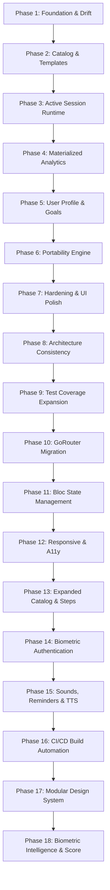

# Growth Gauge: Master Implementation Plan

This master implementation plan serves as the central source of truth for the Growth Gauge architecture, feature parity roadmap, and execution status. Detailed implementation specifications for each phase are organized into modular documents under [`docs/phases/`](phases/). Audit evidence and limitations are recorded in [`docs/audit-report.md`](audit-report.md). Statuses below are conservative: prior completion claims are not considered verified where current checks, tests, or required scope are incomplete or unverified.

---

## 1. Executive Summary & Tech Stack Decisions

Growth Gauge is a dedicated, offline-first strength and conditioning fitness tracking application built on Clean Architecture principles and modern Flutter best practices.

### Core Architectural Decisions
- **Persistence Engine:** **Drift (SQLite)** powers:
  1. *Authoritative Document Store:* JSON aggregate documents stored in a `documents` table with composite primary keys (`collection`, `id`) and timestamps.
  2. *Materialized Relational Read Models:* Normalized SQLite tables for zero-lag analytics queries, PR tracking, and volume aggregation.
- **State Management:** **`flutter_bloc` / `cubit`** providing deterministic state machines (e.g. active workout execution) without ad-hoc service locators.
- **Data Models:** **Freezed + json_serializable** for immutable domain entities, value objects, and audit entries.
- **Visualizations:** **`fl_chart`** paired with reactive Drift query streams.
- **Design System:** Material 3 adaptive theming with 8 curated athletic seed palettes, Manrope typography, WCAG AA/AAA compliance, and modular responsive widgets.

---

## 2. Target Directory & Module Structure

```text
lib/
├── core/
│   ├── database/                # Drift AppDatabase, document tables, relational read tables
│   ├── error/                   # Failures & Result monad
│   ├── events/                  # DomainEvent bus / in-memory event dispatcher
│   ├── ids/                     # UniqueId value object & UUIDv4 validation
│   ├── routing/                 # GoRouter configuration & route registry
│   ├── theme/                   # FitnessTheme Material 3 palette & contrast variants
│   ├── time/                    # Clock abstraction & UTC date-time utilities
│   └── units/                   # Canonical unit converters (kg <-> lb, cm <-> in)
│
├── features/
│   ├── user/                    # Profile, goals, physical measurements, equipment
│   ├── catalog/                 # Exercise catalog, taxonomy, relationships, execution steps
│   ├── template/                # Routines, workout blocks, immutable template revisions
│   ├── session/                 # Live workout runtime, copy-on-write execution, set logging
│   ├── analytics/               # Materialized read models, projections, PRs, visualizations
│   ├── portability/             # Versioned import/export, schema migrations, conflict resolution
│   ├── settings/                # Theming, appearance, local auth, reminders
│   └── common/                  # Modular responsive widgets (AppButton, AppTextField, etc.)
│
└── app/                         # App entrypoint, dependency injection, global theme
```

---

## 3. Implementation Roadmap & Phase Progress Tracker



### Master Phase Review Matrix

| Phase | Title | Status | Steps | Detailed Specification | What Is Implemented | What Is Left To Build |
|---|---|---|---|---|---|---|
| **Phase 1** | Foundation & Drift Store | `[x] COMPLETED` | 6 / 6 | [`phase-01-core-foundation.md`](phases/phase-01-core-foundation.md) | Drift database, document store, domain events, result types, unit converters and v1-to-v5 migration are implemented and validated. Targeted Phase 1 suite passed 28/28 tests; targeted fatal analysis passed. | No Phase 1 implementation gap identified. Repository-wide analyzer/test failures remain in other phases and are tracked separately. |
| **Phase 2** | Catalog & Templates | `[x] COMPLETED` | 8 / 8 | [`phase-02-catalog-templates.md`](phases/phase-02-catalog-templates.md) | Catalog/template feature and widget tests pass 18/18; scoped fatal analysis and format checks pass. Strict validation has zero errors/warnings; all 108 references resolve, 122 exercises and 83 templates register uniquely, and execution profiles are complete. Template detail displays exercise names and set targets; archive/restore/delete are verified. | No remaining Phase 2-scoped implementation or validation item identified. Base template selector cards remain assigned to Phase 17 widget-system UI work in the legacy crosswalk. |
| **Phase 3** | Active Session Runtime | `[x] COMPLETED` | 10 / 10 | [`phase-03-session-runtime.md`](phases/phase-03-session-runtime.md) | Session lifecycle, copy-on-write, set logging/rest controls, crash recovery, daily RPE/mood/notes persistence, and persisted work/rest/cooldown sequences are implemented. Focused session unit/widget suite passes 17/17; scoped fatal analysis and format checks pass. Interval expiry, skip, extension, pause/resume, checkpoint recovery and summary exercise names are verified. | No remaining Phase 3-scoped gap identified. Optional spoken cues remain assigned to Phase 15; in-session exercise guidance scope remains tracked by Phase 13. |
| **Phase 4** | Materialized Analytics | `[~] IN PROGRESS` | 7 / 7 planned; gates unverified | [`phase-04-analytics-projections.md`](phases/phase-04-analytics-projections.md) | Drift read tables, projector, PR detection, charts and analytics tests are present. | Six DAO tests fail because AnalyticsCubit can create stream subscriptions after close while initialization rebuild is pending. Fix lifecycle race; complete remaining period filtering/live hub integration. |
| **Phase 5** | User Profile & Goals | `[~] IN PROGRESS` | 4 / 5 | [`phase-05-user-profile-goals.md`](phases/phase-05-user-profile-goals.md) | User domain, measurements logging, training preferences, equipment selector. | **Step 5.5:** First-launch Onboarding Wizard (3-step flow: Metrics, Goals, Constraints). |
| **Phase 6** | Portability Engine | `[~] IN PROGRESS` | 5 / 5 planned; gates unverified | [`phase-06-portability-engine.md`](phases/phase-06-portability-engine.md) | Versioned JSON portability, checksum, migrations, conflicts and portability tests are present. | Verify suite and platform file import/export; add required CSV parity or document explicit scope. |
| **Phase 7** | Hardening & UI Polish | `[~] IN PROGRESS` | 3 / 5 | [`phase-07-hardening-polish.md`](phases/phase-07-hardening-polish.md) | Isolate CPU offloading, stress testing (1,000 sessions), legacy cleanup, contrast tests. | **Step 7.5:** Dynamic "This Week" analytics integration. Activity trends lacks month/quarter views and period navigation; week label expectation is stale at compact width. Week summary has no Details CTA and overflows in wider-layout widget test. Fix raw exercise IDs. |
| **Phase 8** | Structure Consistency | `[~] IN PROGRESS` | 5 / 5 planned; gates unverified | [`phase-08-consistent-structure.md`](phases/phase-08-consistent-structure.md) | Layered feature directories and barrel files are present; naming inconsistencies remain (for example singular `screen/` vs `screens/`). | Resolve naming drift, review imports/layer boundaries and verify analysis. |
| **Phase 9** | Test Coverage Expansion | `[~] IN PROGRESS` | 5 / 5 planned; serial gate failed | [`phase-09-test-coverage.md`](phases/phase-09-test-coverage.md) | 33 test files plus 2 generated mock files cover core, feature, widget and integration behaviors. Supplied baseline serial run: 124 passed, 21 failed (exit 1); latest focused Phase 3 session suite passes 17/17. | Resolve valid lifecycle, home/session widget, routing/settings compile and generated-mock failures; review deprecated assumptions. Phase 1 migration, Phase 2 catalog count, and Phase 3 summary viewport assertions are covered. Rerun full suite. |
| **Phase 10** | GoRouter Migration | `[~] IN PROGRESS` | 6 / 6 planned; analyzer/test blocked | [`phase-10-routing-migration.md`](phases/phase-10-routing-migration.md) | GoRouter registry/constants and route tests exist; onboarding and notification destinations are registered in current route source. | `app_router_test.dart` does not compile: missing `notifications` and `NotificationCubit.notificationRepository` arguments. Correct test setup and verify route extras/launch flows. |
| **Phase 11** | Bloc State Management | `[~] IN PROGRESS` | 6 / 6 planned; analyzer/test blocked | [`phase-11-state-management.md`](phases/phase-11-state-management.md) | Feature Cubits/BLoC and `flutter_bloc` wiring are present; no Provider usage was found in source search. | `settings_cubit_test.dart` has two `NotificationCubit` constructions missing required `notificationRepository`; align test setup and rerun analyzer/tests. AnalyticsCubit also has a close/init stream race (Phase 4). |
| **Phase 12** | Responsive & A11y | `[~] IN PROGRESS` | 6 / 6 planned; manual gates open | [`phase-12-responsive-accessible.md`](phases/phase-12-responsive-accessible.md) | Responsive primitives and responsive layout tests exist. | Verify breakpoint coverage, semantics, keyboard focus, touch targets, contrast and 200% scaling on devices. |
| **Phase 13** | Comprehensive Catalog & Steps | `[~] IN PROGRESS` | 0 / 7 previously counted; implementation partial | [`phase-13-comprehensive-catalog.md`](phases/phase-13-comprehensive-catalog.md) | Catalog validator reports 122 registered exercise definitions and complete execution profiles. | Strict gate warns about duplicate `Doorway Chest Stretch`, 14 exercises unused by templates, and 225 sets with `targetReps: 0`; decide intended uses vs seed corrections. Also surface setup/execution instructions, custom step editing and session cues; add tests. |
| **Phase 14** | Secure Local Auth | `[~] IN PROGRESS` | 0 / 6 previously counted; implementation partial | [`phase-14-secure-local-auth.md`](phases/phase-14-secure-local-auth.md) | PIN/biometric screens and auth service are present; `local_auth` and secure storage dependencies exist. | Verify native capability, secure PIN verifier/throttling, protected route enforcement and platform tests. |
| **Phase 15** | Sounds, Reminders & TTS | `[~] IN PROGRESS` | 0 / 6 previously counted; implementation partial | [`phase-15-sounds-reminders-tts.md`](phases/phase-15-sounds-reminders-tts.md) | Notification settings/history, scheduler, audio service and notification Cubit are present. | Notification service tests fail to compile because generated mock signatures do not match service API; refresh mocks and update tests. Settings Cubit tests also omit notification repository. Reminder management and TTS remain absent/unverified; add permission/scheduling/widget coverage. |
| **Phase 16** | CI/CD Build Automation | `[~] IN PROGRESS` | 0 / 6 previously counted; workflows exist | [`phase-16-ci-cd-build-automation.md`](phases/phase-16-ci-cd-build-automation.md) | PR analysis and tag release workflows plus Windows/Bash wrappers are present. | Align pinned SDK versions (3.44.0 vs 3.47.8), make check safe, validate artifact paths/secrets/signing and execute platform builds. |
| **Phase 17** | Modular Design System | `[~] IN PROGRESS` | 0 / 6 previously counted; analyzer failure | [`phase-17-modular-design-system.md`](phases/phase-17-modular-design-system.md) | Common widgets exist; the current tree deletes `lib/core/theme/fitness_theme.dart` while `fitness_theme_test.dart` still imports it and references `FitnessTheme`. | Resolve the current theme/test path mismatch, then confirm tokens, palettes/contrast variants, typography families, accessibility, Appearance screen and visual behavior. |
| **Phase 18** | Biometric Intelligence & Score | `[~] IN PROGRESS` | 0 / 6 previously counted; input data partial | [`phase-18-fitness-assessment-biometrics.md`](phases/phase-18-fitness-assessment-biometrics.md) | Profile metrics and calorie calculator exist. | Verify/implement HR zones, BMR/TDEE, body-fat estimate and validated composite score with unit tests. |

---

## 4. Prioritized Execution Queue (Immediate Action Items)

The strict audit priority is **MVP Readiness (Phases 1–18 and legacy crosswalk)**, then **UI Completeness**, then **Release Config**. See the evidence-backed queue and gate results in [`docs/audit-report.md`](audit-report.md). The former UI-only queue below is retained as specific follow-up evidence, not as the complete ordering.

Based on the 23-screenshot UI audit in [`docs/design/`](../docs/design/) and legacy design requirements:

### Priority 1: Core User Journey Fixes & Polish
1. **Dynamic "This Week" Training Hub (`Step 7.5`):**
   - Eliminate hardcoded `3,240 kcal` and `85%` in `week_summary_section.dart`.
   - Wire `FitnessHubPage` to `AnalyticsCubit` / `DailySummary` Drift stream to render live active seconds, workout counts, and dynamic energy expenditure.
   - Wire "Details" button to `context.push(appRouteAnalytics)`.
2. **First-Launch Onboarding Wizard (`Step 5.5`):**
   - Build 3-step wizard (`OnboardingScreen`) to collect Body Metrics (sex, unit, age, height, weight, activity level), Goals, and Constraints (injuries, equipment, time cap).
   - Wire `launch_route_resolver.dart` to redirect first-time users to onboarding before Home.
3. **Template Deletion and Archival (`Step 2.8`, completed):**
   - Archive/restore filtering, popup actions, and confirmation dialogs are present across list/detail/editor; permanent deletion transactionally removes revisions with the template.
   - Unit and widget coverage passes for archive/restore, cascade deletion, list management and prescribed targets in template detail; strict seed validation reports no errors or warnings.
4. **Exercise Execution Steps & Form Guidance (`Step 13.7`):**
   - Display `setupInstructions` and `executionInstructions` as a numbered timeline/stepper in `ExerciseDetailScreen`.
   - Build custom step builder in `CustomExerciseScreen` allowing users to add, edit, and reorder steps.
   - Surface an in-session step cues sheet in `ActiveSessionScreen`.
5. **Cross-Screen Visual Bug Fixes (`Phase 7`):**
   - Map raw document IDs (`exercise-squat-001`, `exercise-barbell-curl-001`) to human-readable names across Session Summary Timeline, Analytics PRs, and PR Trophy Shelf.
   - Fix duplicated "Latest Completed Workouts" section on desktop in `AnalyticsDashboardScreen`.

### Priority 2: Modular Design System & Appearance Settings (`Phase 17`)
1. Implement modular widgets in `lib/features/common/presentation/widgets/`: `AppButton`, `AppTextField`, `AppDropdown`, `AppCard`, `AppSegmentedControl`, `AppProgressRing`, `AppStatCard`, `AppActivityBadge`.
2. Implement dedicated Appearance settings screen (`appRouteAppearance`) from `Settings-2.png`: Light/Dark/System toggle, 8-color seed grid, font family selector, text scale slider, live preview card.
3. Migrate `theme_config.dart` to eliminate obsolete purple constants and anchor to `FitnessTheme` seed palettes.

### Priority 3: Local Authentication & Notifications (`Phases 14 & 15`)
1. Complete biometric authentication with PIN fallback and app lock gate (`Phase 14`).
2. Implement Growth Reminders management screen (`appRouteGrowthReminders`) with message template tokens (`[Streak]`, `[Current Goal]`, `[Name]`) and live notification preview (`Phase 15`).

---

## 5. Cross-Cutting Acceptance Gates & Testing Standards

Before considering any phase or major feature complete:
- **Format Verification:** `dart format --output=none --set-exit-if-changed .`
- **Static Analysis:** `dart analyze lib --fatal-infos` reports 0 issues.
- **Automated Regression:** Relevant unit and widget tests pass.
- **Accessibility:** Touch targets measure $\ge 48 \times 48\text{ dp}$, text achieves $\ge 4.5:1$ contrast ratio ($\ge 7:1$ in high-contrast), and large text ($200\%$) renders without clipping.
- **Responsive Layout:** Screen renders without `RenderFlex` overflow across Compact ($<600\text{ dp}$), Medium ($600\text{–}1024\text{ dp}$), and Expanded ($\ge 1024\text{ dp}$).
- **Architecture Integrity:** No direct `MaterialPageRoute` calls (use GoRouter `context.push`), strict layer separation (Domain $\to$ Application $\to$ Infrastructure $\to$ Presentation), and no legacy counter/timer patterns.

---

## 6. Documentation Directory & File Index

| Document | Path | Purpose |
|---|---|---|
| **Master Implementation Plan** | [`docs/implementation-plan.md`](implementation-plan.md) | Central roadmap, status matrix, and execution queue (this file). |
| **Application Architecture** | [`docs/architecture.md`](architecture.md) | Canonical architectural guidelines, patterns, and source of truth rules. |
| **Unified Design System Spec** | [`docs/design-system-spec.md`](design-system-spec.md) | Comprehensive tokens, modular component APIs, A11y, and responsive rules. |
| **Legacy & Current UI Crosswalk** | [`docs/legacy-design-crosswalk.md`](legacy-design-crosswalk.md) | Detailed parity crosswalk, 15 legacy design image specs, and 23 current UI audit. |
| **Phase 1: Core Foundation** | [`docs/phases/phase-01-core-foundation.md`](phases/phase-01-core-foundation.md) | Drift SQLite database, document store, events, ID value objects. |
| **Phase 2: Catalog & Templates** | [`docs/phases/phase-02-catalog-templates.md`](phases/phase-02-catalog-templates.md) | Exercise taxonomy, immutable template revisions, archival management. |
| **Phase 3: Active Session Runtime** | [`docs/phases/phase-03-session-runtime.md`](phases/phase-03-session-runtime.md) | Copy-on-write workout execution engine, timers, crash recovery. |
| **Phase 4: Materialized Analytics** | [`docs/phases/phase-04-analytics-projections.md`](phases/phase-04-analytics-projections.md) | Drift read tables, analytics projector, personal records, charts. |
| **Phase 5: User Profile & Goals** | [`docs/phases/phase-05-user-profile-goals.md`](phases/phase-05-user-profile-goals.md) | Profiles, equipment inventory, measurements, onboarding wizard. |
| **Phase 6: Portability Engine** | [`docs/phases/phase-06-portability-engine.md`](phases/phase-06-portability-engine.md) | Versioned JSON export/import, schema migrations, SHA-256 checks. |
| **Phase 7: Hardening & Polish** | [`docs/phases/phase-07-hardening-polish.md`](phases/phase-07-hardening-polish.md) | Isolate offloading, stress testing, dynamic hub analytics integration. |
| **Phase 8: Structural Consistency** | [`docs/phases/phase-08-consistent-structure.md`](phases/phase-08-consistent-structure.md) | Clean Architecture layer structure, dependency paths, barrel files. |
| **Phase 9: Test Coverage** | [`docs/phases/phase-09-test-coverage.md`](phases/phase-09-test-coverage.md) | Automated testing inventory and regression suites. |
| **Phase 10: GoRouter Migration** | [`docs/phases/phase-10-routing-migration.md`](phases/phase-10-routing-migration.md) | Declarative routing, route registry, parameter passing. |
| **Phase 11: State Management** | [`docs/phases/phase-11-state-management.md`](phases/phase-11-state-management.md) | BLoC/Cubit consolidation and Provider removal. |
| **Phase 12: Responsive & A11y** | [`docs/phases/phase-12-responsive-accessible.md`](phases/phase-12-responsive-accessible.md) | Window size classes, keyboard traversal, semantic labels. |
| **Phase 13: Expanded Catalog** | [`docs/phases/phase-13-comprehensive-catalog.md`](phases/phase-13-comprehensive-catalog.md) | Curated exercise taxonomy, execution instructions, step builder. |
| **Phase 14: Secure Local Auth** | [`docs/phases/phase-14-secure-local-auth.md`](phases/phase-14-secure-local-auth.md) | Biometric auth, salted PIN storage, protected route guards. |
| **Phase 15: Sounds, Reminders & TTS** | [`docs/phases/phase-15-sounds-reminders-tts.md`](phases/phase-15-sounds-reminders-tts.md) | In-workout sound cues, scheduled notifications, TTS voice coach. |
| **Phase 16: CI/CD Build Automation**| [`docs/phases/phase-16-ci-cd-build-automation.md`](phases/phase-16-ci-cd-build-automation.md)| GitHub Actions workflows, tag-driven release artifacts. |
| **Phase 17: Modular Design System** | [`docs/phases/phase-17-modular-design-system.md`](phases/phase-17-modular-design-system.md) | Curated seed palettes, modular widget system, Appearance screen. |
| **Phase 18: Biometric Intelligence**| [`docs/phases/phase-18-fitness-assessment-biometrics.md`](phases/phase-18-fitness-assessment-biometrics.md)| HR zones, Mifflin-St Jeor TDEE, body composition, Fitness Score. |
