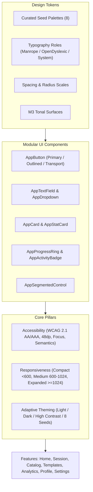

# Growth Gauge: Modular Implementation Plan

## 1. Executive Summary & Tech Stack Decisions

Based on the canonical architecture specifications in [`design/Application_Architecture.md`](Application_Architecture.md) and reference fixtures in [`design/Persona_Worked_Example.json`](
Persona_Worked_Example.json), the application will undergo a clean, structured pivot into a dedicated, offline-first strength and conditioning fitness tracker.

### Core Architectural Decisions
- **Scope & Migration:** Completely replace legacy counter/timer features with the new fitness domain architecture.
- **Persistence Engine:** **Drift (SQLite)** powers:
  1. **Authoritative Document Store:** Hierarchical JSON aggregate documents stored in a `documents` table with composite primary keys (`collection`, `id`) and timestamps.
  2. **Materialized Relational Read Models:** Normalized SQLite tables for instant, zero-lag charting, analytics queries, and personal records.
- **State Management:** **flutter_bloc / cubit** combined with Clean Architecture (Commands/Queries/Use Cases), providing deterministic state machine transitions for active workout sessions.
- **Data Models:** **Freezed + json_serializable** for immutable domain entities, value objects, domain events, and audit logs.
- **Visualizations:** **fl_chart** integrated with reactive Drift query streams.

---

## 2. Target Directory & Module Structure

```text
lib/
├── core/
│   ├── database/                # Drift AppDatabase, document tables, relational read tables
│   ├── error/                   # Failures & Result monad
│   ├── events/                  # DomainEvent bus / in-memory event dispatcher
│   ├── ids/                     # UniqueId value object & UUIDv4 validation
│   ├── time/                    # Clock abstraction & UTC date-time utilities
│   └── units/                   # Canonical unit converters (kg <-> lb, cm <-> in)
│
├── features/
│   ├── user/                    # User account, profile, training profile, goals, equipment, measurements
│   │   ├── domain/              # Entities & Value Objects (Freezed)
│   │   ├── application/         # UserCubit, GoalCubit, MeasurementCubit / UseCases
│   │   ├── infrastructure/      # Drift-backed User Document Repository
│   │   └── presentation/        # Profile, Goals, Equipment, and Settings screens
│   │
│   ├── catalog/                 # Exercise catalog, taxonomy, measurement profiles, relationships
│   │   ├── domain/              # Exercise, MovementPattern, MuscleGroup, MeasurementProfile
│   │   ├── application/         # ExerciseBloc / CatalogUseCases
│   │   ├── infrastructure/      # Exercise Repository & Seed Data Loader
│   │   └── presentation/        # Catalog browser, filter sheet, exercise detail
│   │
│   ├── template/                # Routines, workout blocks, immutable template revisions
│   │   ├── domain/              # WorkoutTemplate, TemplateRevision, WorkoutBlock, TargetSet
│   │   ├── application/         # TemplateBloc / TemplateUseCases
│   │   ├── infrastructure/      # Template Repository
│   │   └── presentation/        # Routine list, template editor, block builder
│   │
│   ├── session/                 # Live workout runtime, copy-on-write execution, rest timers, recovery
│   │   ├── domain/              # WorkoutSession, ExecutionSet, RestInterval, Interruption, AuditEntry
│   │   ├── application/         # WorkoutSessionBloc (State Machine: Draft, InProgress, Paused, Completed)
│   │   ├── infrastructure/      # Session Document Repository & Crash Recovery Cache
│   │   └── presentation/        # Active HUD, set logger, rest overlay, summary dialog
│   │
│   ├── analytics/               # Materialized read models, projections, PRs, visualizations
│   │   ├── domain/              # Read models: DailySummary, ExerciseMetrics, PersonalRecord
│   │   ├── projection/          # AnalyticsProjector (SessionCompletedEvent -> Drift tables)
│   │   ├── application/         # AnalyticsCubit / Query Handlers / RebuildAnalyticsUseCase
│   │   └── presentation/        # History list, PR trophy shelf, volume/frequency charts
│   │
│   └── portability/             # Versioned import/export, schema migrations, conflict resolution
│       ├── domain/              # ExportEnvelope, Manifest, ConflictStrategy, ImportReport
│       ├── application/         # ExportDataUseCase, ImportDataUseCase, MigrationPipeline
│       ├── infrastructure/      # Portability repository & SHA-256 validator
│       └── presentation/        # Backup/Restore UI & Conflict Resolution modal
│
└── app/                         # App entrypoint, routing, global theme, DI setup
```

---

## 3. Implementation Roadmap Overview

```mermaid
flowchart TD
    P1["Phase 1: Dependencies & Core Foundation"] --> P2["Phase 2: Exercise Catalog & Templates"]
    P2 --> P3["Phase 3: Session Runtime & Copy-on-Write Engine"]
    P3 --> P4["Phase 4: Materialized Analytics & Drift Projections"]
    P4 --> P5["Phase 5: User Profile, Goals & Physical Measurements"]
    P5 --> P6["Phase 6: Portability Engine & Schema Migrations"]
    P6 --> P7["Phase 7: Hardening, Polish & Legacy Cleanup"]
    P7 --> P8["Phase 8: Consistent Structure & Maintainability"]
    P8 --> P9["Phase 9: Test Coverage Expansion"]
    P9 --> P10["Phase 10: Application Routing Migration (go_router)"]
    P10 --> P11["Phase 11: Bloc and Framework State Management"]
    P11 --> P12["Phase 12: Responsive and Accessible Experience"]
    P12 --> P13["Phase 13: Comprehensive Exercise Catalog & Steps"]
    P13 --> P14["Phase 14: Secure Local Authentication"]
    P14 --> P15["Phase 15: Progress Sounds, Growth Reminders & TTS Coach"]
    P15 --> P16["Phase 16: GitHub Actions Build Improvements"]
    P16 --> P17["Phase 17: Adaptive Modular Widget System & Design System"]
    P17 --> P18["Phase 18: Fitness Assessment Score & Biometric Intelligence"]
```



### Phase Progress Tracker

| Phase | Description | Status | Completed Steps | Total Steps |
|---|---|---|---|---|
| **Phase 1** | Dependencies & Core Foundation | `[x] COMPLETED` | 6 | 6 |
| **Phase 2** | Exercise Catalog & Templates | `[~] IN PROGRESS` | 7 | 8 |
| **Phase 3** | Session Runtime & Copy-on-Write Engine | `[x] COMPLETED` | 8 | 8 |
| **Phase 4** | Materialized Analytics & Drift Projections | `[x] COMPLETED` | 7 | 7 |
| **Phase 5** | User Profile, Goals & Physical Measurements | `[~] IN PROGRESS` | 4 | 5 |
| **Phase 6** | Portability Engine, Export/Import & Migrations | `[x] COMPLETED` | 5 | 5 |
| **Phase 7** | Hardening, Polish & Legacy Cleanup | `[~] IN PROGRESS` | 3 | 5 |
| **Phase 8** | Consistent Structure & Maintainability | `[x] COMPLETED` | 5 | 5 |
| **Phase 9** | Test Coverage Expansion | `[x] COMPLETED` | 5 | 5 |
| **Phase 10** | Application Routing Migration (go_router) | `[x] COMPLETED` | 6 | 6 |
| **Phase 11** | Bloc and Framework State Management | `[x] COMPLETED` | 6 | 6 |
| **Phase 12** | Responsive and Accessible Experience | `[~] IN PROGRESS` | 6 | 6 |
| **Phase 13** | Comprehensive Exercise Catalog & Exercise Steps | `[ ] PLANNED` | 0 | 7 |
| **Phase 14** | Secure Local Authentication | `[ ] PLANNED` | 0 | 6 |
| **Phase 15** | Progress Sounds, Growth Reminders & TTS Coach | `[ ] PLANNED` | 0 | 6 |
| **Phase 16** | GitHub Actions Build Improvements | `[ ] PLANNED` | 0 | 6 |
| **Phase 17** | Adaptive Modular Widget System & Design System | `[ ] PLANNED` | 0 | 6 |
| **Phase 18** | Fitness Assessment Score & Biometric Intelligence | `[ ] PLANNED` | 0 | 6 |

---

## 4. Phase 1: Comprehensive Details (Dependencies & Core Foundation)

Phase 1 establishes the bedrock for the entire architecture: type-safe core primitives, domain event bus, and the authoritative Drift document store.

### 4.1 Dependency Configuration (`pubspec.yaml`)
```yaml
dependencies:
  # State Management
  flutter_bloc: ^9.0.0
  bloc: ^9.0.0
  equatable: ^2.0.7

  # Persistence Engine (Authoritative Store & Materialized Read Models)
  drift: ^2.24.2
  sqlite3_flutter_libs: ^0.5.28
  drift_flutter: ^0.2.4
  path: ^1.9.1

dev_dependencies:
  # Drift Code Generation
  drift_dev: ^2.24.2
```

### 4.2 Phase 1 File Manifest
- `lib/core/ids/unique_id.dart`: Value object wrapping UUIDv4 with validation and equality.
- `lib/core/time/app_clock.dart`: Deterministic clock abstraction producing ISO-8601 UTC strings.
- `lib/core/error/failures.dart`: `Failure`, `DatabaseFailure`, `NotFoundFailure`, `ValidationFailure`, `ConflictFailure`.
- `lib/core/error/result.dart`: Functional sealed monad `Result<T, Failure>` with `Success` and `Error`.
- `lib/core/units/unit_types.dart`: `WeightUnit`, `DistanceUnit`, `HeightUnit`, `TemperatureUnit`.
- `lib/core/units/unit_converter.dart`: Bidirectional conversions between canonical units (kg, m, cm, °C) and display units.
- `lib/core/events/domain_event.dart`: Base `DomainEvent` with `eventId`, `occurredAt`, `aggregateId`, and `eventType`.
- `lib/core/events/domain_event_dispatcher.dart`: In-memory broadcast stream dispatcher with typed subscriptions.
- `lib/core/database/tables/documents_table.dart`: Drift `documents` table definition with composite primary key `(collection, id)`.
- `lib/core/database/app_database.dart`: Main Drift database class with in-memory factory constructor.
- `lib/core/database/document_adapter.dart`: `DocumentAdapter<T>` contract for JSON serialization.
- `lib/core/database/document_store.dart`: Generic `IDocumentStore<T>` interface.
- `lib/core/database/drift_document_store.dart`: Drift-backed implementation of `IDocumentStore<T>`.
- `lib/core/database/app_database.g.dart`: Generated Drift database code.

### 4.3 Phase 1 Execution Log & Step Status

| Step | Action | Status | Notes |
|---|---|---|---|
| **Step 1.1** | Configure Dependencies | `[x] COMPLETED` | Added current Drift dependencies (`drift`/`drift_dev: ^2.35.1`, `drift_flutter: ^0.3.1`, `sqlite3_flutter_libs: ^0.6.0+eol`) alongside `flutter_bloc: ^9.1.1`, `bloc: ^9.2.1`, `equatable: ^2.0.7`, and `path: ^1.9.1`. Upgraded code generation to Freezed `^4.0.2`; removed the unused `build_test: any` constraint that prevented analyzer 14 and Flutter SDK test tooling from resolving together. |
| **Step 1.2** | Core Primitives | `[x] COMPLETED` | Implemented `UniqueId`, `AppClock`, `Failure` hierarchy, `Result<T, Failure>` monad, and `UnitConverter`. |
| **Step 1.3** | Domain Event Dispatcher | `[x] COMPLETED` | Implemented `DomainEvent` and `DomainEventDispatcher` with asynchronous typed subscription handling. |
| **Step 1.4** | Drift Document Store | `[x] COMPLETED` | Defined `Documents` table, `AppDatabase`, `DocumentAdapter<T>`, `IDocumentStore<T>`, and `DriftDocumentStore<T>`. |
| **Step 1.5** | Code Generation | `[x] COMPLETED` | Generated `lib/core/database/app_database.g.dart` via `build_runner`. |
| **Step 1.6** | Test Verification Suite | `[x] COMPLETED` | Implemented 6 test suites across `test/core/`. **27/27 test cases passed (100% success rate)**. |

### 4.4 Phase 1 Test Verification Results

All 27 test cases passed with zero failures in `test/core/`:
- **`test/core/database/drift_document_store_test.dart` (7 tests)**:
  - `upsert and getById retrieve stored entity accurately` (PASSED)
  - `getById returns NotFoundFailure when entity does not exist` (PASSED)
  - `second upsert with same ID updates entity in-place without duplicating rows` (PASSED)
  - `getAll returns all entities in the collection` (PASSED)
  - `delete removes entity from document store` (PASSED)
  - `watchAll emits reactive updates when documents are added` (PASSED)
  - `clearCollection deletes all entities in collection` (PASSED)
- **`test/core/events/domain_event_dispatcher_test.dart` (2 tests)**:
  - `dispatches events to typed subscribers` (PASSED)
  - `cancelled subscription does not receive subsequent events` (PASSED)
- **`test/core/ids/unique_id_test.dart` (4 tests)**:
  - `generate() creates a valid UUIDv4` (PASSED)
  - `from() preserves valid custom IDs` (PASSED)
  - `from() throws ArgumentError for empty or whitespace-only strings` (PASSED)
  - `equality holds for matching values` (PASSED)
- **`test/core/time/app_clock_test.dart` (4 tests)**:
  - `nowUtc() always produces DateTime with isUtc true` (PASSED)
  - `nowIsoUtc() produces ISO-8601 UTC timestamp` (PASSED)
  - `deterministic clock testing using withClock` (PASSED)
  - `parseIsoUtc and formatIsoUtc roundtrip` (PASSED)
- **`test/core/units/unit_converter_test.dart` (6 tests)**:
  - `weight conversions roundtrip with minimal floating-point deviation` (PASSED)
  - `weightToCanonical and weightFromCanonical obey unit selection` (PASSED)
  - `formatWeight produces clean human-readable output` (PASSED)
  - `distance conversions roundtrip correctly` (PASSED)
  - `height conversions (cm to feet/inches) roundtrip accurately` (PASSED)
  - `temperature conversions` (PASSED)
- **`test/core/error/result_test.dart` (4 tests)**:
  - `Success holds data and returns true for isSuccess` (PASSED)
  - `Error holds failure and returns true for isError` (PASSED)
  - `flatMap chains operations correctly` (PASSED)
  - `Failures equality and toString behavior` (PASSED)

---

## 5. Phase 2: Comprehensive Details (Exercise Catalog & Workout Templates)

Phase 2 builds the reusable program definitions: the **Exercise Catalog** and **Workout Templates with Immutable Revisions**.

### 5.1 Key Architecture & Domain Rules
1. **Taxonomy & Classification:** Exercises support multi-dimensional classification (Body Region, Movement Pattern, Muscle Group, Equipment, Measurement Profile) and relationship links (alternatives, regressions, progressions).
2. **Immutable Template Revisions:** Published revisions are frozen and strictly immutable. Editing a template creates a new revision with `revisionNumber = current + 1` in `DRAFT` status.
3. **Standard Seed Fixtures:** Standard system exercises are auto-seeded on initial app launch if the catalog is empty.

### 5.2 Phase 2 File Manifest
- `lib/features/catalog/domain/`: `exercise.dart`, `exercise_enums.dart`, `exercise_classification.dart`, `exercise_execution.dart`, `exercise_equipment.dart`, `exercise_relationship.dart`, `measurement_profile.dart`.
- `lib/features/catalog/application/`: `catalog_use_cases.dart`, `catalog_cubit.dart`.
- `lib/features/catalog/infrastructure/`: `exercise_document_adapter.dart`, `exercise_repository.dart`, `seed/exercise_seed_data.dart`, `catalog_seeder.dart`.
- `lib/features/catalog/presentation/`: `catalog_screen.dart`, `exercise_detail_screen.dart`, `custom_exercise_screen.dart`.
- `lib/features/template/domain/`: `workout_template.dart`, `workout_template_revision.dart`, `workout_block.dart`, `template_item.dart`, `target_set.dart`, `rest_policy.dart`, `template_enums.dart`.
- `lib/features/template/application/`: `template_use_cases.dart`.
- `lib/features/template/infrastructure/`: `template_document_adapters.dart`, `template_repository.dart`.
- `lib/features/template/presentation/`: `template_list_screen.dart`, `template_detail_screen.dart`, `template_editor_screen.dart`.
- Tests under `test/features/catalog/` and `test/features/template/`.

### 5.3 Phase 2 Execution Status

| Step | Action | Status | Notes |
|---|---|---|---|
| **Step 2.1** | Catalog domain and document persistence | `[x] COMPLETED` | Exercise taxonomy, JSON adapter, and Drift-backed repository are present. Seed fixture constructor fields were aligned with the current model. |
| **Step 2.2** | Catalog seeding and use cases | `[x] COMPLETED` | Added empty-catalog seeding, catalog filters, custom exercise creation, and guarded archive behavior for system exercises. |
| **Step 2.3** | Template document persistence | `[x] COMPLETED` | Added separate document adapters and repository for stable templates and immutable revision snapshots. |
| **Step 2.4** | Draft and publish lifecycle | `[x] COMPLETED` | Added template creation, draft-from-current, draft updates, and publication; repository rejects edits to already-published revisions. |
| **Step 2.5** | Catalog presentation | `[x] COMPLETED` | Search and taxonomy filters cover body region, movement pattern, muscle group, and equipment. Custom exercise creation captures classification and metric data; owners can add/remove exercise relationships. |
| **Step 2.6** | Template presentation | `[x] COMPLETED` | Template list/detail/editor support immutable draft revisions, block types and rounds, ordering, exercise selection, and per-set rep, weight, duration, distance, calorie, and rest targets. |
| **Step 2.7** | Phase 2 integration and acceptance checks | `[x] COMPLETED` | Catalog auto-seeds on app startup and catalog/templates are reachable from Training navigation. All 13 catalog/template tests pass; scoped Flutter analysis reports no issues. |
| **Step 2.8** | Template archival and deletion management | `[ ] PLANNED` | Add UI affordance to archive (soft-delete via `isArchived`) and permanently delete workout templates from `TemplateListScreen`, `TemplateDetailScreen`, and `TemplateEditorScreen`. Expose `archiveTemplate` and `deleteTemplate` use cases, wire confirmation dialogs, and provide an archived templates filter/restore toggle. |

---

## 6. Phase 3: Comprehensive Details (Active Session Runtime & Copy-on-Write Engine)

Phase 3 implements the live workout tracking engine: copy-on-write execution, deterministic state machines, rest/recovery timers, append-only audits, and crash recovery.

### 6.1 Key Architecture & Domain Rules
1. **Copy-on-Write Runtime Isolation:** A template revision is cloned into an independent `WorkoutSession` aggregate. Live session adjustments never mutate the template revision.
2. **State Machine:** `DRAFT` -> `STARTING` -> `IN_PROGRESS` <-> `PAUSED` -> `COMPLETING` -> `COMPLETED`.
3. **Interruption Tracking:** Wall-clock duration is distinguished from active training duration:
   $$\text{elapsedActiveSeconds} = \text{elapsedWallClockSeconds} - \sum \text{interruptionDurationSeconds}$$
4. **Append-Only Audit Log:** Every set edit or deletion appends an immutable `AuditEntry`.
5. **Crash Recovery:** Every set logged writes through to Drift; cold boot auto-detects uncompleted sessions and prompts recovery.
6. **Interval Timer:** The session runtime must support reusable work, rest, and cooldown intervals for timed circuits/HIIT, with explicit transitions, pause/resume, skip/extend rules, and persisted recovery state. This extends the existing rest timer; it must not revive the removed standalone legacy timer module.
7. **Daily Training Log:** A session/day may store optional mood, free-text notes, and perceived effort (RPE). These fields are persisted with the authoritative session/log record and projected to analytics where useful; RPE is optional and must not block session completion.
8. **Voice Guidance:** Interval templates may provide spoken phase/countdown cues using platform text-to-speech. TTS is optional, configurable, lifecycle-safe, and always paired with visible cues; workout completion must not depend on audio.

### 6.2 Phase 3 File Manifest
- `lib/features/session/domain/`: `workout_session.dart`, `session_block.dart`, `session_item.dart`, `execution_set.dart`, `rest_interval.dart`, `session_interruption.dart`, `audit_entry.dart`, `session_enums.dart`, `session_events.dart`.
- `lib/features/session/application/`: `session_use_cases.dart`, `workout_session_bloc.dart`.
- `lib/features/session/infrastructure/`: `session_document_adapter.dart`, `session_repository.dart`, `crash_recovery_service.dart`.
- `lib/features/session/presentation/`: `active_session_screen.dart`, `session_summary_screen.dart`, `active_exercise_card.dart`, `execution_set_row.dart`, `rest_timer_overlay.dart`, `plate_calculator_sheet.dart`, `session_recovery_dialog.dart`.
- Tests under `test/features/session/` verifying copy-on-write, state transitions, audit trail, and crash recovery.
- Extend session/template models and UI for interval blocks with work/rest/cooldown durations, optional voice cue settings, and daily-log fields (`mood`, `notes`, `RPE`). Keep interval timing distinct from the existing post-set rest policy.

### 6.3 Phase 3 Execution Status

| Step | Action | Status | Notes |
|---|---|---|---|
| **Step 3.1** | Session runtime domain snapshots and serialization | `[x] COMPLETED` | Added immutable session, block, item, execution set, rest interval, interruption, audit, and lifecycle enum models with JSON serialization. |
| **Step 3.2** | Copy-on-write from a template revision | `[x] COMPLETED` | `SessionUseCases.createFromRevision` snapshots template content into session-owned IDs, retains source block, item, and set IDs, and allows active-session target edits without changing the template. |
| **Step 3.3** | Persisted lifecycle state machine | `[x] COMPLETED` | Start, pause, resume, complete, cancel, abandon, app-background interruption, and interrupted `STARTING`/`COMPLETING` recovery persist. Completion timestamps and rest closures are saved before the `COMPLETING` transition so crash recovery preserves the intended finish time. Covered by session acceptance tests. |
| **Step 3.4** | Execution set logging and rest interval runtime | `[x] COMPLETED` | Supported measurements, set target edits, status validation, skip/delete, policy-driven rest auto-start/expiry, manual rest after a completed set, minimum skip duration, bounded extensions, and persisted per-set actual rest totals are implemented and covered by acceptance tests. |
| **Step 3.5** | Append-only audits and domain events | `[x] COMPLETED` | Set edits/deletion, rest creation/closure/deletion, and lifecycle actions append audit entries; lifecycle, rest completion/skip, and set completion/skip/delete events publish after persistence. Audit and event behavior is covered by acceptance tests. |
| **Step 3.6** | Session document repository and crash recovery query | `[x] COMPLETED` | Home cold-start and template flows offer recovery, unfinished-session lookup excludes drafts and scopes to the app's existing single local profile (`local-user`), interrupted transitions are repaired, and active sessions persist a pause on app background. Recovery and user scoping are covered by acceptance tests. The app has no account identity provider; multi-account identity integration is outside its current authentication model. |
| **Step 3.7** | Active session and recovery presentation | `[x] COMPLETED` | Active UI uses `WorkoutSessionBloc` to serialize command state, captures supported measurements, resolves exercise names, offers session target edits, deletion of planned and logged sets, cancel/abandon, manual and automatic rest controls, and recovery. Summary reports elapsed, active, and rest time. |
| **Step 3.8** | Session integration and acceptance checks | `[x] COMPLETED` | Added eight session integration tests covering copy-on-write, lifecycle, logging, rest policy/audits, repository scoping, and crash recovery. The session, template, and catalog test suites pass together (21 tests); scoped session analysis reports no issues. The full repository suite was attempted and reports compile failures in unrelated legacy authentication, counter/timer, chart, and notification code. |

### 6.4 Phase 3 Work Started (2026-09-26)

Implemented and verified Phase 3 across the session runtime and its catalog/template dependencies. Execution-set snapshots retain their source template set IDs. Set logging requires at least one valid measurement and prevents duplicate completion; target changes and skips respect set status. Rest supports policy-aware auto-start, manual start after a completed set, expiry, minimum skip time, optional skip/extend, maximum-duration enforcement, per-set actual-rest totals, full lifecycle audits, and post-persistence domain events. Completion persists its timestamp, interruptions, rest closures, totals, and audit before the final status write, allowing crash recovery to finalize the same completion snapshot without including downtime. Backgrounding pauses the active session; Home and template flows offer recovery; the active screen serializes commands, supports all modeled measurements and target editing, allows deleting planned or logged sets, and provides manual/automatic rest controls. The summary reports wall-clock, active, and rest duration. Added eight session integration tests. Session, template, and catalog suites pass together (21 tests), and scoped session analysis reports no issues. The full repository suite was run; unrelated legacy authentication, counter/timer, chart, and notification sources fail to compile, and those failures are recorded above. Phase 3 steps 3.1-3.8 are complete.

---

## 7. Phase 4: Comprehensive Details (Materialized Analytics & Drift Projections)

Phase 4 implements the high-performance analytics query engine, projection pipeline, and visual dashboards.

### 7.1 Architecture & Domain Rules

```text
Completed WorkoutSession
          │
          ▼
WorkoutSessionCompletedEvent
          │
          ▼
AnalyticsProjector (Transactional)
          ├── 1. Daily Summary Record
          ├── 2. Exercise Set Metrics
          ├── 3. Personal Record Evaluation
          ├── 4. Muscle Volume Aggregates
          └── 5. Rest Interval Adherence
          │
          ▼
Drift Materialized Tables (SQLite)
          │
          ▼
fl_chart Reactive Streams
```

1. **Materialized Read Models vs. Source of Truth (Section 2.1 & Rule 2):**
   - The authoritative data is the completed `WorkoutSession` JSON document.
   - Analytics tables in Drift are **derived read models** optimized for filtering, grouping, aggregation, and instant charting.
   - Analytics tables are never used to edit a workout.
2. **Idempotency & Rebuildability (Section 25 & Rule 5):**
   - Projecting the same workout session twice must produce the identical database state without duplicate rows.
   - If analytics data becomes stale, corrupted, or schema changes occur, `RebuildAnalyticsUseCase` clears the relational tables and replays all completed session documents in chronological order.
3. **Personal Record (PR) Calculation Engine (Section 27):**
   - Tracks 5 distinct PR types per exercise:
     - `MAX_WEIGHT`: Heaviest absolute weight lifted.
     - `ESTIMATED_ONE_REP_MAX` (1RM): Calculated using the Brzycki / Epley formulas:
       $$1\text{RM}_{\text{Epley}} = w \times (1 + \frac{r}{30})$$
       $$1\text{RM}_{\text{Brzycki}} = w \times \frac{36}{37 - r}$$
     - `MAX_REPS_AT_WEIGHT`: Most reps completed at a specific weight.
     - `MAX_VOLUME_SET`: $\text{weight} \times \text{reps}$ for a single set.
     - `MAX_VOLUME_SESSION`: Total exercise volume across a session.
4. **Volume & Frequency Aggregations (Section 26):**
   - Calculates weekly set volume per muscle group.
   - Computes daily workout frequency for calendar heatmaps.
5. **Streak Heatmaps and Flexible Windows:** Activity detail views must show consecutive active-day streaks and calendar heatmaps. Chart queries support 7-, 14-, 30-, and 90-day windows, with selected period clearly indicated.
6. **Daily Log Analytics:** Mood, notes, and RPE are available in session/day history. Aggregate RPE only where meaningful; missing RPE or mood remains missing rather than being treated as zero.
7. **Goal-Centric Dashboard:** Show count-based and time-based activities, grouped/sorted by supporting goal with progress against configured targets. Completed workouts and configured activity records remain the source of truth; do not restore generic legacy counter storage.

---

### 7.2 Phase 4 File Manifest

```text
lib/
├── core/
│   └── database/
│       └── tables/
│           ├── daily_workout_summaries_table.dart
│           ├── exercise_set_metrics_table.dart
│           ├── personal_records_table.dart
│           ├── muscle_volume_breakdowns_table.dart
│           └── rest_interval_metrics_table.dart
│
└── features/
    └── analytics/
        ├── domain/
        │   ├── daily_workout_summary.dart     # Freezed DailyWorkoutSummary read model
        │   ├── exercise_set_metric.dart       # Freezed ExerciseSetMetric read model
        │   ├── personal_record.dart           # Freezed PersonalRecord read model
        │   ├── muscle_volume_stat.dart        # Freezed MuscleVolumeStat read model
        │   ├── analytics_enums.dart           # PrType (maxWeight, estimated1Rm, maxReps, maxVolume)
        │   └── pr_calculator.dart             # Formula algorithms for 1RM, volume load, and PR checks
        │
        ├── projection/
        │   ├── analytics_projector.dart       # Event listener writing to Drift tables transactionally
        │   └── projection_rebuilder.dart      # Replays historical sessions from DocumentStore
        │
        ├── application/
        │   ├── analytics_queries.dart         # GetWorkoutHistory, GetExerciseProgression, GetPRs
        │   └── analytics_cubit.dart           # AnalyticsCubit, AnalyticsState
        │
        ├── infrastructure/
        │   └── analytics_dao.dart             # Drift DAO exposing reactive select streams
        │
        └── presentation/
            ├── screens/
            │   ├── analytics_dashboard_screen.dart # Overview: weekly volume, calendar heatmap, recent PRs
            │   ├── exercise_progression_screen.dart# 1RM trend line chart & set history
            │   └── pr_trophy_screen.dart      # Personal record badges grouped by exercise
            └── widgets/
                ├── volume_bar_chart.dart      # fl_chart weekly bar graph
                ├── progression_line_chart.dart# fl_chart 1RM progression curve
                ├── pr_badge_card.dart         # Trophy card highlighting new PRs
                └── workout_frequency_heatmap.dart # GitHub-style calendar consistency grid
```

---

### 7.3 Detailed Component Specifications (Phase 4)

#### A. Drift Relational Schema

```dart
// lib/core/database/tables/daily_workout_summaries_table.dart
class DailyWorkoutSummaries extends Table {
  TextColumn get id => text()();                  // UUID or YYYY-MM-DD-sessionId
  DateTimeColumn get date => dateTime()();        // Normalized midnight UTC
  TextColumn get sessionId => text()();
  IntColumn get durationSeconds => integer()();
  RealColumn get volumeLoadKg => real()();
  IntColumn get totalCompletedSets => integer()();
  IntColumn get totalCompletedReps => integer()();
  RealColumn get averageRpe => real().nullable()();

  @override
  Set<Column> get primaryKey => {id};
}

// lib/core/database/tables/exercise_set_metrics_table.dart
class ExerciseSetMetrics extends Table {
  TextColumn get id => text()();                  // ExecutionSet ID
  TextColumn get sessionId => text()();
  TextColumn get exerciseId => text()();
  DateTimeColumn get timestamp => dateTime()();
  RealColumn get weightKg => real()();
  IntColumn get reps => integer()();
  RealColumn get volumeLoad => real()();          // weightKg * reps
  RealColumn get estimated1Rm => real()();        // Epley formula
  RealColumn get rpe => real().nullable()();
  IntColumn get rir => integer().nullable()();
  TextColumn get setType => text()();             // warmup, working, etc.

  @override
  Set<Column> get primaryKey => {id};
}

// lib/core/database/tables/personal_records_table.dart
class PersonalRecords extends Table {
  TextColumn get id => text()();                  // UUID
  TextColumn get exerciseId => text()();
  TextColumn get prType => text()();              // MAX_WEIGHT, ESTIMATED_1RM, MAX_REPS
  RealColumn get value => real()();
  TextColumn get sessionId => text()();
  TextColumn get setId => text()();
  DateTimeColumn get achievedAt => dateTime()();
  TextColumn get replacesRecordId => text().nullable()();

  @override
  Set<Column> get primaryKey => {id};
}
```

#### B. Analytics Projector Implementation (`lib/features/analytics/projection/`)

The `AnalyticsProjector` listens to `WorkoutSessionCompletedEvent` from `DomainEventDispatcher`:
```dart
class AnalyticsProjector {
  final AppDatabase _db;
  final PRCalculator _prCalculator;

  AnalyticsProjector(this._db, this._prCalculator);

  Future<void> project(WorkoutSession session) async {
    await _db.transaction(() async {
      // 1. Delete any existing rows for this sessionId (ensuring idempotency)
      await (_db.delete(_db.dailyWorkoutSummaries)..where((t) => t.sessionId.equals(session.id))).go();
      await (_db.delete(_db.exerciseSetMetrics)..where((t) => t.sessionId.equals(session.id))).go();
      await (_db.delete(_db.personalRecords)..where((t) => t.sessionId.equals(session.id))).go();

      // 2. Insert Daily Summary
      await _db.into(_db.dailyWorkoutSummaries).insert(session.toDailySummaryRow());

      // 3. Insert Exercise Set Metrics & Evaluate PRs
      for (final block in session.blocks) {
        for (final item in block.items) {
          for (final set in item.sets) {
            if (set.status == ExecutionSetStatus.completed && (set.actualReps ?? 0) > 0) {
              final metricRow = set.toMetricRow(session.id, item.exerciseId);
              await _db.into(_db.exerciseSetMetrics).insert(metricRow);

              // Check if set broke existing PRs
              final newPRs = await _prCalculator.evaluatePRs(metricRow, _db);
              for (final pr in newPRs) {
                await _db.into(_db.personalRecords).insert(pr);
              }
            }
          }
        }
      }
    });
  }
}
```

---

### 7.3.1 Insight and Activity Detail Requirements

- Provide a detail view for each tracked activity/goal with a calendar heatmap, consecutive-day streak calculation, and charts selectable for **7, 14, 30, or 90 days**. Default chart window: **NA — not specified in the legacy source**; allow the user to select a supported window.
- The dashboard must support both activity progress, group/sort activities by the goal they support, and show progress bars against configured targets.
- Daily entries can include mood, notes, and perceived exertion (RPE); show these alongside relevant history and ensure analytics handle missing values correctly.
- Preserve the intent of the legacy weekly chart/heatmap features within the new fitness dashboard. Do not restore the legacy counter/timer pages or their Shared Preferences repositories.
- Acceptance checks: all four chart windows return correctly bounded date ranges; heatmap streaks handle missed days, timezone/date boundaries, and empty history; goal progress handles zero/missing targets without division errors; daily log fields survive restart and JSON export/import.

---

### 7.4 Phase 4 Step-by-Step Execution Sequence

1. **Step 4.1: Drift Analytics Tables & Migration** `[x]`
   - Added all analytical tables and generated Drift code. Schema version 3 adds a composite `(user_id, week_start_date)` index for weekly muscle volume, with an upgrade migration for existing databases. Freezed 4 generates collection constructor parameters accepted by the Flutter compiler; no post-generation normalization is required.
2. **Step 4.2: PR Calculation Engine** `[x]`
   - Implement `PRCalculator` with 1RM formulas and PR comparison logic.
   - Write unit tests verifying 1RM calculation accuracy and tie-breaking.
3. **Step 4.3: Analytics Projector & Event Subscription** `[x]`
   - `AnalyticsProjector` transactionally projects completed sessions, set/rest metrics, summaries, muscle volume, and PRs. App startup starts it on the shared `DomainEventDispatcher`; session start and recovery flows publish through that same dispatcher. Provider teardown stops the subscription.
4. **Step 4.4: Analytics Rebuilder** `[x]`
   - `ProjectionRebuilder` clears analytics read models and replays completed sessions sequentially.
5. **Step 4.5: Analytics DAO & Query Handlers** `[x]`
   - Implemented reactive Drift queries for progression, volume, PRs, workout history/frequency, and rest metrics.
6. **Step 4.6: Analytics Presentation UI (fl_chart)** `[x]`
   - Implemented analytics dashboard, progression and volume charts, PR trophy UI, and frequency heatmap. Registered the screen in app routing and added an Analytics & Progress entry in the Training hub. Dashboard entry rebuilds projections from completed session documents so existing workouts are included.
7. **Step 4.7: Automated Projection & Rebuild Tests** `[x]`
   - Analytics DAO, projector/rebuilder, PR calculator, widget, and volume-query benchmark tests pass. Coverage includes projection idempotency and rebuild parity.

---

### 7.5 Phase 4 Verification & Acceptance Criteria

| Component | Test Case | Success Criteria |
|---|---|---|
| **Projection Idempotency** | Double projection check | Projecting a session twice produces the exact same number of rows; no duplicates or inflated volume. |
| **PR Detection** | New PR achievement | Logging a 100 kg x 5 squat after a previous 90 kg x 5 correctly records `MAX_WEIGHT` and `ESTIMATED_1RM` records pointing to the new set. |
| **Analytics Rebuild** | Full wipe and replay | Wiping all relational analytics tables and running `RebuildAnalyticsUseCase` reproduces 100% identical analytical read data from session documents. |
| **Chart Query Performance** | Query latency benchmark | Querying 1 year of workout volume metrics executes in $< 15$ ms from SQLite indexed tables. |

**Verification results (2026-10-04):** Dart static analysis exits 0 with no errors (informational lint suggestions remain). `flutter build windows --no-pub` succeeds and produces `build/windows/x64/runner/Release/GrowthGauge.exe`. The five analytics test files pass (26 tests). The 52-week volume query benchmark returned 1,060 rows from 10,400 stored rows, with 5.83 ms median and 8.35 ms p95 over 50 measured reads, meeting the 15 ms target. Freezed 4.0.2 and the compatible Drift toolchain regenerate collection constructor parameters without the previous Windows compiler error.

---

### 7.6 Phase 4 Execution Status

| Step | Action | Status | Notes |
|---|---|---|---|
| **Step 4.1** | Drift analytics tables and schema migration | `[x] COMPLETED` | Added `DailyWorkoutSummaries`, `ExerciseSetMetrics`, `PersonalRecords`, `MuscleVolumeBreakdowns`, and `RestIntervalMetrics` tables with composite index on `(userId, weekStartDate)`. Generated Drift classes with `DataClassName` overrides. |
| **Step 4.2** | PR calculation engine | `[x] COMPLETED` | Implemented `PRCalculator` supporting Epley and Brzycki 1RM estimation, volume load, and automatic PR detection (`maxWeight`, `estimated1Rm`, `maxRepsAtWeight`, `maxVolumeSet`, `maxVolumeSession`) with historical chain linking via `replacesRecordId`. |
| **Step 4.3** | Analytics projector & event subscription | `[x] COMPLETED` | `AnalyticsProjector` listens to `WorkoutSessionCompleted` events and transactionally writes all 5 read models with strict idempotency (delete-before-insert per sessionId). |
| **Step 4.4** | Projection rebuilder | `[x] COMPLETED` | `ProjectionRebuilder` wipes all materialized analytics tables and replays completed session documents in chronological order with 100% data parity. |
| **Step 4.5** | Analytics DAO & query handlers | `[x] COMPLETED` | `AnalyticsDao` and `AnalyticsQueries` provide reactive `watch` queries for workout history, exercise progression, personal records, and weekly muscle volume. |
| **Step 4.6** | Analytics presentation UI (fl_chart) | `[x] COMPLETED` | Built `AnalyticsDashboardScreen`, `ExerciseProgressionScreen`, `PrTrophyScreen`, `VolumeBarChart`, `ProgressionLineChart`, `PrBadgeCard`, and `WorkoutFrequencyHeatmap`. Linked in `routes.dart` and Training hub. |
| **Step 4.7** | Analytics automated test suite | `[x] COMPLETED` | 26 tests pass across PR calculator unit tests, projector idempotency/rebuild parity tests, DAO reactive stream tests, widget UI tests, and 52-week volume query benchmark (<15ms). |

---

## 8. Phase 5: Comprehensive Details (User Profile, Goals & Physical Measurements)

Phase 5 establishes user-centric features: training profiles, equipment inventory filtering, goal tracking, and body composition measurements.

### 8.1 Architecture & Domain Rules
1. **User Separation (Section 6 & Rule 6):** User preferences and goals are separate aggregates from workout execution. Modifying a goal or profile never rewrites completed workouts.
2. **Equipment Inventory Filtering (Section 8):** Available equipment restricts exercise selection and routine suggestions without hiding catalog definitions.
3. **Immutable Measurement Log (Section 10):** Historical body weight and caliper/tape measurements are append-only.
4. **Fitness Assessment:** The legacy source requests a composite Fitness Score (examples: vitals, stamina, strength) based on user data and activity history. 
5. **Goal-Centric Dashboard:** Count-based and time-based activities are listed, sorted/grouped by the goal they support, and display progress against target. Detail screens expose recent activity, streaks, charts, and daily logs.

### 8.2 Phase 5 File Manifest
- `lib/features/user/domain/`: `user_account.dart`, `user_profile.dart`, `training_profile.dart`, `workout_preferences.dart`, `training_goal.dart`, `user_measurement.dart`, `equipment_inventory.dart`, `user_enums.dart`.
- `lib/features/user/application/`: `user_use_cases.dart`, `goal_cubit.dart`, `measurement_cubit.dart`.
- `lib/features/user/infrastructure/`: `user_document_adapters.dart`, `user_repository.dart`.
- `lib/features/user/presentation/`: `profile_screen.dart`, `goals_screen.dart`, `measurements_screen.dart`, `equipment_inventory_sheet.dart`, `goal_progress_card.dart`.
- Tests under `test/features/user/` covering unit conversions, goal calculations, and document persistence.
- Extend `TrainingProfile`/profile UI to capture baseline biometrics (at minimum height, weight, and resting heart rate where supplied) and training constraints such as injuries and equipment limitations. These fields inform assessment and exercise suggestions but must not be presented as medical diagnosis.

---

### 8.3 Detailed Specifications (Phase 5)

#### A. Models (`lib/features/user/domain/`)
- **`TrainingGoal`:** `type` (`strength`, `workoutFrequency`, `bodyWeight`, and extensible count/time activity goals), `startValue`, `targetValue`, `currentValue`, `startDate`, `targetDate`, `status` (`active`, `achieved`, `abandoned`).
- **`TrainingProfile`:** include optional baseline height, weight, resting heart rate and other supported baseline metrics, plus constraints/injuries and available-equipment limitations. Record units and timestamps where applicable; do not overwrite historical measurements when profile baselines change.
- **`UserMeasurement`:** `type` (`bodyWeight`, `bodyFatPercentage`, `chestCm`, `waistCm`), `value` (stored in canonical kg/cm), `timestamp`.
- **`EquipmentInventory`:** Selected `List<EquipmentType>` owned by user.

#### B. Execution & Verification
1. Implement domain models with Freezed.
2. Implement `UserRepository` managing `users`, `goals`, and `measurements` collections in Drift.
3. Build UI screens for user profile, goal creation, and body measurement logging.
4. Verify unit conversions match user preferences (`kg` vs `lb`).

### 8.4 Phase 5 Execution Status

| Step | Action | Status | Notes |
|---|---|---|---|
| **Step 5.1** | User domain models and document persistence | `[x] IMPLEMENTED` | Freezed models and Drift document adapters cover accounts, profiles, training profiles, preferences, goals, measurements, and equipment inventories. `UserRepository` now exposes account persistence as well as the existing profile and collection operations. |
| **Step 5.2** | Profile, goals, measurements, and equipment UI | `[x] IMPLEMENTED` | Profile/preferences and equipment inventory, goal management/progress, and append-only measurement logging screens are present and routed from the Training hub. |
| **Step 5.3** | Canonical measurement unit handling | `[x] IMPLEMENTED` | Measurement inputs accept pounds and inches and normalize to kg/cm before persistence; body-fat percentages and custom units retain their appropriate units. Inputs with incompatible units are rejected. |
| **Step 5.4** | User feature regression tests and verification | `[x] COMPLETED` | Repository, use-case, Cubit, and widget coverage passes (29 tests). Strict repository analysis reports no issues; scoped formatting verification passes. |
| **Step 5.5** | First-launch user onboarding flow (3-step wizard) | `[ ] PLANNED` | Implement dedicated `OnboardingScreen` (`Step 1: Body Metrics` with biological sex toggle, imperial/metric unit selector, age/height/weight, and activity level chips; `Step 2: Goals` selection grid; `Step 3: Constraints` with body areas to avoid, equipment checklist, and daily time cap slider). Persist captured data to `UserAccount`, `UserProfile`, and `TrainingProfile`, configure first-launch routing gate in `launch_route_resolver.dart`, and add corresponding widget/flow tests. |

**Verification (2026-10-18):** Phase 5 models, repositories, application state, screens, equipment selector, and navigation were already present. This pass completed the missing account repository operations and canonical measurement input conversion, and added focused regression cases. `flutter analyze --fatal-infos --fatal-warnings` passes repository-wide, all 29 tests in `test/features/user/` pass, and scoped Dart format verification passes. The provided link `design/Implementation_Plan.md` does not exist in this checkout; this canonical plan is `docs/implementation-plan.md`.

---

## 9. Phase 6: Comprehensive Details (Portability Engine, Export/Import & Migrations)

Phase 6 implements the external portability contract: versioned JSON export envelope, SHA-256 integrity verification, sequential schema migrations, and atomic import conflict resolution.

### 9.1 Architecture & Domain Rules

```text
Export File (.json)
        │
        ▼
1. Envelope & Manifest Validation
        │
        ▼
2. SHA-256 Checksum Verification
        │
        ▼
3. Sequential Migration Pipeline (v1 -> v2 -> v3)
        │
        ▼
4. Structural Domain Validation
        │
        ▼
5. Conflict Detection & User Resolution (Skip / Overwrite / Duplicate)
        │
        ▼
6. Atomic Drift Transaction (Persist Documents)
        │
        ▼
7. Rebuild Analytics Read Models (Automatic)
```

1. **Versioned External Contract (Section 32 & Rule 4):**
   - Export schema follows the envelope defined by the reference fixture [`docs/persona-worked-xample.json`](persona-worked-xample.json). The fixture's `sha256:example-only` value is illustrative and is recomputed when testing import:
     ```json
     {
       "manifest": {
         "formatVersion": 3,
         "exportedAt": "2026-09-24T09:15:00Z",
         "appVersion": "1.0.0",
         "generator": "growth-gauge-core",
         "checksum": "sha256:abc...",
         "featureFlags": ["REST_INTERVALS", "SESSION_RECOVERY", "RPE_RIR", "GOALS"]
       },
       "users": [],
       "profiles": [],
       "trainingProfiles": [],
       "preferences": [],
       "goals": [],
       "exercises": [],
       "templates": [],
       "revisions": [],
       "sessions": [],
       "measurements": []
     }
     ```
2. **Checksum Integrity:** Manifest contains SHA-256 computed over the serialized payload to detect file corruption.
3. **Sequential Migrations (Section 34 & Rule 12):**
   - Older backup formats (e.g. v1, v2) pass through chained transformers (`MigrationV1ToV2`, `MigrationV2ToV3`) before ingestion.
4. **Deterministic Conflict Resolution (Section 36):**
   - When an imported entity ID collides with an existing local entity:
     - `KEEP_EXISTING`: Discards incoming entity.
     - `OVERWRITE`: Replaces local document with incoming payload.
     - `DUPLICATE_WITH_NEW_ID`: Generates fresh UUIDs and updates all internal references.
5. **Post-Import Analytics Rebuild:**
   - Imports that add or replace workout sessions trigger `ProjectionRebuilder.rebuildAll()` after the authoritative documents commit. Phase 7 offloads portable CPU processing and session ordering; Drift projection I/O stays on the database isolate, with device frame profiling tracked as the remaining hardening check.
6. **CSV Export:** In addition to the versioned JSON archive used for backup/migration, provide CSV export for analysis in spreadsheet and data tools. CSV is a derived flat representation of activity/session, set metrics, and relevant timestamps/goals; document columns, units, escaping, and handling of optional values. JSON remains the lossless round-trip format.

---

### 9.2 Phase 6 File Manifest

```text
lib/
└── features/
    └── portability/
        ├── domain/
        │   ├── export_manifest.dart           # Manifest model (version, checksum, flags)
        │   ├── export_envelope.dart           # Top-level JSON archive structure
        │   ├── import_report.dart             # Statistics of imported vs conflicted items
        │   └── conflict_strategy.dart         # ConflictResolutionStrategy enum
        │
        ├── application/
        │   ├── export_data_use_case.dart      # Generates envelope & computes SHA-256
        │   ├── import_data_use_case.dart      # Full validation, migration & import pipeline
        │   └── portability_cubit.dart         # UI state for export/import progress
        │
        ├── migration/
        │   ├── migration_registry.dart        # Chains sequential migration steps
        │   ├── migration_step.dart            # Base interface: Future<Map> migrate(Map data)
        │   ├── steps/
        │   │   ├── migration_v1_to_v2.dart    # Migration example from v1 to v2
        │   │   └── migration_v2_to_v3.dart    # Migration example from v2 to v3
        │   └── checksum_validator.dart        # Crypto SHA-256 verification
        │
        ├── infrastructure/
        │   └── file_storage_service.dart      # File picker based JSON read/write
        │
        └── presentation/
            ├── screens/
            │   └── backup_restore_screen.dart # JSON export/import and CSV export actions, file picker, and progress indicator
            └── widgets/
                └── conflict_resolution_dialog.dart # Modal presenting detected collisions
```

---

### 9.2.1 CSV Export Requirements

CSV export is an additional analysis-oriented output; the existing JSON archive remains the backup and restore format.

| Step | Action | Status | Notes |
|---|---|---|---|
| **Step 6.6** | Implement CSV activity/session export | `[ ] PLANNED` | Export relevant activity/session data in CSV for analysis. Exact columns, units, and selection options: **NA — not specified in the legacy feature source**. JSON remains the backup/restore format. |
| **Step 6.7** | Validate CSV output | `[ ] PLANNED` | Test CSV formatting and handling of empty or optional values. Detailed compatibility requirements: **NA — not specified in the legacy feature source**. |

### 9.3 Phase 6 Verification & Acceptance Criteria

| Component | Test Case | Success Criteria |
|---|---|---|
| **Export Validity** | Schema conformance | Exported JSON contains the version 3 manifest and all declared payload arrays; checksum matches the serialized payload. |
| **Checksum Verification** | Tamper detection | Modifying the JSON payload causes `ChecksumValidator` to reject import with `FormatException` before any documents are written. |
| **Fixture Ingestion** | Ingestion of reference fixture | Importing `docs/persona-worked-xample.json` succeeds after recomputing its illustrative checksum; records are normalized and typed before the atomic write. Session imports invoke the analytics rebuild callback. |
| **Conflict Resolution** | `DUPLICATE_WITH_NEW_ID` check | Importing an existing routine with duplicate strategy produces an independent routine with remapped block/set IDs. |

**Additional acceptance requirements:** Keep CSV export separate from JSON backup/restore. 

**Implemented:** Export, SHA-256 validation, chained v1→v2→v3 migration, typed payload validation, Drift transaction import, keep/overwrite/duplicate conflict strategies, reference-fixture normalization, file picker UI, and analytics rebuild wiring. Focused coverage lives in `test/features/portability/portability_test.dart`. The fixture test recalculates its placeholder checksum; unmodified placeholder fixtures are rejected as designed. Analytics rebuilding occurs after document commit, so a projection failure does not roll back the imported source documents.

**Legacy parity addition:** Add CSV export as a separate analysis-oriented output, not a replacement for JSON backup/restore. 

---

## 10. Phase 7: Comprehensive Details (Hardening, Polish & Legacy Cleanup)

Phase 7 hardens the entire system for production release, ensures 60/120 FPS UI smoothness, accessibility, and cleanly purges obsolete legacy code.

### 7.1 Architecture & Polish Rules
1. **Background Isolate Offloading (Section 40 & Performance Strategy):**
   - Large export payload parsing/sorting, JSON serialization, SHA-256 checksums, import JSON validation, and completed-session rebuild ordering run through `Isolate.run()` using primitive messages and top-level worker functions.
     - Drift reads, writes, and analytics projections stay on the owning isolate because the active Drift database/SQLite connection cannot be sent to a worker isolate. A 1,000-session stress test now records elapsed time and event-loop pulse gaps; device frame pacing remains a release verification item.
2. **Accessibility (a11y) & Haptics:**
   - Full screen reader semantics labels on active workout controls.
   - Light/dark high-contrast color schemes use Material contrast levels and test text contrast pairs against WCAG AA (4.5:1).
   - Haptic vibration patterns on rest timer completion.
3. **Legacy Pruning:**
   - Safely remove legacy counter/timer features (`lib/features/counter/`, `lib/features/timer/`, legacy routes) without leaving dead dependencies.
4. **End-to-End Integration Suite:**
   - Automated Flutter test flow verifies: Seed Catalog -> Create Template -> Run Workout -> Log 4 Sets -> Complete a Rest Interval -> Complete -> Verify Analytics/PRs -> Export -> Clear Documents and Read Models -> Import -> Verify Identical Stats.

---

### 7.2 Phase 7 File Manifest & Cleanup Actions

#### Legacy Files to Remove
- `lib/features/counter/` (all counter pages, providers, widgets)
- `lib/features/timer/` (all legacy timer pages, providers, widgets)
- `lib/features/splash/` and `lib/features/onboarding/` (refactored to point to new fitness flow)
- Legacy shared preferences repositories (`shared_preferences_counter_repository.dart`, etc.)

#### New Hardening Files
- `lib/core/concurrency/isolate_runner.dart`: Wrapper around `Isolate.run()` for background tasks.
- `lib/core/theme/fitness_theme.dart`: Polished dark/light Material 3 theme.
- `integration_test/end_to_end_workout_journey_test.dart`: Complete end-to-end user journey test.

---

### 7.3 Phase 7 Verification & Acceptance Criteria

| Component | Test Case | Success Criteria |
|---|---|---|
| **Isolate Concurrency** | Rebuild analytics under load | Export/import CPU work and rebuild ordering run in worker isolates; Drift projections remain on the database isolate. The 1,000-session stress test passes and reports elapsed time and event-loop pulse gaps. The device 60 FPS profile acceptance is pending. |
| **End-to-End Journey** | Full lifecycle integration | Completed in `test/integration/end_to_end_workout_journey_test.dart`; workout, rest, four logged sets, analytics/PRs, backup roundtrip, and restored stats are asserted. |
| **Static Analysis** | `scripts/check.ps1` | Passed: zero analyzer infos/warnings/errors and format verification. Full test suite passed (127 tests, as recorded in Step 7.4). |
| **Legacy Removal** | Unused code verification | Counter/timer/chart/splash/onboarding feature trees, routes, tests, shared-preference repositories, and direct-only CSV/heatmap/Lottie dependencies removed. `path_provider` remains transitive through dependencies, not direct. |

### 7.4 Phase 7 Execution Status

| Step | Action | Status | Notes |
|---|---|---|---|
| **Step 7.1** | Offload portable data CPU work and rebuild ordering | `[~] PARTIAL` | Added `IsolateRunner`; top-level workers receive serializable primitive messages so Drift objects never cross isolate boundaries. Export payload preparation/checksum, import parsing/checksum validation, pretty JSON serialization, and session ordering are offloaded. The 1,000-session stress test passes. Projection writes remain on the Drift isolate; device frame profiling is pending. |
| **Step 7.2** | Accessibility, contrast and rest completion feedback | `[x] COMPLETED` | Active timer, pause/resume and completion controls expose semantics; rest auto-completion triggers medium haptic feedback. Light/dark high-contrast text pairs have WCAG AA contrast tests. |
| **Step 7.3** | Prune legacy features and refactor launch flow | `[x] COMPLETED` | Removed counter/timer/chart/splash/onboarding trees and dead routes/tests/repositories; launch now routes through saved authentication settings into the fitness home. Removed direct-only `csv`, `flutter_heatmap_calendar`, and `lottie` dependencies. |
| **Step 7.4** | End-to-end portability journey and verification | `[x] COMPLETED` | Added `test/integration/end_to_end_workout_journey_test.dart` and a 1,000-session analytics rebuild stress test. `scripts/check.ps1` passes analysis, format check, and all 127 tests. The device-frame profiling portion remains pending and prevents Phase 7 from being fully closed. |
| **Step 7.5** | Dynamic analytics integration for Training Hub ("This Week" & Activity Trends) | `[ ] PLANNED` | Replace hardcoded values (`3,240 kcal`, `85%`, and empty `workoutHistory: const []`) in `WeekSummarySection` and `ActivityTrendsSection`. Wire `AnalyticsCubit` / `DailySummary` repository stream to `FitnessHubPage`, compute real active time, workouts count, and estimated calories burned, wire the "Details" link button to `context.push(appRouteAnalytics)`, and add regression tests. |

**Remaining release check:** profile a rebuild of 1,000 completed sessions on a Flutter device and confirm animation frame pacing. The automated stress test runs this rebuild on the test host and reports elapsed time and 16 ms event-loop pulse gaps; its measured pulse gaps are diagnostic and are not a substitute for Flutter device `FrameTiming`. No Android/iOS device or hardware-rendered target was available in this environment. Drift query/projection transactions intentionally stay on the database isolate; only portable CPU processing and rebuild ordering are moved to worker isolates with the current architecture.

---

## 11. Phase 8: Consistent Structure & Maintainability

This phase reduces structural drift across the existing feature-first codebase. It is an incremental consistency pass, not a wholesale rewrite: retain the domain/application/infrastructure/presentation boundaries already used by the core fitness features and migrate transitional settings, authentication, and notification code only where a concrete inconsistency or maintenance cost is found.

### 8.1 Scope and Rules

- Inventory representative files in catalog, template, session, analytics, user, portability, settings, authentication, and notification before proposing moves or renames.
- Establish and document practical conventions for file/folder naming, public feature APIs, imports, state naming, repository/use-case boundaries, dependency construction, error handling, and generated-file ownership.
- Keep domain code independent of Flutter and persistence. Keep widgets focused on rendering and user interaction; place feature operations in application code and platform/storage details in infrastructure.
- Reuse existing `Result`, Drift adapters/repositories, Cubit/BLoC, and app-level dependency composition patterns where applicable. Do not add empty layers, wrappers, DI frameworks, or broad renames for cosmetic uniformity.
- Make changes in small feature-scoped batches. Update `docs/architecture.md` when a real boundary or target convention changes; update this plan's tracker only as work is completed.

### 8.2 Execution Status

| Step | Action | Status | Notes |
|---|---|---|---|
| **Step 8.1** | Baseline structure and convention inventory | `[x] COMPLETED` | Confirmed consistent layered boundaries in catalog, template, session, analytics, user, and portability; found authentication presentation/service and notification platform service at feature roots. Settings remains transitional as planned. |
| **Step 8.2** | Agree on maintainable conventions | `[x] COMPLETED` | Documented file/test naming, layer ownership and dependency direction, imports/public APIs, composition, errors, and generated-file ownership in `docs/architecture.md`. |
| **Step 8.3** | Normalize high-value inconsistencies | `[x] COMPLETED` | Moved authentication screens to `presentation/` and its service plus notification service to `infrastructure/`; updated feature exports and call sites without changing behavior. Deferred settings/provider, direct auth construction, and route composition to their assigned migration phases. |
| **Step 8.4** | Validate each refactor batch | `[x] COMPLETED` | Regenerated Mockito mocks, formatted all changed Dart files, and ran `scripts/check.ps1`: analysis passed with no issues, all 229 Dart files passed format verification, and all 127 tests passed. |
| **Step 8.5** | Architecture and change review | `[x] COMPLETED` | Reviewed imports, dependency direction, source/generated ownership, docs, and scope. No new dependencies, abstractions, or unrelated changes. |

### 8.3 Acceptance Criteria

- New and modified code has clear, predictable placement and naming, following the conventions documented in the repository.
- No business logic is moved into widgets, no storage/UI dependencies are introduced into domain types, and feature boundaries remain understandable.
- Each structural refactor has regression protection appropriate to its behavior and passes the relevant checks.
- Any intentionally retained legacy/transitional pattern is documented with its migration trigger; unrelated files are not reformatted or moved.

---

## 12. Phase 9: Test Coverage Expansion

This phase adds behavior-focused regression tests where they provide the most risk reduction. Existing coverage includes core primitives, feature acceptance tests, widgets, analytics performance, and one end-to-end workout/portability journey. The next step is to map untested critical behavior and failure paths rather than pursue a raw line-coverage target.

### 9.1 Coverage Strategy

- First inventory current tests and uncovered high-risk behavior; retain the existing `flutter_test`, Mockito, in-memory Drift, and integration-test conventions.
- Prioritize domain invariants and use-case/repository failure paths, persistence/migration boundaries, state transitions and recovery, user-visible loading/empty/error states, and cross-feature workflows.
- Prefer deterministic tests with controlled clocks, in-memory databases, explicit fakes, and stable fixtures. Avoid tests coupled to private implementation details or timing sleeps.
- Add widget tests for important interaction and accessibility semantics where they exercise behavior not already covered by feature acceptance tests.
- Run the current suite before and after each batch; use coverage output as a diagnostic to find unexercised behavior, not as the sole completion criterion.

### 9.2 Execution Status

| Step | Action | Status | Notes |
|---|---|---|---|
| **Step 9.1** | Build behavior-to-test inventory | `[x] COMPLETED` | Added `docs/test-coverage-inventory.md` mapping current critical behaviors, coverage locations, residual manual checks, and prioritized gaps. |
| **Step 9.2** | Expand domain and application tests | `[x] COMPLETED` | Added skip/delete state-transition and terminal-session retry coverage; existing template/session invariants and Cubit validation/error tests are recorded in the inventory. |
| **Step 9.3** | Expand repository and migration tests | `[x] COMPLETED` | Added on-disk Drift v1-to-v3 migration coverage, migration-registry rejection cases, malformed/future/empty-ID import no-write checks, overwrite handling, and typed equipment import. |
| **Step 9.4** | Expand widget and integration tests | `[x] COMPLETED` | Existing empty/active widget states are inventoried; extended the full workout/analytics/backup journey to assert tampered backup rejection preserves existing documents before successful restore. Route-specific behavior stays with Phase 10. |
| **Step 9.5** | Review coverage and test reliability | `[x] COMPLETED` | Reviewed `flutter test --coverage` diagnostically; targeted gaps in session set transitions and portability conflict/import branches were covered without a percentage gate. `scripts/check.ps1` passes analysis, format verification for 230 Dart files, and all 136 tests. New tests use fixed payloads, temporary/on-disk SQLite or in-memory Drift, and no timing thresholds. Hardware frame pacing remains a documented manual/release check. |

### 9.3 Acceptance Criteria

- Every documented critical domain rule and important user journey maps to at least one automated test or an explicitly recorded manual/release check.
- High-risk error, empty, boundary, and recovery paths identified by the inventory have appropriate regression tests.
- The full existing suite remains green, new tests are deterministic, and `scripts/check.ps1` passes; test-only performance/coverage reports do not become brittle timing gates.

---

## 13. Phase 10: Application Routing Migration

Adopt `go_router` as the application routing package and separate shared router behavior from app-specific route registration. `lib/core/routing/` owns GoRouter lifecycle, route constants, transitions and unmatched-path handling without importing feature modules; `lib/app/` owns destination registration and feature dependency composition. Preserve current authentication launch behavior, screen transitions where supported, and route-local feature dependencies while replacing scattered route strings and ad hoc route construction with a centrally defined, testable route table. This phase changes the routing dependency and therefore updates `docs/architecture.md` when implemented.

### 10.1 Routing Rules

- Put reusable routing behavior under `lib/core/routing/` and app destination registrations/composition under `lib/app/`; keep feature screens and feature operations in their existing feature modules.
- Define stable path constants/names and typed path/query/extra data as needed; avoid passing unvalidated loosely typed arguments when route state can be modeled explicitly.
- Keep dialogs and local transient pushes on Flutter navigation when they are not application destinations; migrate only app-level destinations and navigation flows.
- Preserve launch-to-authentication-to-home decisions, deep-link-safe initial destinations, back-stack semantics, unknown-route handling, and existing feature access.
- Reuse app-level dependencies rather than constructing repositories and use cases ad hoc in route builders. Do not add a second routing abstraction alongside `go_router`.
- Add `go_router` as a direct dependency, remove `page_transition` only if equivalent transitions are implemented without it, and remove `NavigationHelper`/named-route code after all call sites are migrated and verified.

### 10.2 Execution Status

| Step | Action | Status | Notes |
|---|---|---|---|
| **Step 10.1** | Route inventory and behavior baseline | `[x] COMPLETED` | Documented destinations, entries, auth decisions, local transient flows, route data (none currently), and back-stack behavior in [`route-inventory.md`](route-inventory.md). |
| **Step 10.2** | Define app router and dependency composition | `[x] COMPLETED` | Refined into `lib/core/routing/app_router.dart` for GoRouter lifecycle, stable path/name constants, transitions and not-found handling, plus `lib/app/app_routes.dart` for app destinations and feature dependencies. Core routing has no feature imports; route registrations are provided as `RouteBase` entries from app composition. |
| **Step 10.3** | Migrate top-level navigation callers | `[x] COMPLETED` | Migrated launch/authentication, settings and training hub destinations; `go` replaces auth/launch/completion history and `push` preserves Home for feature destinations. |
| **Step 10.4** | Migrate feature destinations and typed route data | `[x] COMPLETED` | Migrated catalog, templates, analytics, profile, goals, measurements, backup/restore, active session, session summary, PR trophies, exercise progression, custom exercise, exercise detail, template detail, and template editor. Replaced all imperative `MaterialPageRoute` instances with `context.push`, `context.pushReplacement`, and `context.pop`, leveraging `appGoRoute` with `state.extra`. |
| **Step 10.5** | Add router and navigation regression tests | `[x] COMPLETED` | Tests cover named paths, saved-auth launch routing, auth selection, unmatched locations and app-destination push/pop behavior. |
| **Step 10.6** | Remove legacy routing and validate | `[x] COMPLETED` | Removed `routes.dart`, `NavigationHelper`, named-route setup and `page_transition`; updated architecture and route inventory. `scripts/check.ps1` passed. |

### 10.3 Acceptance Criteria

- Every application destination has one discoverable route definition in the app boundary; shared routing behavior has no feature imports and uses app-composed routes.
- Current launch/authentication flow, user-visible destinations, required results/data, and back behavior are covered by router/widget tests and remain functional.
- `lib/routes.dart`, named application route calls, and the bespoke `NavigationHelper` are removed when no longer referenced; local dialog/modal navigation remains valid.
- No duplicate routing system remains; analysis, formatting, targeted tests, and `scripts/check.ps1` pass, and `docs/architecture.md` describes the implemented router accurately.

---

## 14. Phase 11: Bloc and Framework State Management

Consolidate application state management on the existing `flutter_bloc`/`bloc` packages and Flutter framework primitives. Remove third-party state-management packages such as `provider` once their state and dependency-composition uses have been migrated. This does not mean every local widget state needs a Cubit: use Flutter primitives such as `StatefulWidget`, `ValueNotifier`, and `InheritedWidget` for tightly scoped UI state or lightweight framework composition, and Bloc/Cubit for feature or application state with meaningful transitions.

### 11.1 Migration Rules

- Inventory `Provider`, `ChangeNotifierProvider`, `Consumer`, `context.read/watch`, and other state-management APIs separately from dependency injection/composition uses; the current `provider` package serves both roles.
- Move durable/shared settings state and user-visible asynchronous state to focused Cubits/BLoCs with explicit states and operations. Keep transient form/dialog/animation state local to the widget when it does not need application-level ownership.
- Prefer constructor injection and the app composition root for repositories, services, and use cases. Use framework-provided `InheritedWidget`/`Listenable` only when a small composition or listenable contract is clearer than a Bloc.
- Do not replace Provider with a different third-party state framework or create a parallel custom global state system. Preserve lifecycle cleanup, persistence, notification integration, and testability during each migration.
- Remove the `provider` dependency and its imports only when no state or composition call sites remain; keep `flutter_bloc`/`bloc` as the sole third-party state-management packages.

### 11.2 Execution Status

| Step | Action | Status | Notes |
|---|---|---|---|
| **Step 11.1** | Inventory state and dependency composition | `[x] COMPLETED` | Migrated settings state and identified former Provider service-locator call sites for constructor injection. |
| **Step 11.2** | Define state ownership conventions | `[x] COMPLETED` | Cubit owns shared settings transitions; Flutter state remains local; app composition owns long-lived services and injects them. |
| **Step 11.3** | Migrate settings and app-wide state | `[x] COMPLETED` | Replaced SettingsProvider with SettingsCubit while retaining SharedPreferences, secure-storage, and notification-service boundaries. |
| **Step 11.4** | Migrate remaining feature/composition call sites | `[x] COMPLETED` | Removed Provider-based service lookup from home and template flows and injected session/repository dependencies. |
| **Step 11.5** | Add state migration regression tests | `[x] COMPLETED` | Added Cubit tests for load, emissions, persistence, notification scheduling, secure-storage cleanup, error fallback, and disposal. |
| **Step 11.6** | Remove dependency and verify | `[x] COMPLETED` | Removed the direct dependency and all Provider API call sites; the lockfile retains Provider transitively. `scripts/check.ps1` passes analysis, format verification, and the full test suite. |

### 11.3 Acceptance Criteria

- No third-party state-management package other than `flutter_bloc`/`bloc` remains; `provider` has no imports or direct dependency entry.
- Application and feature state with meaningful shared transitions is owned by Cubits/BLoCs; strictly local UI state uses Flutter framework primitives without unnecessary Cubits.
- Dependency construction is explicit and lifecycle-safe at the app boundary or through constructor injection; state is not used as a service locator.
- Settings, authentication, notification, and feature behavior remain covered by tests, and the repository checks pass.

---

## 15. Phase 12: Responsive and Accessible Experience

Adapt the existing screens for mobile phones, tablets, and laptop/desktop windows while making accessibility behavior consistent across those form factors. Use available width, height, and input capabilities to choose layouts; do not assume that a device category always has a fixed size or orientation. Preserve the current visual language and feature flows while improving constraints, navigation, keyboard use, and semantics.

### 12.1 Experience Rules

- Use constraint-driven breakpoints and reusable responsive layout components; avoid hard-coded device model checks and duplicated screen implementations.
- Define supported layout classes for compact, medium, and expanded windows. On expanded layouts, use the extra space deliberately (for example, constrained content widths, adaptive navigation, or two-pane detail flows) rather than stretching phone layouts across the screen.
- Verify portrait and landscape behavior, window resizing, text scaling, safe areas, scrolling, and dialogs/sheets at representative viewport sizes.
- Support touch targets and gestures on mobile, keyboard navigation and focus traversal on laptop/desktop, and adaptive input affordances where mouse/keyboard are available.
- Apply semantic labels/roles/order, visible focus, sufficient contrast, scalable text, and reduced-motion-aware transitions. Respect platform accessibility settings where Flutter exposes them.
- Settings must support the legacy-requested theme and font customization where compatible with the current app. Preserve settings across restarts if supported by the existing settings model; do not introduce a new architecture for this feature.
- Keep breakpoints and shared responsive primitives in the existing presentation/common or app theme boundary only when they are genuinely reused; avoid speculative design-system layers.

### 12.2 Execution Status

| Step | Action | Status | Notes |
|---|---|---|---|
| **Step 12.1** | Audit current layouts and accessibility gaps | `[x] COMPLETED` | Reviewed core journeys and applied bounded content layouts, scroll and control sizing, and semantic improvements where the audit found gaps. |
| **Step 12.2** | Define responsive layout and navigation rules | `[x] COMPLETED` | `AppWindowSizeClass` uses compact below 600 px, medium from 600 to 1024 px, and expanded from 1024 px; Home adapts navigation at those constraints. |
| **Step 12.3** | Add reusable adaptive layout primitives | `[x] COMPLETED` | Added shared `ResponsiveContent` and reused the existing form layout convention for bounded forms. |
| **Step 12.4** | Adapt high-priority application journeys | `[x] COMPLETED` | Applied responsive constraints to launch/auth, Home, active workout, catalog/template, analytics, profile, settings, user screens, and backup/restore. |
| **Step 12.5** | Improve keyboard, semantics, contrast, and scaling | `[x] COMPLETED` | Added/retained meaningful semantics, keyboard submission and activation coverage, resize-safe navigation state, reduced-motion-aware page changes, and large-text layout checks; existing contrast coverage remains in place. |
| **Step 12.6** | Add viewport/accessibility regression checks | `[x] COMPLETED` | Widget tests cover compact/medium/expanded navigation, content widths, 200% text scaling, semantics, keyboard activation, and chart descriptions. Manual device and assistive-technology checks are documented in `docs/responsive-accessibility-checks.md` and still require execution on target devices. |

The Phase 12 implementation passes `scripts/check.ps1` (analysis, format verification, and full test suite). The documented platform/device checklist has not been manually executed; keep the phase in progress until that review is completed.

### 12.3 Acceptance Criteria

- Core journeys render without overflow or clipped actions at representative phone, tablet, and laptop viewport sizes, including resized windows and large text.
- Expanded layouts use available space intentionally while compact layouts preserve usable controls and clear navigation.
- Important actions are reachable by touch and keyboard, expose meaningful semantics and focus, and meet the repository's contrast/accessibility criteria.
- Automated widget checks cover responsive states and documented manual checks cover platform/device behavior that cannot be reliably automated; `scripts/check.ps1` passes.

---

## 16. Phase 13: Comprehensive Exercise Catalog

Expand the existing catalog seed data into a broad, balanced, searchable exercise library that exercises the taxonomy and measurement model already implemented. The deliverable is a high-quality maintained catalog with verified classifications, equipment, instructions, and metrics, rather than an uncurated maximum-count list. Preserve custom user-created exercises and the current idempotent catalog seeding behavior.

### 13.1 Catalog Coverage and Data Rules

- Build a coverage matrix across movement patterns, body regions, primary/secondary muscle groups, equipment, and supported measurement profiles; identify meaningful combinations currently missing from seed data.
- Include varied exercise families where supported by the current domain: compound and isolation strength, bodyweight, barbell/dumbbell/kettlebell, cable, machine, bands, conditioning/cardio, mobility, and power/plyometric movements. Do not force categories the domain cannot represent; record any model changes as a separate justified design decision.
- Provide consistent names, concise execution instructions, setup/safety cues where appropriate, aliases/search terms, equipment requirements, classification, and measurement fields required by the existing execution model.
- Review classification and metric values for consistency, duplicate entries, unsuitable measurements, and invalid relationships. Add alternatives/regressions/progressions only when the relationship is meaningful and valid.
- Keep seed data versioned, deterministic, and offline-first. Seeding must remain idempotent, must not overwrite user edits or custom exercises, and must define how newly added/updated system entries are reconciled on an existing installation.
- Track data provenance and licensing for any externally sourced descriptions or media; use original/appropriately licensed text and do not add images or network dependencies without a separate requirement.

### 13.2 Execution Status

| Step | Action | Status | Notes |
|---|---|---|---|
| **Step 13.1** | Audit current seed library and taxonomy | `[ ] PLANNED` | Count and classify current seeded exercises; identify supported taxonomy gaps and duplicate/weak records. |
| **Step 13.2** | Define coverage matrix and metadata standard | `[ ] PLANNED` | Establish category coverage, required fields, naming/search conventions, and provenance rules. |
| **Step 13.3** | Curate and validate exercise entries | `[ ] PLANNED` | Add balanced exercise families with consistent instructions, classifications, equipment, metrics, and valid relationships. |
| **Step 13.4** | Reconcile versioned seed data safely | `[ ] PLANNED` | Ensure repeat seeding and upgrades add/update system-owned records without overwriting custom or user-modified data. |
| **Step 13.5** | Add catalog quality and seeding tests | `[ ] PLANNED` | Verify taxonomy coverage, uniqueness, serialization, filter/search behavior, relationship integrity, and idempotent upgrade behavior. |
| **Step 13.6** | Review catalog usability and documentation | `[ ] PLANNED` | Confirm catalog browsing/filtering remains usable and document coverage, provenance, and known taxonomy limitations. |
| **Step 13.7** | Exercise step-by-step guidance and custom step builder | `[ ] PLANNED` | Display structured sequential steps (`setupInstructions` and `executionInstructions`) as numbered steps with an interactive timeline/stepper in `ExerciseDetailScreen`. Update `CustomExerciseScreen` with a dynamic step builder (add/remove/reorder steps), and surface step-by-step guidance cues in the active workout session HUD modal. |

### 13.3 Acceptance Criteria

- The maintained catalog has a reviewed coverage matrix spanning each supported movement pattern, body region, equipment family, and measurement profile, with gaps explicitly justified.
- Every seeded record passes validation for unique stable identity, required fields, valid classifications/metrics, and any referenced exercise relationships.
- Seeding is repeatable and upgrade-safe, preserving user-created exercises and user edits while making new system entries available offline.
- Search/filter and catalog detail behavior remain usable with the larger dataset; automated tests cover seed integrity, filters, and upgrade safety.

---

## 17. Phase 14: Secure Local Authentication

Complete the existing local authentication flow with platform biometrics (including fingerprint where supported) and a PIN fallback. At setup and app launch/resume, check the device's actual biometric and secure-lock capabilities. When biometrics are unavailable or not enrolled, offer PIN setup and use PIN authentication; when a biometric attempt is cancelled or fails, keep an explicit PIN fallback available. Authentication must remain local and must not block access to recovery of the configured credential.

### 14.1 Authentication Rules

- Use the platform authentication prompt through `local_auth`; check biometric availability/type and device support, not only the presence of a biometric sensor. Distinguish unsupported, not enrolled, temporarily unavailable, cancelled, and failed outcomes for clear UI fallback.
- Keep biometric templates and device credentials with the operating system. The app stores no biometric data and does not implement its own fingerprint matching.
- Never persist a raw PIN. Store a salted verifier using a suitable password-based derivation approach and secure storage; do not log PINs or authentication secrets. Define a minimum PIN policy and failed-attempt throttling/lockout behavior that does not create an unrecoverable local account.
- Provide a PIN route when biometric authentication is absent, unsupported, opted out, cancelled, or unavailable. Biometric failure must not silently authenticate or permanently prevent the user from selecting PIN.
- Apply the lock policy consistently at cold launch and configured resume points, preserve secure navigation/back-stack behavior, and avoid exposing protected screens while authentication is pending.
- Provide an explicit way to change/reset local authentication settings with re-authentication or a clear local recovery policy. Explain that local app lock is a device-level privacy feature, not a remote account or cloud identity.

### 14.2 Execution Status

| Step | Action | Status | Notes |
|---|---|---|---|
| **Step 14.1** | Audit platform capability and current auth flows | `[ ] PLANNED` | Verify biometric types, device credential support, secure storage behavior, launch/resume routes, and supported platform differences. |
| **Step 14.2** | Define auth policy and fallback states | `[ ] PLANNED` | Specify PIN setup/validation, biometric opt-in, cancellation/failure fallback, lock timing, retry limits, and reset behavior. |
| **Step 14.3** | Harden PIN storage and validation | `[ ] PLANNED` | Replace raw PIN comparison/storage with a salted verifier, secure storage, input validation, and bounded failed-attempt handling. |
| **Step 14.4** | Complete biometric and PIN flows | `[ ] PLANNED` | Wire setup, capability checks, launch/resume gate, explicit fallback, settings, and correct route-stack behavior. |
| **Step 14.5** | Add authentication regression tests | `[ ] PLANNED` | Cover supported/unavailable/not-enrolled/cancelled/failed biometrics, PIN success/failure/throttling, and protected-route gating with platform fakes. |
| **Step 14.6** | Validate platform behavior and document limits | `[ ] PLANNED` | Run supported-device checks, permission/platform configuration review, security review, and project validation. |

### 14.3 Acceptance Criteria

- Biometric authentication is offered only when the platform reports it usable; PIN remains available when biometric authentication is absent or unsuccessful.
- The PIN is never stored or logged in raw form; secure storage, verifier comparison, retry throttling, and reset behavior have tests and documented policy.
- Protected routes remain inaccessible until authentication succeeds, while users can recover from biometric cancellation/failure through the PIN path.
- Tests cover expected platform capability and failure outcomes, and target-device checks verify system prompts and lifecycle behavior on supported platforms.

---

## 18. Phase 15: Progress Sounds and Notifications

Finish the existing notification service and add opt-in, low-noise sound and local notification experiences that help users understand workout progress and stay motivated. Use session and analytics state as the source of truth. Keep essential status visible in the app, allow quiet operation, and avoid making permissions, sound, or notification delivery necessary for workout completion.

### 15.1 Product and Platform Rules

- Separate immediate in-workout audio cues from scheduled/background local notifications. Cues may report rest completion, set/session milestones, or user-configured progress; notifications may summarize meaningful progress or a chosen training reminder.
- Make available reminder settings configurable. The legacy source specifies customizable scheduled local notifications that may reference current goals or progress. Make sound, vibration, notification categories, quiet hours, reminder schedule, and motivational messaging configurable. Respect OS notification permissions and avoid repeated prompts after denial.
- Keep messages truthful, concise, privacy-aware on lock screens, and based on persisted session/analytics state. Avoid shame, pressure, excessive frequency, duplicate milestones, or notifications for every logged set by default.
- Request notification permission contextually, explain its value first, and keep the core app usable when permission is denied. Provide a preview/test action and a clear disable-all control.
- Use stable notification identifiers and cancel/reschedule when preferences change, reminders are disabled, or a workout is completed. Handle timezone and daylight-saving changes for scheduled reminders.
- Keep audio assets small, licensed, bundled/offline where possible, and provide a silent option. Accessibility must not depend on hearing the sound; pair cues with visual/semantic feedback and haptics where supported.

### 15.2 Execution Status

| Step | Action | Status | Notes |
|---|---|---|---|
| **Step 15.1** | Audit notification service and progress events | `[ ] PLANNED` | Map session lifecycle, rest completion, goal progress, analytics milestones, current settings, permissions, and platform plugin support. |
| **Step 15.2** | Define motivation and notification preferences | `[ ] PLANNED` | Define opt-in categories, cadence/quiet hours, privacy-safe lock-screen text, sound controls, and suppression rules. |
| **Step 15.3** | Implement in-workout sound and status cues | `[ ] PLANNED` | Add configurable milestone/rest cues with silent fallback, lifecycle-safe audio handling, and visual/semantic equivalents. |
| **Step 15.4** | Complete local notifications and scheduling | `[ ] PLANNED` | Initialize platform plugins, request permissions contextually, schedule/cancel reminders, and handle timezone and preference updates. |
| **Step 15.5** | Add progress summaries and deduplication | `[ ] PLANNED` | Create accurate opt-in summaries from persisted progress; prevent duplicate, stale, or excessive notifications. |
| **Step 15.6** | Add service, preference, and platform tests | `[ ] PLANNED` | Test scheduling, permission denial, time changes, sound-off behavior, cancellation, deduplication, privacy text, and event-to-message mapping. |

### 15.3 Acceptance Criteria

- Users can configure sound and notification behavior independently, preview cues, choose quiet periods, and disable all optional alerts.
- Rest/session feedback remains understandable without sound or notification permission; notification denial does not impair workout flows.
- Notifications reflect persisted progress, respect frequency/privacy preferences, and are cancelled or updated when stale.
- Service logic and settings have deterministic tests, with device checks for sound, permissions, scheduling, and lifecycle behavior on supported platforms.

---

## 19. Phase 16: GitHub Actions Build Improvements

Review and improve CI and release automation using the repository's existing scripts as the source of truth. The current workflows duplicate check commands, pin different Flutter versions (`3.29.1` for pull requests and `3.38.4` for releases) below the project's declared Flutter minimum (`>=3.44.0`), limit pull request checks to `main`, and maintain separate release build/artifact upload logic. The target is consistent, secure, reproducible checks and clear release artifacts across supported platforms.

### 16.1 CI/CD Rules

- Align Flutter/Dart versions with `pubspec.yaml` and local scripts, preferably through one documented version source; avoid silently testing with an older SDK than the project requires.
- Reuse `scripts/check` (or its documented equivalent) for analysis, format verification, and tests so local and CI behavior agree. Run code generation only when required and fail if generated source is stale rather than rewriting files invisibly.
- Run checks for pull requests and relevant branch pushes, including forks where safe. Never expose release-signing secrets to untrusted PR code. Use concurrency cancellation for superseded checks when it does not interrupt a release.
- Separate fast validation from platform builds where that improves feedback. Use a deliberate matrix for supported targets and install only platform build prerequisites in the corresponding jobs.
- Minimize workflow and job token permissions; pin third-party actions to immutable commit SHAs where repository policy permits and document the update mechanism. Keep caches scoped and treat them as performance aids, not correctness inputs.
- Make release builds tag-driven and reproducible, upload artifacts with explicit names/retention, validate artifact existence, and publish a release only after all required builds succeed. Keep signing secrets out of non-release jobs and avoid deprecated release steps.
- Document supported build targets, required secrets, versioning/tag conventions, and how to reproduce failures locally. Do not add deployment or publishing targets beyond the project's stated release needs.

### 16.2 Execution Status

| Step | Action | Status | Notes |
|---|---|---|---|
| **Step 16.1** | Inventory workflows, scripts, targets, and secrets | `[ ] PLANNED` | Map triggers, Flutter/JDK versions, platform dependencies, release permissions, signing secrets, artifacts, and duplicated commands. |
| **Step 16.2** | Define CI version and validation source of truth | `[ ] PLANNED` | Align SDK/tooling with `pubspec.yaml`; route CI checks through the same validation scripts used locally. |
| **Step 16.3** | Improve pull request validation | `[ ] PLANNED` | Add appropriate branch/push coverage, safe fork behavior, concurrency, caching, least-privilege permissions, and clear job summaries. |
| **Step 16.4** | Refactor platform release builds and artifacts | `[ ] PLANNED` | Simplify the build matrix, separate secret-free builds from signing, verify artifact names/paths, and publish only after all required jobs pass. |
| **Step 16.5** | Harden actions, secrets, and maintenance | `[ ] PLANNED` | Review action pinning/update policy, secret exposure, release token scope, and replacement of deprecated release actions. |
| **Step 16.6** | Validate and document CI behavior | `[ ] PLANNED` | Validate workflow syntax and build/check commands, document local reproduction and release requirements, and review action permissions/security. |

### 16.3 Acceptance Criteria

- Pull request checks use the project-supported Flutter version and the same core validation commands developers run locally.
- Release builds cover the declared supported platforms, preserve signing secrets for trusted release jobs only, and publish complete artifacts only after required builds pass.
- Workflow permissions are minimal, action versions have a maintainable pin/update policy, and caches do not hide failed or stale validation.
- Workflow changes are syntax-validated and documented, and local scripts can reproduce the checks needed to diagnose CI failures.

---

## 20. Phase 17: Unified Design System, Modular Widget Library & Adaptive Theme Engine

Create a cohesive, accessible, and responsive design system for Growth Gauge. This phase replaces fragmented and hardcoded UI patterns (such as conflicting purple color schemes in `theme_config.dart`, ad-hoc text fields, and inconsistent card paddings) with a unified design system. The system combines Material 3 dynamic color generation with a curated fitness seed palette, centralized typography (Manrope, Open Dyslexic, System Default), WCAG 2.1 AA/AAA accessibility compliance, and a library of modular, responsive components in `lib/features/common/presentation/widgets/`.

### 17.1 Architectural & Design-System Rules

1. **Color Engine & Curated Seed Palettes:**
   - Deprecate hardcoded purple color constants in `theme_config.dart`. Generate dynamic light, dark, medium-contrast, and high-contrast `ColorScheme` instances using `ColorScheme.fromSeed` anchored by 8 curated fitness seeds:
     - **Forest (Default):** Vibrant athletic green (`0xFF00FF66` dark / `0xFF008732` light)
     - **Midnight:** Deep electric indigo (`0xFF5C6BC0`)
     - **Amber:** High-visibility power yellow/amber (`0xFFFFB300`)
     - **Slate:** Cool metallic minimalist grey (`0xFF78909C`)
     - **Rust:** Fiery sprint orange (`0xFFFF5722`)
     - **Moss:** Natural organic sage green (`0xFF4CAF50`)
     - **Cyan:** Hyper-electric endurance cyan (`0xFF00E5FF`)
     - **Custom:** User-selected hex color harmonized via HCT color space
   - Surfaces must strictly use Material 3 tonal elevation containers (`surfaceContainerLowest`, `surfaceContainerLow`, `surfaceContainer`, `surfaceContainerHigh`, `surfaceContainerHighest`).

2. **Typography Engine:**
   - Centralize typography on three verified font families:
     - **Manrope (Default):** Modern geometric sans-serif optimized for numbers, fitness metrics, and clean headers.
     - **Open Dyslexic:** High-readability font designed to mitigate common reading errors and visual crowding.
     - **System Default:** Native platform sans-serif (San Francisco on iOS/macOS, Roboto on Android, Segoe UI on Windows).
   - Base all text styles on `Theme.of(context).textTheme` semantic roles. Support continuous font scaling via `MediaQuery.textScalerOf(context)` without clipping or fixed-height overflow.

3. **Accessibility (A11y) & WCAG Compliance:**
   - **Contrast Ratio:** Enforce minimum 4.5:1 for normal text and 3:1 for large text / graphical controls in standard modes; enforce 7:1 (AAA) in High Contrast mode.
   - **Touch Targets:** All interactive controls must guarantee a minimum hit region of 48×48 dp (`kMinInteractiveDimension`).
   - **Focus & Keyboard Navigation:** Desktop and tablet keyboards must show a high-visibility 2 dp primary accent outline with 2 dp offset on active elements.
   - **Screen Reader Semantics:** Active timers, set counts, completion dialogs, and charts must provide descriptive semantic labels, hints, and live-region announcements (`SemanticsService.announce`).
   - **Reduced Motion:** When `MediaQuery.disableAnimationsOf(context)` is enabled, animations (progress rings, transitions, charts) immediately snap to end values without spring or lerp effects.

4. **Responsive & Adaptive Layout Hierarchy:**
   - Window size classes:
     - **Compact (< 600 dp):** Mobile phones. Bottom navigation bar, single-column scrollable lists, full-width modal sheets.
     - **Medium (600–1024 dp):** Tablets and foldables. Left navigation rail, 2-column card grids, persistent side sheets.
     - **Expanded (≥ 1024 dp):** Desktop and large tablets. Extended navigation rail, 3-column catalog grids, max-width bounded content containers (Dashboards: 1080 dp, Forms: 760 dp, Detail views: 900 dp).

5. **Modular Widget System (`features/common/presentation/widgets/`):**
   - Provide standard composable UI primitives:
     - `AppButton`: Primary (filled accent), Secondary (tonal), Outlined, Ghost/Text, Destructive, and Transport (play/pause/skip).
     - `AppTextField`: Standardized dark input with floating label, prefix/suffix icons, character counter, error text, and unit labels.
     - `AppDropdown<T>`: Uniform dropdown with search filtering and bottom-sheet fallback on compact viewports.
     - `AppCard`: Standard 16 dp rounded container with `surfaceContainer` fill and optional selected state border.
     - `AppSegmentedControl<T>`: Pill toggle control with sliding active indicator.
     - `AppStatCard`: Metric tile featuring icon container, value, title, and trend indicator.
     - `AppProgressRing`: Vector circular progress ring for calories, daily goal completion, and time caps.
     - `AppActivityBadge`: Circular icon pill indicating block types (Warm Up, Interval, Reps, Rest, Cool Down).

### 17.2 Execution Status

| Step | Action | Status | Notes |
|---|---|---|---|
| **Step 17.1** | Audit theme, colors, and reconcile `FitnessTheme` | `[ ] PLANNED` | Remove obsolete purple schemes in `theme_config.dart`. Implement 8 curated seed palettes (Forest, Midnight, Amber, Slate, Rust, Moss, Cyan, Custom) with dynamic light/dark/contrast modes in `FitnessTheme`. |
| **Step 17.2** | Implement centralized typography engine | `[ ] PLANNED` | Wire `Manrope`, `Open Dyslexic`, and `System Default` into `AppFontTheme` using standard `TextTheme` roles, responsive line heights, and `TextScaler` support. |
| **Step 17.3** | Build core form controls (`AppTextField`, `AppDropdown`, `AppButton`) | `[ ] PLANNED` | Implement modular inputs in `lib/features/common/presentation/widgets/` with 48 dp touch targets, floating labels, validation states, and visible focus. |
| **Step 17.4** | Build data display components (`AppCard`, `AppProgressRing`, `AppStatCard`, `AppActivityBadge`) | `[ ] PLANNED` | Implement standardized cards, vector progress rings for calories/time caps, stat tiles, and block activity category badges. |
| **Step 17.5** | Implement dedicated Appearance screen (`appRouteAppearance`) | `[ ] PLANNED` | Build the screen from `Settings-2.png`: Light/Dark/System toggle, 8-swatch seed grid, font family selector, text size slider, and live preview card updating in real time. |
| **Step 17.6** | Screen migration and design system regression tests | `[ ] PLANNED` | Migrate Home, Catalog, Template, Session, and Settings to use the modular widgets. Add automated tests covering WCAG AA contrast, text scaling up to 200%, keyboard focus traversal, and responsive window resizing. |

### 17.3 Acceptance Criteria

- All screens share a consistent visual language: near-black green surfaces (`#0E1410`), accent green (`#00FF66`), 16 dp rounded cards, and clean typography.
- Users can switch between 8 seed palettes, 3 font families, and continuous text scale in Appearance settings with instantaneous preview.
- All controls pass WCAG 2.1 AA contrast requirements and touch targets measure at least 48×48 dp.
- Layouts adapt seamlessly across Compact (<600 dp), Medium (600–1024 dp), and Expanded (≥1024 dp) breakpoints without clipped text or RenderFlex overflows.
- Hardcoded literals, duplicate text fields, and inconsistent card decorations are replaced by shared modular widgets.


---

## 21. Legacy Feature Parity Crosswalk (Retrofit Checklist)

This crosswalk maps `features.md` into the existing phase structure. It does not reinstate the retired generic counter/timer implementation. Statuses below are requirements to verify against the implementation; they are not claims that work is complete.

| Legacy / realigned requirement | Target phase(s) in this plan | Required coverage |
|---|---|---|
| Organized counters and timers / goal-centric activity list | Phases 3, 4, 5, 12 | Count- and time-based activities; goal grouping/sorting; progress bars; activity detail views. |
| Heatmaps and 7-day charts | Phase 4 | Streak/calendar heatmaps plus 7/14/30/90-day charts and explicit date-window behavior. |
| JSON and CSV export; restore/import | Phase 6 | Versioned lossless JSON export/import with checksum, migrations, conflicts, and rebuild; separate analysis-oriented CSV export. |
| Persistent local storage | Phases 1, 6 | Keep the plan's existing Drift/SQLite storage architecture and schema-migration work; do not restore Shared Preferences as the fitness-record store. |
| Themes and fonts | Phases 12, 17 | User-selectable themes and fonts; exact theme variants, font choices, and size presets: **NA — not specified in the legacy source**. |
| Biometric lock with PIN fallback | Phase 14 | Native biometric capability checks, explicit PIN fallback, secure salted PIN verifier, throttling/recovery, protected-route gating. |
| Scheduled local notifications | Phase 15 | Customizable scheduled local reminders; exact cadence choices and message templates: **NA — not specified in the legacy source**. |
| Fitness profile and constraints | Phase 5 | Baseline height/weight/resting HR and supported metrics; injuries/constraints and equipment limitations. |
| Fitness assessment score | Phase 5 (with Phase 4 analytics inputs) | Composite score based on user data/activity history; formula, weights, scale, and thresholds: **NA — not specified in the legacy source**. |
| Daily log (mood, notes, RPE) | Phases 3, 4 | Persisted daily/session fields and display in history; nullable analytics handling. |
| Preset/custom workout and interval timer | Phases 2, 3 | Saved routines/templates plus work/rest/cooldown interval blocks, pause/resume/recovery. |
| Voice-guided coach (TTS) | Phases 3, 15 | Optional TTS interval cues, user controls, lifecycle safety, visual/semantic equivalents and silent mode. |
| GitHub Actions build/release artifacts | Phase 16 | Consistent SDK/check commands, secure CI, tag-based release builds and verified downloadable artifacts. |

### Cross-cutting acceptance gate

Before declaring legacy parity complete, verify each row against code and tests, update the relevant phase tracker/status only after evidence exists, and record any deliberately deferred item. Do not change the current architecture or reintroduce `lib/features/counter/`, `lib/features/timer/`, legacy Shared Preferences repositories, or obsolete routes merely to achieve feature-name parity. Where a legacy feature’s detailed behavior is not specified, mark it **NA** rather than inventing requirements.


---

## 22. Legacy Design Image Retrofit Plan

This section maps each legacy UI design image (from `docs/Legacy/design/`) to the current implementation, identifies what is already built, and documents the specific gaps that must be addressed. All work is integrated into the existing phases above; the phase references below are the authoritative home for each piece of work.

> **Design language reference (from legacy images)**
> - **Primary background**: near-black green-tinted surface (`#0D1F0D` / `#0E1A0E`)
> - **Brand accent**: bright green (`#00E676`)
> - **Card style**: rounded corners (~16 dp), `surfaceContainer` dark fill, no harsh borders
> - **Default font family**: `Manrope` geometric sans-serif
> - **CTA style**: filled rounded button in accent green with dark label
> - **Icon containers**: circular filled icons per activity type (runner = Warm Up, timer = Interval, dumbbell = Reps, clock = Rest, snowflake = Cool Down)

---

### 22.1 Home / Training Hub

**Source image:** `HomePage-1.png`  
**Current file:** [`lib/features/home/fitness_hub_page.dart`](../lib/features/home/fitness_hub_page.dart)  
**Target phase:** Phase 7 polish + Phase 12 responsive (already in progress)

| Component | Status | Notes |
|---|---|---|
| Greeting header with user name and avatar circle | ✅ Implemented | Present in `home_page.dart` header |
| Time-range selector (Today / Week / Month) | ✅ Implemented | Exists in `FitnessHubPage` |
| Quick Start horizontal carousel | ✅ Implemented | `quick_start_section.dart` |
| Explore Library CTA banner | ✅ Implemented | In `fitness_hub_page.dart` |
| Weekly stats summary cards (active time, workouts count) | ✅ Implemented | Grid cards present |
| **"This Week" calories burned donut ring progress indicator** | ❌ Missing | Large ring with calories in center and weekly goal label; maps to Phase 7 Step 7.4 polish |
| **7-day M–T–W–T–F–S–S activity tile row with checkmarks** | ❌ Missing | Each day shows a small circle tile: filled accent green with checkmark = completed, muted = missed; Phase 12 / Phase 17 |
| **Streak badge overlaid on activity tiles** | ❌ Missing | "12-Day Streak 🔥" pill badge; Phase 7 / Phase 15 |
| **"Details" link in "This Week" header → Analytics Trends route** | ❌ Missing | Tappable text that navigates to the Trends screen; Phase 10 routing already complete, needs UI link wired |

---

### 22.2 Workout Builder (Template Editor)

**Source images:** `New-Workout-1.png`, `Edit-Workout-1.png`  
**Current files:** [`lib/features/template/presentation/template_editor_screen.dart`](../lib/features/template/presentation/template_editor_screen.dart), [`lib/features/template/presentation/template_detail_screen.dart`](../lib/features/template/presentation/template_detail_screen.dart)  
**Target phase:** Phase 2 (completed) + Phase 13 exercise steps + Phase 15 sound/voice toggles

| Component | Status | Notes |
|---|---|---|
| Editable workout name field at top | ✅ Implemented | `template_editor_screen.dart` |
| Block structure list (Warm Up, Blocks, Cool Down) | ✅ Implemented | Drag-reorderable block list |
| Per-block interval timer vs. reps distinction | ✅ Implemented | Measurement profile per block |
| "+ Add Block" dashed button | ✅ Implemented | Present in editor |
| **Live reactive "Total Duration" header** | ❌ Missing | Shows computed sum of all block durations in real time as blocks are added/edited; Phase 7 polish |
| **Base template selector cards (Custom / HIIT / Strength)** | ❌ Missing | Visual card picker at top of new-template flow with icon + label + selected state ring; Phase 2 enhancement or Phase 17 widget system |
| **Warm Up and Cool Down blocks shown as locked (non-removable)** | ❌ Missing | Swipe-to-delete disabled, lock icon shown; Phase 3 session rules |
| **Sound Effects toggle + Voice Guide toggle per template** | ❌ Missing | Two switch tiles at bottom of editor; sound = play audio cues; voice = TTS coach; links to Phase 15 |

---

### 22.3 Active Session Player

**Source images:** `Running-Workout-1.png`, `Running-Workout-2.png`  
**Current file:** [`lib/features/session/presentation/active_session_screen.dart`](../lib/features/session/presentation/active_session_screen.dart)  
**Target phase:** Phase 3 (completed) + Phase 7 polish

| Component | Status | Notes |
|---|---|---|
| Countdown timer display | ✅ Implemented | `active_session_screen.dart` |
| Rep counter | ✅ Implemented | Present for reps-based exercises |
| Pause / Resume button | ✅ Implemented | Transport controls present |
| Block Progress bar | ✅ Implemented | Progress indicator present |
| "Next Up" card (next exercise name and type) | ✅ Implemented | Footer card present |
| **Exercise icon circle (type-specific circular icon container)** | ❌ Missing | Large centered circle with themed icon: runner (Warm Up), timer (Interval), dumbbell (Reps), clock (Rest), snowflake (Cool Down); Phase 7 / Phase 17 |
| **Exercise type badge chip (INTERVAL / REPS label pill)** | ❌ Missing | Pill chip below exercise name indicating measurement type; Phase 7 |
| **Large countdown / rep counter with ±1 circular tap buttons** | ❌ Missing | "+1" / "−1" buttons in circular outlines flanking the large digit counter for reps; Phase 7 |
| **Rounds N/8 footer card** | ❌ Missing | Persistent bottom card showing "Round 2 of 4" progress; Phase 7 |
| **Previous block transport button** | ❌ Missing | Three-button transport row: ← skip-back / ⏸ pause / → skip-forward; Phase 3/7 |

---

### 22.4 Session Summary (Deep Dive)

**Source image:** `Workout-Completed-1.png`  
**Current file:** [`lib/features/session/presentation/session_summary_screen.dart`](../lib/features/session/presentation/session_summary_screen.dart)  
**Target phase:** Phase 3 (completed) + Phase 7 polish

| Component | Status | Notes |
|---|---|---|
| RPE slider (Easy → Max) | ✅ Implemented | `session_summary_screen.dart` |
| "How did you feel?" emoji row (Tired / Neutral / Good / Energetic / Great) | ✅ Implemented | Mood selector present |
| Notes text area | ✅ Implemented | Free-text notes field |
| "Save Log" CTA button | ✅ Implemented | Primary action |
| **Total Duration + Completed Date header card** | ❌ Missing | Top section showing "45 min" duration and "Completed Mon, 14 Oct" date badge; Phase 7 |
| **Heart Rate input with zone annotation** | ❌ Missing | Average heart rate field with inline "Zone 3 • Moderate" annotation derived from HR zones; Phase 18 biometric intelligence |
| **TIMELINE read-only block list at bottom** | ❌ Missing | Scrollable list of each executed block with block name, type icon, and duration; Phase 7 |

---

### 22.5 Analytics & Trends Screen

**Source image:** `Summary-1.png`  
**Current file:** [`lib/features/analytics/presentation/screens/analytics_dashboard_screen.dart`](../lib/features/analytics/presentation/screens/analytics_dashboard_screen.dart)  
**Target phase:** Phase 4 (completed) + Phase 13 + Phase 18

| Component | Status | Notes |
|---|---|---|
| Volume bar chart | ✅ Implemented | `fl_chart` bar chart present |
| Exercise progression chart (PR trophies) | ✅ Implemented | PR trophy shelf implemented |
| Workout frequency chart | ✅ Implemented | Frequency visualization present |
| **Monthly consistency calendar heatmap** | ❌ Missing | Navigable month calendar where each day cell is colored by activity intensity or marked as completed; Phase 4 enhancement / Phase 13 |
| **Average Heart Rate line chart with tooltip** | ❌ Missing | Line chart of avg HR per session with interactive tooltip showing exact value; Phase 18 (requires HR data from summary) |
| **Total Duration trend bar chart with tooltip** | ❌ Missing | Stacked or grouped bar chart of workout duration per day/week; Phase 4 enhancement |
| **1W / 1M / 3M / YTD segmented period toggle** | ❌ Missing | Four-segment control at top of Performance section to filter all charts; Phase 4 enhancement |
| **% growth vs. previous period badge** | ❌ Missing | Green badge "↑ 12% vs last month" shown below each chart; Phase 4 enhancement |
| **"12-Day Streak" badge in Consistency section** | ❌ Missing | Streak badge with flame icon displayed in the calendar header; Phase 15 / Phase 7 |

---

### 22.6 Profile Setup — 3-Step Onboarding Wizard

**Source images:** `Profile-Setup-1.png`, `Constraints-1.png`  
**Current file:** [`lib/features/user/presentation/`](../lib/features/user/presentation/)  
**Target phase:** Phase 5 (completed) + Phase 18

| Component | Status | Notes |
|---|---|---|
| Height / Weight / RHR biometric input fields | ✅ Implemented | `profile_screen.dart` |
| Equipment inventory sheet | ✅ Implemented | `equipment_inventory_sheet.dart` |
| **3-step wizard with step indicator (Step N of 3)** | ❌ Missing | Linear stepper UI with progress dots or numbered chips; must not use a new state management pattern — wire to existing `UserCubit` |
| **Step 1: Biological Sex toggle (Male / Female segmented control)** | ❌ Missing | Segmented toggle widget; Phase 5 / Phase 17 widget system |
| **Step 1: Imperial / Metric unit toggle** | ❌ Missing | Two-option segmented control switching height/weight field labels and expected range; Phase 5 (unit conversion in `core/units/` already exists) |
| **Step 1: Activity Level horizontal chip row** | ❌ Missing | Selectable chips: Sedentary / Light / Moderate / Heavy / Athletic; Phase 5 enhancement |
| **Step 1: Optional body composition fields** | ❌ Missing | Neck / Waist / Hip fields shown as collapsible "Optional" section for body-fat estimation; Phase 18 biometric intelligence |
| **Step 2: Goal Selection grid** | ❌ Missing | Cards with icon + label for goals (Lose Weight / Build Muscle / Improve Endurance / General Fitness etc.); Phase 5 |
| **Step 3: Constraints screen** | ❌ Missing | Body areas to avoid chips, equipment checklist, Daily Time Cap slider (15M–120M), Dietary Restrictions dropdown + allergen text field, "Finish Setup" CTA; Phase 5 enhancement — do not duplicate `equipment_inventory_sheet.dart`, extend it |

---

### 22.7 Settings Hub

**Source image:** `Settings-1.png`  
**Current file:** [`lib/features/settings/settings_page.dart`](../lib/features/settings/settings_page.dart)  
**Target phase:** Phase 14 (auth) + Phase 15 (reminders) + Phase 17 (appearance) + Phase 7 polish

| Component | Status | Notes |
|---|---|---|
| Theme toggle | ✅ Implemented | Dark/Light/System toggle in settings |
| Auth section (biometric lock) | ✅ Partially | Tile present but biometric flow incomplete (Phase 14) |
| Backup / Restore tiles | ✅ Implemented | Portability tiles present |
| **User profile summary card at top** | ❌ Missing | Large card with avatar circle, display name, "Pro Member" badge (if applicable), and pencil edit icon that routes to `ProfileScreen`; Phase 7 |
| **"UI Customization" tile → Appearance screen route** | ❌ Missing | Navigates to dedicated Appearance screen (Section 22.8); Phase 17 |
| **"Growth Reminders" tile → Reminders list route** | ❌ Missing | Navigates to `GrowthRemindersScreen` (Section 22.9); Phase 15 |
| **Help & FAQ external link tile** | ❌ Missing | Opens external URL or in-app web view; Phase 7 |
| **About Us tile** | ❌ Missing | Shows app version, legal, credits; Phase 7 |
| **Log Out destructive button** | ❌ Missing | Bottom of settings list, destructive red label, triggers account sign-out confirmation; Phase 7 |
| **App version string at bottom** | ❌ Missing | Small muted text "v1.0.0 (42)" below Log Out; Phase 7 |

---

### 22.8 Appearance Screen

**Source image:** `Settings-2.png`  
**Current files:** [`lib/features/settings/config/theme_config.dart`](../lib/features/settings/config/theme_config.dart)  
**Target phase:** Phase 17 (Adaptive Modular Widget System & Design System)

> This entire screen needs to be built. It does not yet exist as a standalone route.

| Component | Status | Notes |
|---|---|---|
| **Light / Dark / System segmented control** | ❌ Missing | Three-option toggle at top of appearance screen (currently buried in settings page as a dropdown/switch) |
| **Color seed grid (7 tiles + Custom)** | ❌ Missing | Tappable color swatch tiles with labels: Forest ✓ (default), Midnight, Amber, Slate, Rust, Moss, Cyan, and a "Custom" tile with palette icon; selected tile shows a checkmark ring; drives `FitnessTheme` seed color |
| **Font Style radio list** | ❌ Missing | Radio-list group: "Manrope — Default Geometric Sans" (default ✓), "Open Dyslexic — Accessibility Focused", "System Default — San Francisco / Roboto"; a "More Fonts" expandable row may follow |
| **Text Size slider (A → A with % badge)** | ❌ Missing | Continuous slider between small-A and large-A icons; current scale shown as "100%" badge that updates as slider moves |
| **LIVE PREVIEW card** | ❌ Missing | Card below controls showing sample heading + body text rendered in the currently selected font family, scale, and active theme in real time — no restart required |
| **Route registration for Appearance screen** | ❌ Missing | Add `appRouteAppearance` in `app_routes.dart`; navigate from Settings tile |

---

### 22.9 Growth Reminders Screen

**Source images:** `Growth-Reminders-1.png`, `Edit-Reminders-1.png`  
**Current service:** [`lib/features/user/`](../lib/features/user/) notification service (basic scheduling exists)  
**Target phase:** Phase 15 (Progress Sounds, Growth Reminders & TTS Coach)

> The `NotificationService` exists but the full Reminders UI does not.

| Component | Status | Notes |
|---|---|---|
| Basic local notification scheduling in `NotificationService` | ✅ Implemented | Foundation exists |
| **`GrowthRemindersScreen` route** | ❌ Missing | New screen; register as `appRouteGrowthReminders` in `app_routes.dart` |
| **"Enable All Reminders" master toggle + motivation copy** | ❌ Missing | Top section with single switch that enables/disables all scheduled reminders at once |
| **Reminder list items** | ❌ Missing | Each row: icon (emoji), label, time string, recurrence label, edit-pencil icon button, active switch toggle |
| **Quick Add inline form** | ❌ Missing | Collapsed/expanded section within the same screen: Label field, Time picker row, Repeat dropdown (Daily / Weekdays / Weekends / Custom), Motivational Message textarea (120-char counter), "Save Reminder" CTA |
| **Template variable insert chips** | ❌ Missing | Chips below the message textarea: `[Streak]`, `[Current Goal]`, `[Name]`; tapping inserts the token at the cursor position |
| **NOTIFICATION PREVIEW mock card** | ❌ Missing | Read-only card that substitutes live variable values (highlighted in accent green) into the composed message, simulating the lock-screen notification appearance |
| **`EditReminderScreen` route** | ❌ Missing | Full edit form navigated from the edit-pencil icon; includes icon picker emoji row, Label + Time + Repeat fields, "Reminder Active" toggle, Motivational Message + variable chips + preview; register as `appRouteEditReminder` |

---

### 22.10 Data Management (Backup & Restore)

**Source image:** `Data-Management-1.png`  
**Current file:** [`lib/features/portability/presentation/screens/backup_restore_screen.dart`](../lib/features/portability/presentation/screens/backup_restore_screen.dart)  
**Target phase:** Phase 6 (completed) + Phase 7 UI polish

| Component | Status | Notes |
|---|---|---|
| JSON Backup export and restore logic | ✅ Implemented | `portability_cubit.dart`, `export_data_use_case.dart`, `import_data_use_case.dart` |
| Conflict resolution dialog | ✅ Implemented | `conflict_resolution_dialog.dart` |
| Checksum verification & migrations | ✅ Implemented | `checksum_validator.dart`, `migration_registry.dart` |
| **Dedicated "JSON Backup" card** | ❌ Missing | Card with code icon `{}`, title "JSON Backup", subtitle "Full history & settings • Best for migration", and outline "Generate" button with download icon; Phase 7 UI polish |
| **Dedicated "CSV Spreadsheet" export card** | ❌ Missing | Card with table/spreadsheet icon, title "CSV Spreadsheet", subtitle "Activity metrics only • For Excel or Sheets", and outline "Generate" button; Phase 6 / Phase 7 UI polish |
| **Dashed-border "Select File to Restore" picker zone** | ❌ Missing | Prominent card with dashed border, centered green circular upload icon, "Tap to browse files", and amber warning chip "⚠ This may overwrite existing logs."; Phase 7 UI polish |
| **Export/Restore "HISTORY" timeline list** | ❌ Missing | Vertical stepper/timeline showing history of exports and imports with timestamp (e.g. "Exported CSV • Today 10:00 AM", "Exported JSON • Oct 24") and status dots; Phase 6 / Phase 7 |

---

### 22.11 Retrofit Priority Summary

The table below ranks unbuilt components by user-facing impact to guide sequencing within each phase.

| Priority | Screen Area | Missing Component | Target Phase |
|---|---|---|---|
| 🔴 High | Home / Hub | Dynamic "This Week" analytics integration (real calories, active time, workouts, Details link) | Phase 7 (Step 7.5) |
| 🔴 High | Home / Hub | Calories donut ring + 7-day activity tiles + streak badge | Phase 7 / Phase 17 |
| 🔴 High | Onboarding | 3-step first-launch wizard (Body Metrics, Goals, Constraints) | Phase 5 (Step 5.5) |
| 🔴 High | Templates | Delete / Archive workout template with confirmation dialog & filter | Phase 2 (Step 2.8) |
| 🔴 High | Exercise Steps | Sequential setup & execution steps timeline + custom step builder | Phase 13 (Step 13.7) |
| 🔴 High | Active Session | Exercise icon circle + type badge + ±1 rep buttons | Phase 7 |
| 🔴 High | Session Summary | Total Duration header + TIMELINE block list | Phase 7 |
| 🔴 High | Settings | User profile card + missing tiles (Reminders, Appearance, Log Out, version) | Phase 7 |
| 🔴 High | Data Management | Dual export cards (JSON/CSV) + dashed restore zone + history timeline | Phase 7 |
| 🟠 Medium | Appearance Screen | Entire screen (seed grid, font picker, text size slider, live preview) | Phase 17 |
| 🟠 Medium | Growth Reminders | Full `GrowthRemindersScreen` + `EditReminderScreen` | Phase 15 |
| 🟠 Medium | Analytics | Calendar heatmap + period toggle + growth badges | Phase 4 enhancement |
| 🟠 Medium | Workout Builder | Live Total Duration header + base template selector + locked blocks + sound/voice toggles | Phase 7 / Phase 15 |
| 🟡 Lower | Session Summary | HR input with zone annotation | Phase 18 |
| 🟡 Lower | Analytics | Avg HR line chart + Total Duration bar chart | Phase 18 |
| 🟡 Lower | Profile Setup | Optional body composition fields (Neck/Waist/Hip) | Phase 18 |

---

### 22.12 Design Consistency Checklist (Cross-cutting)

Apply the following to every retrofit component — do not implement a component without satisfying these:

- [ ] Background uses `Theme.of(context).colorScheme.surface` / `surfaceContainer`; do not hard-code hex values
- [ ] Accent green is `Theme.of(context).colorScheme.primary` (driven by the seed color in Phase 17)
- [ ] Rounded corners use `Theme.of(context).shape.large` (or explicit `BorderRadius.circular(16)` from the design token)
- [ ] Typography uses `Theme.of(context).textTheme` roles — `headlineMedium`, `titleLarge`, `bodyMedium`, `labelSmall`; do not set raw `fontSize` values in feature code
- [ ] All new routes use `context.push(routePath, extra: ...)` via GoRouter — never `Navigator.of(context).push(MaterialPageRoute(...))`
- [ ] New screens follow the clean-architecture layer separation: domain → application (Cubit/Bloc) → infrastructure → presentation
- [ ] Run `./scripts/check.ps1` (analysis + format + tests) before marking any component done

---

### 22.13 Comprehensive Current Implementation Audit (`docs/design/` 23-Image Analysis)

This section maps all 23 live screenshots captured in `docs/design/` against the codebase, cataloging what is currently built, responsive presentation differences, visual bugs/artifacts, and exact implementation plan actions.

#### 1. Full Screen-by-Screen Mapping Table

| Screen & Artifacts | Visual State in `docs/design/` Screenshots | Code Implementation Status | Identified Gaps & Required Actions |
|---|---|---|---|
| **Home Dashboard**<br>`HomePage-Mobile.png`<br>`HomePage-Desktop.png` | • Responsive shell (Rail on desktop, Bottom bar on mobile)<br>• Calories card: `3,240 kcal`, `85%` donut ring<br>• Stats cards: `0h 0m` active time, `0` workouts<br>• Activity trends: `Week \| Month \| Quarter` toggle, empty day/week slots<br>• Quick Start carousel with workout cards | ⚠️ **Partially Implemented & Hardcoded**<br>• Shell navigation adapts properly.<br>• `CaloriesCard` contains hardcoded literals (`3,240`, `85%`).<br>• `workoutHistory` defaults to empty `const []`.<br>• "Details" link button has empty callback `onPressed: () {}`. | **Step 7.5:** Wire `FitnessHubPage` to `AnalyticsCubit` / `DailySummary` Drift stream. Compute live active time, workouts, and estimated kcal. Route "Details" to `appRouteAnalytics`. |
| **Exercise Catalog**<br>`ExerciseCatalog-Mobile.png`<br>`ExerciseCatalog-Desktop.png` | • Responsive view (single column list on mobile, 3-column card grid on desktop)<br>• Search bar + 4 taxonomy filters (`Region`, `Pattern`, `Muscle`, `Equipment`)<br>• FAB `+ Custom exercise` | ✅ **Implemented**<br>• Full taxonomy filtering and search work.<br>• Custom exercise modal functions. | Ensure responsive constraints prevent horizontal overflow on extreme desktop widths. |
| **Exercise Detail**<br>`ExerciseDetailPage-Mobile.png`<br>`ExerciseDetails-Desktop.png` | • Large title + short description<br>• Card with metadata: Movement Pattern, Body Region, Primary Muscles, Equipment Required, Tracking Metric | ❌ **Severely Incomplete**<br>• The page is almost empty below the metadata card.<br>• No setup instructions or execution steps.<br>• No exercise illustrations/diagrams.<br>• No relationship/progression links. | **Step 13.7:** Display sequential `setupInstructions` and `executionInstructions` as a numbered timeline/stepper. Surface linked progressions/regressions. |
| **Exercise Progression**<br>`ExerciseProgression-Mobile.png` | • Exercise dropdown selector (`Dumbbell Hammer Curl`)<br>• Line chart: Estimated 1RM Progression (kg) with trend line<br>• "Completed Sets History" cards with RPE and 1RM calculation | ✅ **Implemented**<br>• Dropdown selection, 1RM trend chart, and set history cards render cleanly. | Enhance chart tooltips for individual data points on desktop hover. |
| **Workout Templates**<br>`WorkoutTemplatePage-Mobile.png`<br>`WorkoutTemplatePage-Desktop.png` | • Scrollable list of templates with title, description, and chevron `>`<br>• FAB `+ New template`<br>• Description text contains raw citation artifacts (e.g. `[cite: 4]`, `[cite: 2, 4]`) | ⚠️ **Partially Implemented / Missing Archival**<br>• Templates query and display from Drift.<br>• **No delete or archive affordance** (no swipe, popup menu, or button).<br>• Seed descriptions contain uncleaned markdown citations. | **Step 2.8:** Add template archive/delete actions with confirmation dialogs and an archived routines filter tab. Clean citation artifacts from seed data. |
| **Template Detail / Start**<br>`WorkoutStartPage-Mobile.png`<br>`WorkoutStartPage-Desktop.png` | • Template name + description (`[cite: 4]`)<br>• `Revision 1 / PUBLISHED` history badge<br>• Full-width green `▶ Start workout` button<br>• Block card summary (`Arm Blaster / 2 exercises • 3 round(s)`)<br>• FAB `✏ Edit template` | ⚠️ **Partially Implemented**<br>• Can launch session or enter template editor.<br>• No delete or archive option in app bar.<br>• Does not display exercises, sets, or targets inside the block card. | **Step 2.8:** Add delete/archive action to app bar. Expand block card to show exercise names, target reps, weights, and rest periods. |
| **Active Workout Running**<br>`WorkoutRunningPage-Mobile.png`<br>`WorkoutRunningPage-Desktop.png` | • Header with timers: `00:10 ACTIVE`, `00:10 ELAPSED`, Pause button<br>• Active Set card with green icon, exercise name, target prescription (`10 reps • 30.0 kg`)<br>• Set navigation `<` `>` and action buttons (`Log set`, `Edit target`, `Skip`, `Delete`)<br>• Collapsible block accordion showing all planned sets<br>• Full-width `✓ Complete workout` button | ✅ **Core Functionality Implemented**<br>• State machine, copy-on-write execution, and set logging work reliably. | **Step 13.7:** Add info action/sheet displaying exercise form cues and execution steps during the active set. |
| **Workout Complete Summary**<br>`WorkoutCompletePage-Mobile.png`<br>`WorkoutComplete-Desktop.png` | • Top cards: `TOTAL DURATION (⏱ 00:25)` & `COMPLETED ON (📅 Nov 2)`<br>• Perceived Effort (RPE) slider (`8/10 Hard`)<br>• Emoji feeling row (Tired, Neutral, Good, Energetic, Great)<br>• Notes text area + green `💾 Save Log` button<br>• TIMELINE list shows raw IDs (`exercise-barbell-curl-001`, `exercise-skull-crusher-001`) | ⚠️ **Implemented with Visual Defects**<br>• Summary logging, RPE, and notes persist.<br>• **Bug:** TIMELINE displays raw IDs instead of resolved exercise names.<br>• Missing heart rate input with zone annotation. | Resolve exercise IDs to names in summary timeline. Add average HR input (Phase 18). |
| **Analytics & Progress**<br>`AnalyticsPage-Mobile.png`<br>`AnalyticsPage-Desktop.png` | • 10-week workout frequency heatmap (`43 total`)<br>• Weekly volume by muscle bar chart<br>• "Latest Completed Workouts" card list<br>• "Recent Personal Records" list showing raw IDs (`exercise-squat-001`)<br>• Desktop layout duplicates "Latest Completed Workouts" section twice | ⚠️ **Implemented with Defects**<br>• Projections and charts render real data.<br>• **Bug:** Desktop view renders "Latest Completed Workouts" twice.<br>• **Bug:** Recent PRs show raw IDs instead of exercise names. | Fix desktop layout duplication. Resolve exercise IDs to names in PR list. Add period filter toggle (`1W \| 1M \| 3M \| YTD`). |
| **Personal Record Trophies**<br>`PRPage-Mobile.png`<br>`PRPage-Desktop.png` | • Header: `Achievements (34)`, Sort dropdown (`Newest First`)<br>• Filter chips: `All Trophies`, `Max Weight`, `Est. 1RM`, `Max Reps`<br>• Trophy list displays raw IDs (`exercise-bench-001`, `exercise-squat-001`) | ⚠️ **Implemented with Defect**<br>• Filtering and sorting function correctly.<br>• **Bug:** Cards display raw IDs (`exercise-bench-001`) instead of human-readable exercise names. | Resolve exercise IDs to names across the trophy shelf. |
| **Profile & Preferences**<br>`ProfilePage-Mobile.png`<br>`ProfilePage-Desktop.png` | • User card: "Athlete / INTERMEDIATE • General Strength"<br>• Core measurements: Age, Height, Weight<br>• Detailed body metrics: Neck, Waist, Hip<br>• Unit preferences: KG/LB, KM/MI, CM/FT-IN<br>• Training profile & workout execution toggles | ⚠️ **Settings Sub-Screen Only**<br>• Full preference and measurement storage works.<br>• User display name is uneditable (defaults to "Athlete").<br>• **Missing:** Not an onboarding wizard for first launch. | **Step 5.5:** Create 3-step `OnboardingScreen` for first launch. Allow editing display name in profile. |
| **Settings Hub**<br>`SettingsPage-Mobile.png`<br>`SettingsPage-Desktop.png` | • Appearance card: App theme, Font size, Font family dropdowns<br>• Notifications card: Notification time (`Set time`)<br>• Data & Security card: Backup and restore, Authentication type | ⚠️ **Basic Prototype State**<br>• Functional, but lacks structure of design specs (`Settings-1.png` / `Settings-2.png`).<br>• No profile card header with avatar and edit button.<br>• No dedicated Appearance screen (color seed grid, live preview).<br>• No Growth Reminders management list.<br>• Missing Help & FAQ, About Us, Log Out, and app version. | **Phases 7, 15, 17:** Upgrade settings to grouped hub with profile card, route to Appearance screen (`appRouteAppearance`), route to Reminders screen (`appRouteGrowthReminders`), and add footer actions. |

---

#### 2. Summary of 4 Core Unimplemented Features & Immediate Action Items

1. **Onboarding Page for Capturing User Information (`Step 5.5`):**
   - Implement `OnboardingScreen` featuring the 3-step wizard (`Body Metrics` → `Goals` → `Constraints`).
   - Wire `launch_route_resolver.dart` to check profile existence and divert first-time users before landing on Home.

2. **Dynamic "This Week" Section on Home Dashboard (`Step 7.5`):**
   - Remove hardcoded `3,240 kcal` and `85%` in `week_summary_section.dart`.
   - Stream actual weekly volume, active seconds, and workout counts from `AnalyticsCubit` / `DailySummary`.
   - Calculate calorie expenditure dynamically and wire the "Details" header button to `context.push(appRouteAnalytics)`.

3. **Template Deletion and Archiving (`Step 2.8`):**
   - Expose archive and delete methods in `TemplateBloc` and `ITemplateRepository`.
   - Add archive/delete action buttons and confirmation dialogs in `TemplateListScreen`, `TemplateDetailScreen`, and `TemplateEditorScreen`.
   - Add an "Archived Routines" filter/toggle to `TemplateListScreen` and clean citation artifacts from seed templates.

4. **Steps for Specific Exercises (`Step 13.7`):**
   - Update `ExerciseDetailScreen` to render `setupInstructions` and `executionInstructions` as a sequential, numbered timeline/stepper.
   - Build a custom step builder in `CustomExerciseScreen` allowing users to add, edit, and reorder steps.
   - Provide an in-session step cues sheet during active workout tracking in `ActiveSessionScreen`.

5. **Cross-Screen Visual Fixes (Found in Audit):**
   - **Fix Raw Exercise IDs:** Map document IDs (`exercise-squat-001`) to exercise names in Session Summary Timeline, Analytics PRs, and PR Trophy Shelf.
   - **Fix Desktop Analytics Duplication:** Remove the duplicated "Latest Completed Workouts" section in `AnalyticsDashboardScreen`.


---

## 23. Growth Gauge Unified Design System Specification (Theme, Accessibility & Responsiveness)

This specification establishes the authoritative standard for visual styling, accessible interaction, responsive layouts, and reusable components across Growth Gauge. It consolidates legacy design requirements, resolves current code discrepancies (e.g. conflicting purple themes in `theme_config.dart`), and defines a modular component library in `lib/features/common/presentation/widgets/`.



---

### 23.1 Design Token Architecture

#### A. Curated Color Seed Palettes
The application supports 8 curated seed colors driving Material 3 `ColorScheme.fromSeed` generation. Each palette automatically generates Dark, Light, Medium Contrast, and High Contrast variants:

| Palette Name | Seed Hex | Primary Tone (Dark) | Primary Tone (Light) | Visual Identity & Intent |
|---|---|---|---|---|
| **Forest (Default)** | `#00FF66` | `#00FF66` (Electric Green) | `#008732` (Deep Forest) | High-energy athletic identity matching legacy designs |
| **Midnight** | `#5C6BC0` | `#9FA8DA` (Indigo Tint) | `#3949AB` (Deep Navy) | Focused, minimal nighttime training palette |
| **Amber** | `#FFB300` | `#FFCA28` (Warm Gold) | `#FF8F00` (High-Vis Amber) | High-visibility warning/power lifting theme |
| **Slate** | `#78909C` | `#B0BEC5` (Cool Metallic) | `#455A64` (Dark Steel) | Monochromatic, distraction-free minimalist aesthetic |
| **Rust** | `#FF5722` | `#FF8A65` (Vibrant Terracotta) | `#D84315` (Burnt Orange) | High-intensity interval / sprint training aesthetic |
| **Moss** | `#4CAF50` | `#81C784` (Natural Sage) | `#2E7D32` (Deep Foliage) | Organic, outdoor running & mobility palette |
| **Cyan** | `#00E5FF` | `#18FFFF` (Hyper Cyan) | `#0097A7` (Teal Marine) | Electric endurance / cardio aesthetic |
| **Custom** | User Defined | HCT Harmonized | HCT Harmonized | User-chosen hex color harmonized via HCT color space |

#### B. Material 3 Tonal Surfaces (Dark Theme Standard)
To eliminate jarring solid-black surfaces and ensure proper depth hierarchy:
- **Canvas / Background:** `#0E1410` (Dark green-tinted canvas)
- **`surfaceContainerLowest`:** `#090D0A` (Underlying recesses, dark slot backgrounds)
- **`surfaceContainerLow`:** `#131A14` (Recessed card slots, inactive tabs)
- **`surfaceContainer`:** `#1A221C` (Standard cards, dialog bodies, bottom sheets)
- **`surfaceContainerHigh`:** `#222B24` (Elevated cards, active set highlights, dropdown menus)
- **`surfaceContainerHighest`:** `#2A342C` (Hover states, focused borders, subtle dividers)
- **`onSurface`:** `#DFE3DD` (Primary text, 87% opacity white equivalent)
- **`onSurfaceVariant`:** `#8E988F` (Secondary captions, metadata labels, units)

#### C. Spacing & Corner Radius Scales
- **Spacing:** `xxs: 4dp`, `xs: 8dp`, `sm: 12dp`, `md: 16dp`, `lg: 20dp`, `xl: 24dp`, `xxl: 32dp`, `hero: 48dp`.
- **Border Radius:**
  - `small: 8dp` (Chips, badges, mini tags)
  - `medium: 12dp` (Text fields, dropdowns, buttons)
  - `large: 16dp` (Standard cards, accordion panels, dialogs)
  - `xlarge: 20dp` (Hero summary cards, calories banner)
  - `pill: 999dp` (Segmented controls, floating pills, transport circles)

#### D. Typography Roles & Font Families
- **Supported Families:**
  - `Manrope`: Modern geometric sans-serif (Default). Features crisp tabular numerals ideal for sets, reps, weights, and timers.
  - `Open Dyslexic`: Accessibility-focused font with weighted bottoms to prevent letter flipping and crowding.
  - `System Default`: Platform-native font (`San Francisco` on iOS/macOS, `Roboto` on Android, `Segoe UI` on Windows).
- **Scale Mapping (Material 3):**
  - `displayLarge`: 48 sp / Bold (Hero timers, active rep countdowns)
  - `headlineMedium`: 28 sp / Bold (Screen headers, metric totals like `3,240 kcal`)
  - `titleLarge`: 20 sp / Semi-bold (Card titles, block headers)
  - `titleMedium`: 16 sp / Medium (Section headers, dialog titles)
  - `bodyLarge`: 16 sp / Regular (Primary body text, descriptions)
  - `bodyMedium`: 14 sp / Regular (Form labels, metadata rows)
  - `labelLarge`: 14 sp / Bold (Button labels, tab titles)
  - `labelSmall`: 11 sp / Medium (Metric units `kg`, `reps`, badge chips)

---

### 23.2 Modular Application Widget Library

All modular components reside in `lib/features/common/presentation/widgets/`:

#### 1. `AppButton`
- **Variants:**
  - `AppButton.primary`: Filled vibrant accent button (`#00FF66` background, dark `#003913` text).
  - `AppButton.secondary`: Tonal container button (`surfaceContainerHigh` background, `primary` text).
  - `AppButton.outlined`: 1.5 dp outline button with rounded corners for secondary actions (e.g. `Generate`, `Edit target`).
  - `AppButton.ghost`: Text button with no background for quiet navigation links (e.g. `Details`, `See All`).
  - `AppButton.destructive`: Red-tinted outlined or filled button for irreversible actions (`Delete`, `Log Out`).
  - `AppButton.transport`: Circular 56 dp glowing icon button for workout player controls (Pause ⏸, Skip ⏮ ⏭).
- **Accessibility:** Guarantees minimum `48×48 dp` hit target; includes visible focus indicator.

#### 2. `AppTextField`
- **Features:**
  - Standardized dark fill (`surfaceContainerLow`) with 12 dp border radius.
  - Floating label with clear focus transition.
  - Optional prefix icon (e.g. `Icons.search`, `Icons.label`).
  - Optional suffix unit annotation (e.g. `kg`, `cm`, `yrs`, `min`).
  - Built-in character counter (e.g. `45/120` in reminder templates).
  - High-visibility error border and assistive text.

#### 3. `AppDropdown<T>`
- **Features:**
  - Clean container matching `AppTextField` styling.
  - Adaptive presentation:
    - **Compact (<600 dp):** Tapping opens a smooth modal bottom sheet with search filter.
    - **Medium / Expanded (≥600 dp):** Opens an aligned popover menu with keyboard navigation.

#### 4. `AppCard`
- **Features:**
  - Standard 16 dp rounded rectangle with `surfaceContainer` fill.
  - Selected state: High-contrast 2 dp green border outline (`colorScheme.primary`) and subtle glow.
  - Dashed variant: Border stroke for dropzones (e.g. "+ Add Block", "Select File to Restore").

#### 5. `AppSegmentedControl<T>`
- **Features:**
  - Pill-shaped container (`surfaceContainerLowest`) with sliding animated active indicator pill.
  - Equal-width segments supporting text labels, icons, or counts.
  - Used uniformly for: `Week | Month | Quarter`, `1W | 1M | 3M | YTD`, `Male | Female`, `Metric | Imperial`.

#### 6. `AppProgressRing`
- **Features:**
  - Custom-painted vector circular progress ring.
  - Centered value readout (e.g. `85%`) with optional sub-label.
  - Responsive sizing (`64 dp` in lists, `96 dp` on cards, `140 dp` in hero sections).
  - Animated progress interpolation with reduced-motion fallback.

#### 7. `AppStatCard`
- **Features:**
  - Compact stat tile with circular icon container, large metric value, title label, and trend delta (`↗ +12%`).
  - Responsive layout: expands horizontally on mobile rows, stacks neatly in desktop multi-column grids.

#### 8. `AppActivityBadge`
- **Features:**
  - Circular container with themed iconography:
    - `Warm Up`: Amber / Runner icon
    - `Interval`: Purple / Stopwatch icon
    - `Reps`: Green / Dumbbell icon
    - `Rest`: Grey-Blue / Zzz clock icon
    - `Cool Down`: Cyan / Snowflake icon
  - Includes text pill badge variant (`INTERVAL`, `REPS`).

---

### 23.3 Accessibility (A11y) & WCAG 2.1 AA/AAA Compliance

1. **Color Contrast Enforcement:**
   - Standard Mode: All text against surfaces must achieve at least `4.5:1` contrast ratio (`titleLarge`, `headlineMedium` must achieve `3:1`).
   - High Contrast Mode: Text must achieve at least `7:1` (WCAG AAA); outlines and icons must achieve `4.5:1`.
   - Contrast level is driven dynamically via `ColorScheme.contrastLevel` (`0.0` normal, `0.5` medium, `1.0` high).

2. **Touch Targets & Hit Testing:**
   - Every interactive element (buttons, chips, list items, slider thumbs, icon buttons) must have a touch target of at least `48×48 dp`.
   - Where visual controls are compact (e.g. 24 dp icon), wrap with `EdgeInsets` or `IconButton` enforcing `visualDensity: VisualDensity.standard` and `constraints: BoxConstraints(minWidth: 48, minHeight: 48)`.

3. **Visible Keyboard Focus:**
   - Desktop and tablet devices must render a distinct focus indicator when navigating via `Tab` or arrow keys:
     ```dart
     Focus(
       child: Container(
         decoration: BoxDecoration(
           border: isFocused ? Border.all(color: colorScheme.primary, width: 2.0) : null,
         ),
       ),
     )
     ```

4. **Screen Reader Semantics:**
   - Timers must not announce every millisecond tick. Announce meaningful workout milestones (e.g. "Rest complete", "Round 2 of 4 started") using `SemanticsService.announce(message, TextDirection.ltr)`.
   - Charts must provide descriptive alternative semantics (e.g. `Semantics(label: 'Weekly workout frequency: 4 workouts completed this week')`).

5. **Text Scaling & Dynamic Type:**
   - The UI must scale cleanly up to `200%` system text size without clipping text or dropping buttons off-screen.
   - Use `Flexible`, `Expanded`, and scrollable containers (`ListView`, `SingleChildScrollView`) for all cards containing text. Never use hardcoded container heights for widgets wrapping text.

6. **Reduced Motion:**
   - Check `MediaQuery.disableAnimationsOf(context)` across all animated widgets.
   - When enabled, progress rings, screen transitions, and chart animations must disable duration/curves and jump immediately to final states.

---

### 23.4 Responsive & Adaptive Layout Architecture

#### A. Window Breakpoints (`AppWindowSizeClass`)
| Window Class | Viewport Width | Form Factor | Navigation Pattern | Content Layout |
|---|---|---|---|---|
| **Compact** | `< 600 dp` | Mobile phones, portrait foldables | Bottom Navigation Bar (2–5 tabs) | 1 column, stacked cards, full-width modal sheets |
| **Medium** | `600 dp – 1024 dp` | Tablets, landscape foldables | Navigation Rail (compact icon rail) | 2-column card grids, persistent filter sheets |
| **Expanded** | `≥ 1024 dp` | Desktop, laptop, widescreen tablets | Extended Navigation Rail with labels | 3-column catalog grids, max-width bounded dashboard |

#### B. Content Width Bounding (`ResponsiveContent`)
To prevent unbounded stretching on widescreen desktop monitors:
- **Dashboards & Analytics (`FitnessHubPage`, `AnalyticsDashboardScreen`):** Constrained to `maxWidth: 1080 dp`.
- **Forms, Wizards & Onboarding (`OnboardingScreen`, `CustomExerciseScreen`, `TemplateEditorScreen`):** Constrained to `maxWidth: 760 dp`.
- **Detail Views (`ExerciseDetailScreen`, `TemplateDetailScreen`):** Constrained to `maxWidth: 900 dp`.

---

### 23.5 Design System Validation & Quality Gates

Before any new screen or component is marked complete:
- [ ] **Static Analysis:** Zero analyzer warnings or errors (`dart analyze lib --fatal-infos`).
- [ ] **Contrast Check:** Screen verified in both Standard and High Contrast modes.
- [ ] **Touch Target Test:** All interactive controls verify `minWidth >= 48 && minHeight >= 48`.
- [ ] **Text Scaling Test:** Layout renders without overflow under `TextScaler.linear(2.0)`.
- [ ] **Keyboard Navigation:** Tab traversal follows logical order and visible focus rings render.
- [ ] **Responsive Test:** Golden or widget tests verify layout at `400×800` (phone), `800×1200` (tablet), and `1440×900` (desktop).
